# Maestría en Ciencia de Datos

**Desarrollo de una metodología de curaduría de bases de conocimiento para sistemas RAG en entidades públicas: el caso del POT de Medellín**

## Participantes

**Datos del Estudiante**

| Campo | Valor |
|---|---|
| Nombre | Sebastián Camilo Muñoz Palacio |
| Correo electrónico | sebastianc.munoz@upb.edu.co |
| ID Usuario (cédula) | No se publica |
| ID UPB | No se publica |

**Datos del Estudiante**

| Campo | Valor |
|---|---|
| Nombre | Iván Andrés Velasco Arias |
| Correo electrónico | ivan.velasco@upb.edu.co |
| ID Usuario (cédula) | No se publica |
| ID UPB | No se publica |

**Datos del Director**

| Campo | Valor |
|---|---|
| Nombre | Leonardo Betancur Agudelo |
| Correo electrónico | leonardo.betancur@upb.edu.co |
| Formación máxima del director | *(pendiente)* |
| ID Usuario (cédula) | No se publica |
| ID UPB | *(pendiente)* |
| Facultad/Institución/Empresa | Facultad de Ingeniería en TIC, Universidad Pontificia Bolivariana |

Escuela de Ingenierías

Facultad de Ingeniería en TIC

Medellín, 2026.11.20

<!-- salto de página -->

## Declaración de originalidad

"Declaro que esta tesis (o trabajo de grado) no ha sido presentada para optar a un título, ya sea en igual forma o con variaciones, en esta o cualquier otra universidad". Art. 82 Régimen Discente de Formación Avanzada, Universidad Pontificia Bolivariana.

FIRMA AUTOR (ES) \_\_\_\_\_\_\_\_\_\_\_\_\_\_\_\_\_\_\_\_\_\_\_\_\_\_\_\_\_\_\_\_\_\_\_\_\_

Medellín, \_\_\_\_\_\_\_\_\_\_\_\_\_\_\_\_\_\_\_\_\_

<!-- salto de página -->

## Agradecimientos

Los autores agradecen al profesor Leonardo Betancur Agudelo, director de este trabajo, por su acompañamiento y su confianza; a la profesora Ana Isabel Oviedo, por sus aportes; y a la Universidad Pontificia Bolivariana y a los profesores de la Maestría en Ciencia de Datos, por la formación recibida.

Agradecen también a la Alcaldía de Medellín y al Departamento Administrativo de Planeación, por la oportunidad de crecer profesionalmente y de llevar a la práctica lo aprendido; y a los funcionarios de la Unidad de Seguimiento Estratégico al POT (USEPOT), por abrir su conocimiento y su tiempo a este trabajo, en especial a su líder, Rigoberto Zapata, por su experiencia y su disposición.

**Sebastián Camilo Muñoz Palacio**

Agradezco a mi madre, Luz Myriam Palacio, y a mi familia, por su apoyo y su paciencia durante estos años de estudio, en los que el tiempo que les correspondía muchas veces fue para este trabajo.

A Iván, compañero de la especialización y de la maestría, amigo y socio. Este trabajo es tan suyo como mío: su rigor como estadístico sostuvo el análisis y su disciplina mantuvo el ritmo en las semanas más exigentes. Hemos compartido aulas, proyectos y ahora una empresa, y en cada etapa ha sido un apoyo constante. Gracias por recorrer juntos este camino.

A Sebastián Velasco, gran amigo y mentor en muchos aspectos profesionales, quien me animó a cursar esta maestría, decisión que terminó llevándonos a fundar SIS Analytics, uno de los proyectos que más me enorgullecen. Gracias por la amistad, por sus consejos y por empujarme a ir más allá.

Finalmente, a todas las personas que de una u otra forma acompañaron este camino.

**Iván Andrés Velasco Arias**

Agradezco a mis padres y a mi hermana, mi mayor ejemplo de esfuerzo, por su amor y su apoyo incondicional en cada etapa de mi formación.

A la Alcaldía de Medellín, que me abrió las puertas al mundo laboral y facilitó la continuidad de mis estudios.

De manera muy especial, a Sebastián Camilo Muñoz, quien me motivó a emprender la especialización, decisión que nos llevó a asumir juntos nuevos retos.

A Sebastián Velasco y Ana Sofía, amigos y compañeros en SIS Analytics, cuya motivación fue importante para decidir cursar esta maestría.

Finalmente, a todas las personas que han formado parte de este camino.

## Lista de figuras

- Figura 1. Árbol de problemas de la preparación de la información del seguimiento al POT.
- Figura 2. Árbol de objetivos de la curaduría de la base de conocimiento del seguimiento al POT.
- Figura 3. Mapa conceptual del área de la Maestría en Ciencia de Datos.
- Figura 4. Pipeline de curaduría: estructuración normativa con control de vigencia.
- Figura 5. Diagrama de flujo PRISMA 2020 de la revisión sistemática.
- Figura 6. Paso 0: Caracterización del corpus. Flujo de decisión.
- Figura 7. Paso 1: Conversión y segmentación. Flujo de decisión.
- Figura 8. Paso 2: Firma de metadatos. Flujo de decisión.
- Figura 9. Paso 3: Grafo de remisiones y afectaciones. Flujo de decisión.
- Figura 10. Paso 4: Determinación de vigencia. Flujo de decisión.
- Figura 11. Paso 5: Reproducciones y contradicciones. Flujo de decisión.
- Figura 12. La consulta: del filtro de vigencia a la respuesta con citas. Flujo de decisión.
- Figura 13. Paso 6: Construcción de la base. Flujo de decisión.
- Figura 14. Resultados de la calificación ciega en el banco D por condición.

## Lista de tablas

- Tabla 1. Trabajo de los autores y apoyo de la inteligencia artificial.
- Tabla 2. Cobertura de la taxonomía por etapa del pipeline de curaduría.
- Tabla 3. Respaldo en la literatura para las métricas solicitadas en la evaluación del anteproyecto.
- Tabla 4. Síntesis comparativa de las técnicas de curaduría identificadas (n = 21).
- Tabla 5. Corpus de origen del seguimiento al POT por tipo de documento.
- Tabla 6. Pasos de la metodología, familia de origen y artefacto que entrega cada uno.
- Tabla 7. Criterios de aceptación de la metodología.
- Tabla 8. Criterios de elegibilidad de la revisión sistemática.
- Tabla 9. Flujo PRISMA 2020 de la revisión sistemática.
- Tabla 10. Reglas de decisión para la resolución de desacuerdos entre revisores.
- Tabla 11. Instrumento de valoración de la calidad de los estudios.
- Tabla 12. Distribución de la calidad del núcleo por bandas.
- Tabla 13. Resultados de la auditoría por muestreo de la extracción.
- Tabla 14. Instrumentos del caso ancla.
- Tabla 15. Esquema de metadatos de la base curada.
- Tabla 16. Fórmulas del lenguaje normativo y relación del grafo que producen.
- Tabla 17. Linaje de las prohibiciones para el aprovechamiento económico del espacio público.
- Tabla 18. Cobertura del segundo objetivo específico por los pasos de la metodología.
- Tabla 19. Base curada del subconjunto y costo de construirla.
- Tabla 20. Condiciones comparadas en la prueba de concepto.
- Tabla 21. Bancos de preguntas de la prueba de concepto.
- Tabla 22. Artículo esperado en el contexto según la variante de recuperación.
- Tabla 23. Comparación principal: error de vigencia en el estrato de colisión.
- Tabla 24. Resultados de la calificación ciega en el banco D.
- Tabla 25. Cumplimiento de los criterios de aceptación.
- Tabla 26. Productos comprometidos del primer objetivo específico y su evidencia.
- Tabla 27. Productos comprometidos del segundo objetivo específico y su evidencia.
- Tabla 28. Productos comprometidos del tercer objetivo específico y su evidencia.
- Tabla E1. Tipos de colisión semántica del corpus del seguimiento al POT (Anexo E).
- Tabla F1. Instrumentos del corpus de la prueba de concepto (Anexo F).
- Tabla F2. Estratificación de los bancos de preguntas (Anexo F).
- Tabla G1. Rúbrica de calificación de las respuestas (Anexo G).
- Tabla H1. Componentes de la arquitectura de implementación propuesta (Anexo H).
- Tabla H2. Estimación del costo mensual de la arquitectura propuesta (Anexo H).

<!-- salto de página -->

## RESUMEN

Adoptar sistemas de recuperación aumentada con generación en entidades públicas enfrenta un obstáculo previo: la información no está preparada para la inteligencia artificial. El corpus normativo del seguimiento al Plan de Ordenamiento Territorial de Medellín lo ilustra: repite textos entre documentos y se compone de normas que se derogan y modifican entre sí, lo que produce colisiones semánticas, fragmentos parecidos en contenido pero incompatibles en vigencia. Se desarrolla una metodología de curaduría de bases de conocimiento para entidades públicas. Una revisión sistemática de 734 registros, sintetizada en veintiún estudios, mostró que las técnicas no se habían evaluado en conjunto ni en español. Con esa evidencia se diseñó un procedimiento de siete pasos que segmenta el corpus por artículo, construye el grafo de modificaciones y derogaciones, determina la vigencia de cada unidad y la contrasta con una segunda fuente, y conserva lo histórico rotulado. Aplicado a treinta y seis normas ya convertidas a texto y a sus derogatorias, registradas a mano, produjo en segundos una base de 9.529 registros, sin modelos de lenguaje. En setenta preguntas calificadas a ciegas, el sistema respondió satisfactoriamente el 57 % de las preguntas con la base curada, frente al 33 % del sistema de referencia y al 51 % de la mejor versión sobre el corpus original. En las preguntas de colisión, las citas a normas que no regían bajaron del 35 % al 10 % frente al sistema de referencia, sin significación estadística. La base curada no mejoró la abstención ante preguntas sin respuesta.

**PALABRAS CLAVE:** curaduría de datos; recuperación aumentada con generación; base de conocimiento; vigencia normativa; ordenamiento territorial

## ABSTRACT

The adoption of retrieval-augmented generation systems in public agencies faces an obstacle that precedes the technology: the information is not ready to be processed by artificial intelligence. The regulatory corpus that supports the monitoring of Medellín's land-use plan illustrates this condition: it repeats the same text across documents and consists of regulations that repeal and amend one another, which produces semantic collisions, passages similar in content but incompatible in legal validity. This work develops a knowledge-base curation methodology for public agencies. A systematic review of 734 records, synthesised in twenty-one studies, showed that the available techniques had not been evaluated jointly or on a Spanish-language corpus. Building on that evidence, a seven-step procedure was designed that segments the corpus by article, builds the graph of amendments and repeals, determines the validity of each unit and checks it against a second source, and keeps superseded text labelled instead of deleting it. Applied to thirty-six regulations already converted to text, with their repeals recorded by hand, it produced in seconds a base of 9,529 records without language models. On seventy blind-graded questions, the system answered 57% of the questions satisfactorily with the curated base, against 33% for the reference system and 51% for the best configuration on the original corpus. In the collision questions, citations of regulations no longer in force fell from 35% to 10% against the reference system, a difference that was not statistically significant. The curated base did not improve abstention on unanswerable questions.

**KEY WORDS:** data curation; retrieval-augmented generation; knowledge base; legal validity; land-use planning

<!-- salto de página -->

# INTRODUCCIÓN

Las entidades públicas acumulan grandes volúmenes de conocimiento documental (normas, estudios técnicos, informes de seguimiento, baterías de indicadores) cuya consulta es condición de su propia operación. La recuperación aumentada con generación (RAG, por sus siglas en inglés) ofrece una vía para consultar ese acervo en lenguaje natural conservando la trazabilidad hasta la fuente, que es un requisito de la función pública. Sin embargo, la calidad de las respuestas de un sistema así depende de la calidad de la base de conocimiento sobre la que opera, y esa base rara vez existe: lo que existe es un conjunto de documentos producidos para ser leídos por personas, no procesados por máquinas.

El caso que ocupa a este trabajo es el corpus del seguimiento al Plan de Ordenamiento Territorial (POT) de Medellín. Reúne dos condiciones que la literatura reciente ha identificado como determinantes del desempeño y que aquí se presentan juntas. La primera es de formato: el acervo reside en documentos orientados a la impresión, muchos escaneados, cuya conversión a texto arrastra ruido que se propaga en cascada hasta la respuesta. La segunda es de contenido: los instrumentos normativos se derogan y modifican entre sí, coexisten versiones sucesivas del mismo documento y el mismo texto se reproduce en piezas distintas, de modo que la base contiene fragmentos semánticamente próximos pero incompatibles en su validez.

El trabajo denomina colisión semántica a esa concurrencia y sostiene que curar la base de conocimiento antes de vectorizarla es una condición previa a cualquier implementación institucional. De ahí la pregunta que lo orienta: qué metodología permite curar la información de la base de conocimiento de una organización pública para su consulta mediante sistemas de recuperación aumentada con generación.

## Aportes del proyecto

El proyecto deja cuatro aportes. El primero es una taxonomía de técnicas de curaduría de corpus para sistemas de recuperación aumentada con generación, derivada sistemáticamente de la literatura y organizada en cuatro familias sobre once etapas del ciclo de vida del corpus. El segundo es una metodología de curaduría replicable formulada para las condiciones de una entidad pública hispanohablante, que integra en un solo procedimiento técnicas hoy dispersas en soluciones puntuales. El tercero es la evidencia empírica del efecto de esa metodología, obtenida mediante una comparación directa, con el mismo modelo y las mismas instrucciones, entre el corpus original y el corpus curado, diseño que no aparece en ninguno de los veintiún estudios del núcleo. El cuarto es de orden metodológico: la revisión incorporó una verificación aritmética independiente de las cifras de cada estudio y una auditoría por muestreo de la propia extracción, procedimientos que se documentan para que puedan reutilizarse.

## Declaración de uso de IA

Se usaron herramientas de inteligencia artificial (IA) generativa de Anthropic (Anthropic, 2026) como apoyo: Claude en la revisión sistemática y Claude Opus 5.5 en el diseño de la metodología y en la prueba de concepto. La Tabla 1 resume, para cada frente, el trabajo de los autores y el apoyo de la IA.

*Tabla 1. Trabajo de los autores y apoyo de la inteligencia artificial.*

| Frente | Trabajo de los autores | Apoyo de la IA |
|---|---|---|
| Redacción | Revisión, ajuste y aprobación de todo el texto | Apoyo en la estructura, la redacción y el estilo |
| Cribado de la revisión | Veredicto sobre la clasificación (etapa y dominio) de una muestra aleatoria de 16 de los 80 estudios de verificación, con 91 % de acuerdo con la clasificación asistida (sección 7.1.1.3) | Cribado asistido de los 692 registros, con la decisión y su justificación registradas (Anexo B), y reclasificación ciega de los 80 de verificación |
| Extracción y calidad | Extracción de los 21 estudios a dos revisores, arbitraje de las diferencias con reglas escritas y valoración de la calidad | Propuesta de extracción para contraste en ocho estudios, recálculo con código de las cifras de cada estudio y reclasificación ciega de cinco estudios para la auditoría (sección 7.1.1.7) |
| Metodología | Definición de los pasos y verificación de cada relación del caso ancla contra el texto de la norma | Apoyo en la redacción de los pasos, las figuras de flujo y el cotejo de las relaciones |
| Corpus | Conversión del caso ancla sin modelos de lenguaje (texto del PDF y Tesseract; Smith, 2007) y revisión del Markdown de los 31 decretos contra el PDF | Transcripción asistida de los 31 decretos de PDF a Markdown |
| Prueba de concepto | Aprobación del diseño y del plan de análisis antes de recibir la calificación; verificación del código con corridas en seco y validación de la base curada | Apoyo en la escritura del código de curaduría, indexación, recuperación y análisis |
| Bancos de preguntas | Revisión del banco de prueba por uno de los autores y validación conjunta por dos funcionarios de la Unidad de Seguimiento Estratégico al POT (sección 7.1.3.4) | Formulación de los bancos por agentes de IA con el prompt y las reglas fijadas por los autores, y cotejo de sus evidencias |
| Calificación | Calificación ciega de las 280 respuestas por uno de los autores y adjudicación de cada desacuerdo, más la calificación ciega de las 40 respuestas de colisión por un funcionario de la Unidad (sección 7.1.3.6) | Recalificación ciega como segundo calificador y propuesta de calificación en los casos adjudicados, que el autor revisó y confirmó |

*Nota.* En las filas de bancos de preguntas y de calificación se incluye también el trabajo de los funcionarios de la Unidad.

Las decisiones académicas, la selección final de los estudios, la resolución de los desacuerdos y la validación de todos los productos son responsabilidad de los autores.

## Organización del documento

El documento tiene once capítulos. Los capítulos 2 a 5 recogen, actualizados, los contenidos aprobados en el anteproyecto: el problema y su justificación, los objetivos, el marco referencial y la metodología. El capítulo 6 presenta el diseño de la solución y el 7, los resultados por fases y el logro de cada objetivo; los dos son propios del informe final. Los capítulos 8 a 11 reúnen las conclusiones, los trabajos futuros, las referencias y los anexos. Dentro del capítulo 7, la sección 7.1.1 reporta la ejecución de la primera fase, cuyo producto (la taxonomía de técnicas de curaduría) alimenta el estado del arte de la sección 4.2. De la misma forma, la sección 7.1.2 desarrolla la metodología de curaduría paso por paso, y su secuencia se resume en el capítulo 6. La sección 7.1.3 reporta la prueba de concepto: la aplicación de la metodología a un subconjunto del corpus, la comparación con el corpus original y la calificación de las respuestas.

<!-- salto de página -->

# PLANTEAMIENTO DEL PROBLEMA

## Problema

Un sistema de recuperación aumentada con generación que se alimente directamente de los documentos de una organización pública opera sobre una base de conocimiento desordenada. La información llega sin coherencia semántica y acumula normas que derogan o modifican a otras, colisiones semánticas entre versiones de un mismo contenido, inconsistencias entre fuentes, datos privados que no deberían indexarse y contenido irrelevante que introduce ruido. Volcar los datos en bruto a un modelo de lenguaje no es una buena práctica institucional: esa base induce respuestas incoherentes, citación de disposiciones sin validez vigente y un costo de procesamiento innecesariamente alto (R. Li et al., 2026; Semnani et al., 2025; Zhang et al., 2025). El corpus del seguimiento al Plan de Ordenamiento Territorial de Medellín reúne todas esas condiciones y hoy carece de un procedimiento que las trate antes de la vectorización.

Este trabajo denomina colisiones semánticas a la concurrencia, dentro de una misma base de conocimiento, de fragmentos próximos en el espacio semántico pero incompatibles en su validez normativa o temporal, que el mecanismo de recuperación por similitud no puede distinguir. La literatura reciente los ha caracterizado como conflictos de conocimiento, desalineación temporal y desajuste de recuperación entre documentos similares, y ha demostrado que degradan la fidelidad de las respuestas y la exactitud de la citación (R. Li et al., 2026; Park et al., 2026; Semnani et al., 2025).

Curar esa información antes de vectorizarla es, entonces, una condición previa a cualquier implementación institucional. De ahí se desprende la pregunta que orienta el trabajo: ¿qué metodología permite curar la información de la base de conocimiento de una organización pública para su consulta mediante sistemas RAG?

### Causas

Una primera causa es el formato de origen de la información. El acervo del seguimiento al POT se produce y archiva en PDF y formatos ofimáticos orientados a la impresión, que no preservan la estructura lógica del contenido. Su conversión a texto arrastra ruido de maquetación, encabezados repetidos, tablas rotas y errores de reconocimiento, defectos que se propagan a la segmentación, a los vectores y a las respuestas (Zhang et al., 2025).

Una segunda causa es la superposición temporal y jerárquica de los instrumentos normativos. Acuerdos, decretos, resoluciones y adendas se suceden modificándose parcialmente entre sí, y las versiones de los documentos técnicos coexisten en los repositorios sin marcas explícitas de vigencia. La información sobre qué rige y qué fue derogado existe, pero está expresada en el texto de las propias normas y no como metadato estructurado que un sistema de recuperación pueda usar (R. Li et al., 2026).

Una tercera causa es la redundancia y duplicación del corpus. Un mismo contenido aparece en el documento original, en sus versiones posteriores, en informes que lo transcriben y en productos contractuales que lo reproducen. La redundancia eleva el costo de indexación y de consulta, y multiplica las oportunidades de colisión al poblar el espacio vectorial con fragmentos casi idénticos de estatus distinto (Luo et al., 2025; Park et al., 2026).

Una cuarta causa es la ausencia de criterios y procedimientos de curaduría formalizados. La preparación de información para sistemas RAG carece de una metodología establecida comparable a las que existen en gestión de datos para los activos estructurados (DAMA International, 2017), y la evidencia de la revisión ejecutada confirma que la literatura ha tratado el problema de forma fragmentaria. Sin un procedimiento definido, cualquier implementación institucional partiría de una base de conocimiento construida ad hoc, con los riesgos de inconsistencia y sobrecosto ya descritos.

El árbol de problemas (Figura 1) sintetiza esta estructura siguiendo la metodología de marco lógico.

*Figura 1. Árbol de problemas de la preparación de la información del seguimiento al POT.*

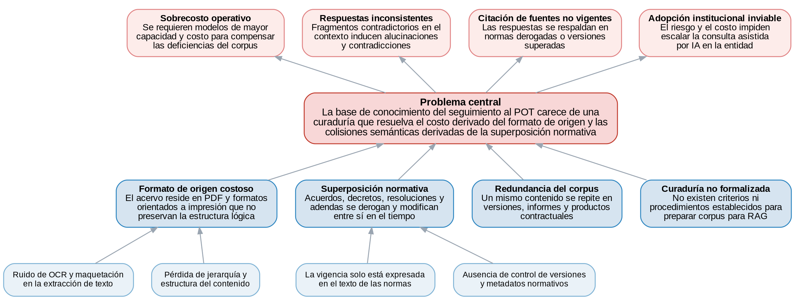

*Nota.* Elaboración propia.

### Evidencias

La primera evidencia es institucional. El seguimiento al POT, adoptado mediante el Acuerdo 48 de 2014, se apoya en una arquitectura documental que crece y se modifica de forma continua: el acuerdo y su reglamentación posterior en decretos y resoluciones, los documentos técnicos de soporte, las adendas y los productos de contratos, junto con la batería de 431 indicadores del Programa de Ejecución con sus fichas, responsables y periodos (Concejo de Medellín, 2014; Unidad de Seguimiento Estratégico al POT, 2026). En ese conjunto conviven disposiciones que modifican o derogan disposiciones anteriores, versiones sucesivas de un mismo documento técnico y matrices que se actualizan semestralmente. Toda consulta técnica exige saber cuál pieza rige y cuál quedó superada, un conocimiento que hoy reside en la experiencia de los funcionarios y no en la estructura de la información.

La segunda evidencia proviene de la literatura. El punto de partida de las arquitecturas RAG es bien conocido: los modelos generativos requieren una memoria externa para producir respuestas verificables y actualizables (Gao et al., 2024; Lewis et al., 2020). Sin embargo, la investigación reciente muestra que el desempeño de estos sistemas depende críticamente de la calidad de esa memoria. Zhang et al. (2025) demuestran que el ruido introducido por el reconocimiento óptico de caracteres en la construcción de bases de conocimiento a partir de PDF produce un deterioro en cascada sobre la recuperación y la generación. Semnani et al. (2025) evidencian que las inconsistencias a nivel de corpus inducen respuestas contradictorias incluso en colecciones curadas profesionalmente. R. Li et al. (2026) documentan que, ante conocimiento que cambia en el tiempo, la recuperación por similitud mezcla versiones históricas de una misma afirmación y el modelo no resuelve la contradicción a favor de la versión vigente. Y Park et al. (2026) muestran que la coexistencia de documentos muy similares en una base vectorial provoca que el sistema recupere información del documento equivocado. Estos hallazgos, obtenidos en dominios y lenguas diversas, describen con precisión la situación del corpus normativo del POT.

La tercera evidencia es un resultado de la revisión sistemática ejecutada en este proyecto. De los 692 registros cribados en Dimensions que mencionan simultáneamente RAG, bases de conocimiento y problemas de consistencia o alucinación, el 83 % (573) fue excluido en el cribado asistido (secciones 7.1.1.3 y 7.3) por abordar la base de conocimiento como un insumo dado y concentrar su aporte en la aplicación o en la arquitectura del modelo, sin discutir cómo se construyó o depuró el corpus. Más aún: de los 21 estudios que componen el núcleo de evidencia de esta revisión, ninguno trabaja sobre un corpus en español. La preparación de la información, siendo condición reconocida del desempeño (Zhang et al., 2025), es el eslabón menos estudiado de la cadena, y los trabajos que sí la abordan se concentran en corpus anglófonos y asiáticos.

## Justificación

Procesar documentos crudos con modelos de gran capacidad, si una base de conocimiento curada permitiera operar con modelos más pequeños y económicos, sería un sobrecosto operativo evitable que una entidad estatal está obligada a prevenir. Esa hipótesis es el punto de partida de la justificación de este trabajo.

La adopción de sistemas de consulta asistida por inteligencia artificial en entidades públicas enfrenta una restricción que suele pasar inadvertida: no basta con disponer de la tecnología, hay que preparar la información para ella. La evidencia reciente muestra que alimentar un sistema RAG con documentos en su formato original degrada la calidad de las respuestas, y sugiere que eleva el costo de operación, porque los modelos de mayor capacidad toleran mejor el ruido de la extracción (Zhang et al., 2025). En sentido contrario, un sistema con un generador pequeño puede operar sin tarjeta gráfica sobre un corpus preparado (Sivakumar y Meenakshi, 2026), aunque falta evidencia que aísle el efecto de esa preparación (sección 4.2.4). Para una entidad que administra recursos públicos, la diferencia entre esas dos rutas no es un matiz técnico sino un criterio de eficiencia del gasto: invertir en la preparación de la información es una vía para reducir el costo de los sistemas que se construyan sobre ella.

A esa razón económica se suma una razón de confiabilidad propia del sector público. Las entidades estatales derogan, modifican y actualizan sus instrumentos normativos de manera continua; es su forma normal de operar. Un sistema que responda citando una norma derogada o una versión superada de un documento técnico no es solo impreciso: compromete la trazabilidad que exige la función pública y puede inducir decisiones con soporte jurídico inválido. La literatura ha demostrado que este riesgo es inherente a los corpus que cambian en el tiempo cuando se indexan sin criterios de vigencia (R. Li et al., 2026; Semnani et al., 2025), y el corpus del seguimiento al POT es un caso ejemplar de esa condición.

El proyecto es viable precisamente por la forma en que está delimitado. Su objeto es una metodología, no un sistema en producción: se desarrolla sobre documentos que ya existen y son de acceso institucional o público, la prueba de concepto se ejecuta en un entorno académico con herramientas disponibles, y el despliegue institucional queda planteado como arquitectura propuesta con su análisis de costos, sin que su ejecución condicione los resultados del trabajo. Esta delimitación desacopla la investigación de las restricciones presupuestales y de adopción tecnológica de la entidad, y le entrega a la organización un insumo que conserva su valor con independencia del momento en que decida implementarlo.

En lo académico, el aporte se sitúa en un vacío delimitado contra la literatura existente y ahora medido. La revisión sistemática ejecutada confirma que la mayoría de los trabajos sobre RAG trata la base de conocimiento como un insumo dado; que los estudios que sí abordan la curaduría se concentran en dominios y lenguas distintos (ninguno de los veintiún estudios del núcleo trabaja sobre corpus en español); y que ningún estudio evalúa el efecto conjunto de la conversión, los metadatos de vigencia, la deduplicación y el tratamiento de las colisiones sobre un mismo corpus. Diseñar esa metodología, derivarla sistemáticamente de la evidencia y evaluarla sobre un corpus normativo real en español, con preguntas validadas por funcionarios y métricas propias del problema, como el error de vigencia de las citas, deja un referente transferible para otras entidades que enfrentan la misma condición.

<!-- salto de página -->

# OBJETIVOS

## Objetivo general

Desarrollar una metodología de curaduría de bases de conocimiento documentales para la consulta mediante sistemas RAG en entidades públicas, aplicada al corpus normativo y técnico del seguimiento al POT de Medellín.

## Objetivos específicos

1. Identificar, mediante una revisión sistemática de literatura con protocolo basado en Kitchenham y reporte PRISMA 2020, las técnicas existentes para la preparación, curaduría y estructuración de corpus documentales orientados a sistemas RAG, y la evidencia sobre su efecto en la consistencia, la alucinación y el costo.

2. Diseñar la metodología de curaduría acorde con las condiciones de una entidad pública, integrando la conversión estructurada de formatos, el esquema de metadatos de vigencia y jerarquía normativa, la deduplicación y el tratamiento de las colisiones semánticas del corpus del seguimiento al POT.

3. Analizar el efecto de la metodología mediante una prueba de concepto que compare un sistema RAG de referencia sobre el corpus original frente al mismo sistema sobre el corpus curado, con un conjunto de preguntas validado por funcionarios y métricas de fidelidad, precisión del contexto, vigencia de las fuentes citadas y costo de procesamiento.

La Figura 2 presenta el árbol de objetivos, que refleja el árbol de problemas: cada causa se convierte en un medio, cada subcausa en un submedio y cada efecto en un fin.

*Figura 2. Árbol de objetivos de la curaduría de la base de conocimiento del seguimiento al POT.*

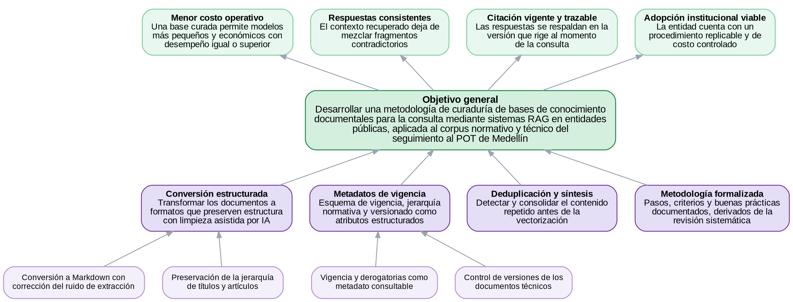

*Nota.* Elaboración propia.

<!-- salto de página -->

# MARCO REFERENCIAL

## Marco conceptual

Este marco delimita el conjunto de ideas que dan sustento teórico a la propuesta. Se organiza en tres bloques que van de lo general a lo particular: los conceptos del área de la Maestría en Ciencia de Datos pertinentes al proyecto, los conceptos del área de aplicación en la gestión de información pública y el ordenamiento territorial, y la relación entre ambas áreas, que define el objeto del trabajo.

### Área de la Maestría en Ciencia de Datos

La Figura 3 sintetiza los conceptos del área pertinentes al proyecto y las relaciones que los vinculan, partiendo del procesamiento de lenguaje natural y la recuperación de información, que convergen en la arquitectura RAG, y llegando a la base de conocimiento como objeto central del trabajo.

*Figura 3. Mapa conceptual del área de la Maestría en Ciencia de Datos.*

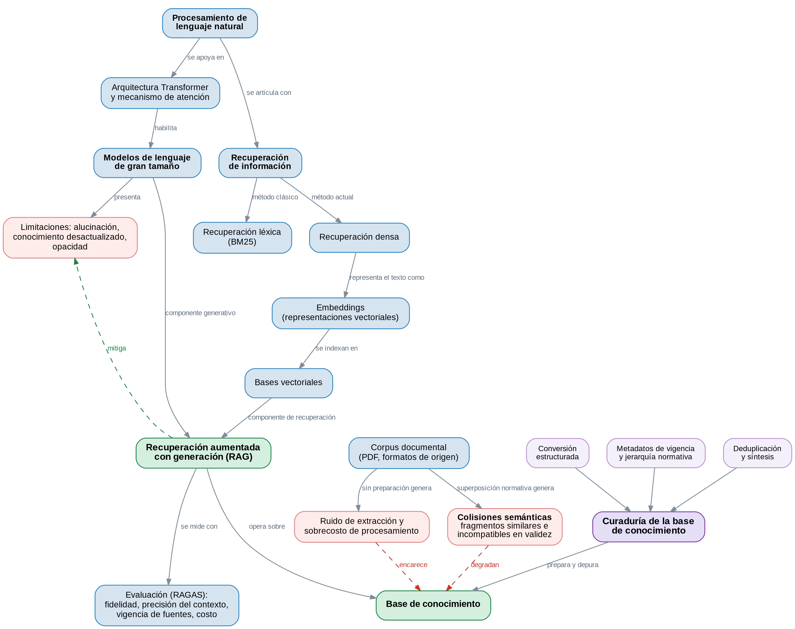

*Nota.* Elaboración propia.

**Procesamiento de lenguaje natural y modelos de lenguaje.** El proyecto se inscribe en la línea de Inteligencia Artificial y, dentro de ella, en el procesamiento de lenguaje natural y la recuperación de información. El desarrollo reciente del campo está marcado por la arquitectura Transformer y el mecanismo de atención, que permiten aprender representaciones contextuales del texto a partir de grandes corpus y capturar dependencias de largo alcance entre palabras (Devlin et al., 2019; Vaswani et al., 2017). Sobre esa base surgieron los modelos de lenguaje de gran tamaño, cuya memoria paramétrica presenta limitaciones reconocidas: la generación de información incorrecta o no verificable, el conocimiento congelado en la fecha de entrenamiento y la opacidad sobre el origen de cada afirmación (Gao et al., 2024).

**Recuperación de información y recuperación densa.** Los métodos clásicos, como BM25, ordenan documentos por coincidencia léxica de términos (Robertson y Zaragoza, 2009) y fallan cuando el usuario no conoce la palabra exacta o cuando el mismo concepto se expresa de formas distintas. La recuperación densa supera esa barrera al representar consultas y documentos como vectores en un espacio semántico, de modo que textos con significado parecido quedan próximos aunque no compartan palabras (Karpukhin et al., 2020). Estas representaciones se obtienen con codificadores derivados de modelos preentrenados y han sido refinadas mediante aprendizaje contrastivo a nivel de oración (Reimers y Gurevych, 2019). En la práctica se almacenan en bases vectoriales que permiten la búsqueda aproximada de vecinos más cercanos a gran escala.

**Recuperación aumentada con generación.** El concepto central del proyecto fue propuesto por Lewis et al. (2020) como una arquitectura que combina un componente de recuperación con un modelo generativo. En lugar de depender únicamente de su memoria paramétrica, el modelo consulta una memoria no paramétrica y condiciona su respuesta en los fragmentos recuperados. Esta estrategia reduce la generación de información incorrecta, permite actualizar el conocimiento sin reentrenar el modelo y posibilita que cada respuesta cite las fuentes que la sustentan (Gao et al., 2024).

**Variantes avanzadas y adaptativas.** La literatura describe una progresión desde esquemas básicos hacia variantes avanzadas y modulares (Gao et al., 2024). Un avance relevante es la recuperación adaptativa, en la que el sistema decide cuándo recuperar en vez de hacerlo siempre: la recuperación activa anticipa qué información hará falta durante la generación (Jiang et al., 2023), Self-RAG entrena al modelo para recuperar bajo demanda y criticar sus propias salidas (Asai et al., 2024), y la recuperación correctiva evalúa la calidad de lo recuperado y reacciona cuando es insuficiente (Yan et al., 2024). Cuando el conocimiento está estructurado en relaciones, las variantes basadas en grafos enriquecen el contexto con vínculos explícitos entre entidades (Procko y Ochoa, 2024; Xu et al., 2024).

**Arquitectura por etapas y evaluación.** Un sistema RAG suele organizarse en una secuencia de etapas: segmentación del corpus, codificación en vectores, recuperación de los fragmentos más afines y generación de la respuesta (Gupta et al., 2024). Cada etapa introduce decisiones de diseño que afectan el resultado, desde el tamaño y el solapamiento de los fragmentos hasta el número de pasajes recuperados. El marco RAGAS propuesto por Es et al. (2024) ofrece indicadores de uso extendido (fidelidad, relevancia de la respuesta y precisión del contexto) sin requerir respuestas de referencia anotadas por humanos. La evaluación de estos sistemas se ha consolidado como una línea de trabajo propia (Yu et al., 2024).

### Área de aplicación

**Ordenamiento territorial y el POT de Medellín.** El ordenamiento territorial es el conjunto de acciones político-administrativas y de planificación con que el Estado organiza el uso y la ocupación del suelo. En Medellín se materializa en el Plan de Ordenamiento Territorial, adoptado mediante el Acuerdo 48 de 2014 (Concejo de Medellín, 2014). El plan se despliega en un conjunto amplio de instrumentos y documentos: los documentos técnicos de soporte, el atlas cartográfico protocolizado, los macroproyectos y planes parciales, y la reglamentación posterior del acuerdo, que se amplía con decretos y resoluciones a lo largo del tiempo.

**Seguimiento del plan y el Expediente Distrital.** El seguimiento se apoya en el Expediente Distrital, instrumento de seguimiento permanente que requiere de un sistema de información territorial para la recolección, el almacenamiento y la generación de información, así como para preservar la memoria institucional del proceso de planeación (Alcaldía de Medellín, s. f.-a). Ese seguimiento consume información heterogénea (documentos normativos, documentos técnicos de soporte, baterías de indicadores, estudios técnicos, productos de contratos e insumos cartográficos) que debe relacionarse para producir informes y apoyar decisiones (Concejo de Medellín, 2014).

**Gobierno de datos, metadatos y principios FAIR.** El cuerpo de conocimiento DAMA-DMBOK define el gobierno de datos como el ejercicio de autoridad y control sobre la gestión de los activos de información, y resalta la gestión de metadatos entre sus funciones (DAMA International, 2017). Los metadatos son decisivos para localizar, interpretar y relacionar información dispersa, pues sin ellos la recuperación depende del conocimiento individual sobre dónde está cada cosa. Esta necesidad se conecta con los principios FAIR, que postulan que los datos deben ser encontrables, accesibles, interoperables y reutilizables tanto por personas como por sistemas automáticos (Wilkinson et al., 2016).

**Interoperabilidad y fragmentación de la información territorial.** Los marcos de gobierno digital definen la interoperabilidad como la habilidad de las organizaciones para intercambiar información y conocimiento con el fin de mejorar sus procesos y servicios (Ministerio de Tecnologías de la Información y las Comunicaciones, 2019). La experiencia internacional muestra que el principal obstáculo para integrar la información territorial no es tecnológico sino de gobernanza: la información suele estar fragmentada en silos institucionales, con formatos heterogéneos y sin protocolos comunes de publicación (Secretaría de Desarrollo Agrario, Territorial y Urbano, 2021). El caso de Medellín reproduce esa tensión, con la información distribuida entre el sistema de seguimiento al POT, los documentos técnicos de soporte y las plataformas de datos abiertos, cada una con su propia lógica de acceso (Alcaldía de Medellín, s. f.-b, s. f.-c). Una estrategia complementaria son los grafos de conocimiento urbano, que modelan de forma explícita las relaciones entre entidades territoriales (Liu et al., 2023).

### Relación entre las dos áreas

La articulación se produce en el punto donde la recuperación aumentada con generación responde a un problema de gobierno y consulta de información pública. El seguimiento del ordenamiento territorial enfrenta exactamente el tipo de situación para la que RAG resulta apropiada: un volumen amplio de conocimiento técnico distribuido en múltiples fuentes, sujeto a actualizaciones frecuentes y donde cada respuesta debe poder rastrearse hasta su origen documental (Digital Government Authority, 2026).

Esa articulación adquiere su forma concreta en la base de conocimiento: el conjunto de documentos preparados, segmentados y vectorizados sobre el que opera la recuperación. Su preparación enfrenta dos problemas caracterizados por la literatura reciente. El primero es el del formato de origen: la construcción de bases de conocimiento a partir de PDF arrastra ruido de reconocimiento óptico y de maquetación que se propaga en cascada (Zhang et al., 2025), mientras que un sistema con un generador pequeño puede operar sin tarjeta gráfica sobre un corpus preparado (Sivakumar y Meenakshi, 2026), aunque falta evidencia que aísle el efecto de esa preparación (sección 4.2.4). El segundo es el de la consistencia del corpus: cuando la base contiene documentos que se modifican o derogan entre sí, coexisten fragmentos semánticamente próximos pero incompatibles en su validez, descritos en la literatura como inconsistencias a nivel de corpus (Semnani et al., 2025), desalineación temporal entre versiones (R. Li et al., 2026) y desajuste de recuperación entre documentos similares (Park et al., 2026).

Este proyecto agrupa esos fenómenos bajo el constructo de colisión semántica, definido como la concurrencia, dentro de una misma base de conocimiento, de fragmentos próximos en el espacio semántico pero incompatibles en su validez normativa o temporal, que el mecanismo de recuperación por similitud no puede distinguir. La curaduría de la base de conocimiento (el conjunto de procedimientos de conversión, estructuración, enriquecimiento con metadatos y depuración previos a la vectorización) es la respuesta metodológica a ambos problemas.

## Estado del arte

Este estado del arte es el producto de la revisión sistemática ejecutada como primera fase del proyecto. El método que lo produjo (protocolo, flujo PRISMA [Preferred Reporting Items for Systematic Reviews and Meta-Analyses; Page et al., 2021], instrumento de extracción, valoración de calidad y auditoría) se reporta en la sección 7.1.1; aquí se presenta la síntesis. La agrupación temática organiza los veintiún estudios del núcleo en cuatro familias según el momento del ciclo de vida del corpus sobre el que actúa la intervención, conservando las once etapas del pipeline como nivel inferior de la taxonomía.

### Panorama de la evidencia

Los veintiún estudios que componen el núcleo de la revisión describen un campo joven, con producción concentrada en los dos últimos años, predominio de literatura sin arbitraje y una ausencia que resulta determinante para este trabajo.

**Año y tipo de publicación.** Los veintiún estudios son de 2025 o 2026: catorce de 2026 y siete de 2025. Doce son preprints (57,1 %), seis artículos de revista (28,6 %) y tres ponencias (14,3 %). La proporción de literatura sin arbitraje editorial es alta incluso para un campo emergente, y motivó la regla de síntesis adoptada: ninguna afirmación de la taxonomía se apoya únicamente en estudios sin arbitraje.

**Tipo de evidencia.** Quince estudios (71,4 %) presentan un experimento comparativo con línea base, cuatro son bancos de prueba públicos, uno es un estudio de caso aplicado y uno una revisión secundaria. El campo, por tanto, sí compara; lo que no hace (como se verá en la sección 4.2.4) es aislar el componente de curaduría dentro de esas comparaciones.

**Dominio del corpus.** Seis estudios (28,6 %) trabajan sobre corpus jurídico-normativos, dos sobre corpus gubernamentales no normativos, uno sobre corpus médico y doce sobre corpus de dominio general (Wikipedia, noticias, manuales de producto, bancos de preguntas abiertos).

**Idioma del corpus.** Once estudios trabajan en inglés, tres en la categoría «otro» (dos en tailandés y uno en francés), dos en chino, dos en corpus multilingües y tres no declaran el idioma. Ninguno de los veintiún estudios trabaja sobre un corpus en español. Ese cero, y no una apreciación cualitativa, es el dato que sostiene el planteamiento del vacío en la sección 4.2.5.

**Cobertura de la taxonomía.** Los veintiún estudios cubren las once etapas del pipeline de curaduría, con densidad desigual (Tabla 2):

*Tabla 2. Cobertura de la taxonomía por etapa del pipeline de curaduría.*

| Etapa del pipeline | Núcleo | Verificación | Estudios |
|---|---|---|---|
| 1. Conversión y parsing | 2 | 9 | N01, N03 |
| 2. Segmentación | 3 | 18 | N04, N05, N11 |
| 3. Metadatos y estructura | 2 | 7 | N06, N14 |
| 4. Deduplicación y depuración | 1 | 3 | N13 |
| 5. Vigencia y versionado | 2 | 5 | N16, N17 |
| 6. Consistencia del corpus | 3 | 6 | N19, N20, N21 |
| 7. Construcción de la base de conocimiento | 2 | 10 | N22, N23 |
| 8. Costo y eficiencia | 1 | 5 | N02 |
| 9. Evaluación | 2 | 8 | N25, N26 |
| 10. Revisión secundaria | 1 | 3 | N15 |
| 11. Transversal / caso de aplicación | 2 | 6 | N07, N27 |
| **Total** | **21** | **80** | |

*Nota.* N01 a N27 son los códigos de los 27 estudios de lectura completa; los seis que faltan en la tabla son los informes no recuperados. La referencia de cada código está en la sección 4.2.3.

La asimetría es informativa: la segmentación concentra veintiún estudios entre núcleo y verificación, mientras la deduplicación reúne cuatro y la vigencia siete. Entre las etapas de curaduría propiamente dichas (1 a 7), las dos ramas más delgadas son precisamente las dos que definen el problema del corpus del seguimiento al POT.

**Respaldo en la literatura para las métricas solicitadas en la evaluación del anteproyecto.** Los cuatro campos incorporados al instrumento tras la evaluación arrojan lo que muestra la Tabla 3.

*Tabla 3. Respaldo en la literatura para las métricas solicitadas en la evaluación del anteproyecto.*

| Elemento | Estudios que lo reportan | % del núcleo |
|---|---|---|
| Métricas de recuperación separadas de las de generación | 11 | 52,4 % |
| Exactitud de las citas emitidas | 4 | 19,0 % |
| Comportamiento ante preguntas sin respuesta (abstención) | 1 | 4,8 % |
| Validación humana con rúbrica o acuerdo interevaluador | 10 | 47,6 % |

Solo la mitad del campo separa la medición de la recuperación de la medición de la respuesta; menos de una quinta parte puntúa las citas que el sistema emite; y la abstención es prácticamente un punto ciego. Esta tabla responde a la observación de la evaluación del anteproyecto: las métricas que pidió no son un requisito arbitrario del trabajo, son exactamente aquello que el campo aún no reporta de forma sistemática.

### Taxonomía de las técnicas de curaduría

La agrupación temática que sigue organiza los veintiún estudios en cuatro familias, según el momento del ciclo de vida del corpus sobre el que actúa la intervención. Las once etapas del pipeline se mantienen como nivel inferior de la taxonomía.

---

#### Familia A. Preparación del corpus: conversión y segmentación
*Etapas 1 y 2 · cinco estudios: N01, N03, N04, N05, N11*

**El problema.** El corpus llega como PDF. Lo que se extraiga de él y la forma en que se corte determinan el techo de todo lo que viene después, porque ningún componente posterior puede recuperar información que la conversión perdió o que la segmentación partió.

**Lo que se ha reportado.** El único estudio que aísla el efecto de la conversión es N01 (Zhang et al., 2025), y lo hace construyendo un banco de 1.261 PDF con ruido inyectado de forma controlada. Su resultado marca el piso del problema: frente a los datos estructurados de referencia, la mejor solución de reconocimiento óptico de caracteres (OCR) disponible pierde 14 % (cinco puntos de F1, la media armónica de la precisión y el recall) en la evaluación de extremo a extremo (de 36,1 a 31,1) y hasta 10,8 puntos en recuperación (de 70,0 a 59,2). La degradación no es uniforme: en contenido tabular y gráfico el desplome es de otro orden, con la recuperación cayendo de 70,3 a 16,5. Dos consecuencias del estudio importan más que la cifra principal. La primera es que la distancia de edición no predice el desempeño del sistema: una conversión con menos errores de carácter puede rendir peor en el pipeline completo, de modo que la métrica habitual de calidad de OCR no sirve para decidir. La segunda es indirecta y sostiene el argumento de costo: un modelo grande tolera mejor el ruido de conversión que uno pequeño (9,4 puntos porcentuales en ruido de formato y 3,5 en ruido semántico), lo que significa que una conversión deficiente se paga después contratando un modelo mayor.

Frente a ese diagnóstico, los demás estudios de la familia proponen respuestas. N03 (Kaseteiam y Vanijja, 2026) convierte los PDF a Markdown preservando la jerarquía de encabezados y segmenta jerárquicamente con respaldo de longitud fija; es el precedente arquitectónico más parecido al pipeline que necesita el POT, pero conviene señalar que su conversión no se evalúa por separado, en un estudio de ablación, es decir, retirando ese componente y midiendo el efecto (las configuraciones que compara comparten idéntica curaduría y solo varían en el módulo de verificación posterior), de modo que aporta diseño y no evidencia. N04 (Zouak et al., 2026) sí compara dos pipelines completos sobre el mismo corpus de dieciséis textos legislativos marroquíes bilingües, 1.178 páginas: la arquitectura basada en expresiones regulares con verificación tipográfica frente a la basada en un modelo multimodal con respaldo de visión. Las diferencias son grandes y con tamaño de efecto reportado (fidelidad de 0,313 a 0,833 con d de Cohen +1,237, precisión del contexto de 0,315 a 0,818), y el dato más contundente es de cobertura: el respaldo de visión recuperó 456 artículos de cuatro PDF en árabe para los que la otra arquitectura no produjo ningún fragmento válido. Los propios autores advierten dos veces que las arquitecturas difieren en varios componentes y que las diferencias deben leerse a nivel de pipeline, no de componente.

En segmentación, N05 (Akarajaradwong et al., 2025) aporta la evidencia más directamente trasladable de toda la revisión, porque cuantifica la pérdida de información que produce segmentar mal un cuerpo normativo: con cualquier estrategia de longitud fija, alrededor del 30 % de los artículos no queda referenciado en ningún fragmento y al menos el 41,7 % no queda contenido íntegro en uno solo; cerca del 20 % de los artículos no puede caber completo en ningún fragmento por su extensión. En su mejor configuración ingenua las tasas de fallo son 0,323 y 0,156, frente a 0,000 con segmentación consciente de la jerarquía. En operación, la segmentación por artículo eleva la recuperación de 0,658 a 0,938 en un corpus y de 0,077 a 0,437 en otro, y reduce la contradicción de 0,097 a 0,040. Es importante registrar también el límite que el propio estudio establece: cuando la comparación se controla filtrando el corpus para igualar condiciones, la ventaja se reduce a +6,1 % en ordenamiento y +2,4 % en F1 de extremo a extremo.

N11 (Allu et al., 2026) aporta una restricción de diseño más que una ganancia de calidad: replantea la segmentación asistida por modelo como un problema de planificación y no de generación, entregando al modelo únicamente los identificadores de las unidades del documento y recibiendo listas ordenadas de identificadores, nunca texto. El texto de origen se preserva literal. El efecto medido es de costo (los tokens de salida bajan 84,6 %, el costo total de 3,64 a 1,75 dólares y el tiempo 59,6 %), con una contrapartida honesta: la precisión sube pero el recall, el rango recíproco medio (MRR) y la ganancia acumulada descontada normalizada (nDCG) bajan en todos los cortes.

**Tendencia de la familia.** Hay convergencia en que la unidad de segmentación de un corpus normativo debe ser la unidad estructural (el artículo) y no una longitud fija, y la evidencia de N05 es lo bastante fuerte para tratarlo como criterio y no como preferencia. En conversión, en cambio, el campo está desbalanceado: el único estudio que la aísla mide el daño, y ninguno de los que proponen una conversión mejor la evalúa por separado. Existe una medición del problema y no existe una medición de la solución.

**Qué se traslada al caso del POT.** La segmentación por artículo del Acuerdo 48, con resolución de las remisiones entre artículos, se adopta con la evidencia de N05. El principio de no regeneración de N11 no es una opción sino una restricción: ningún artículo normativo puede pasar por un modelo que lo reescriba. Y la advertencia de N01 sobre contenido tabular apunta al elemento de mayor riesgo del corpus, que son las fichas de indicadores, cuyo contenido crítico es precisamente tabular.

---

#### Familia B. Estructuración y representación de la base
*Etapas 3 y 7 · cuatro estudios: N06, N14, N22, N23*

**El problema.** Una vez cortado el corpus, dos decisiones quedan abiertas: qué información acompaña a cada fragmento cuando se indexa, y cómo se organiza el conjunto. Ambas determinan si el recuperador puede distinguir entre fragmentos que se parecen pero no son intercambiables.

**Lo que se ha reportado.** Dos estudios independientes llegan a la misma técnica por caminos distintos, lo que la convierte en la intervención más respaldada del núcleo: anteponer a cada fragmento una firma de metadatos antes de incrustarlo. N06 (Park et al., 2026) lo hace sobre manuales de producto con una tripleta de categoría, sustantivos y modelo, más un módulo que decide si un fragmento continúa el documento anterior y hereda su firma; el efecto en recuperación es claro (Hit@1, la proporción de consultas cuyo primer resultado es el correcto, de 0,9077 frente a 0,8128, es decir +9,5 puntos sobre la línea base ingenua, con MRR@10 de 0,9381 frente a 0,8676). N14 (Maniyar et al., 2026) lo hace sobre corpus jurídicos con un resumen de ventana local, el nombre del documento y la jurisdicción, ocupando entre el 20 % y el 25 % del espacio de tokens del fragmento. Su contribución más útil es haber nombrado y medido el modo de falla: el desajuste de recuperación a nivel de documento, que es traer el fragmento correcto de la norma equivocada porque el lenguaje jurídico se repite casi idéntico entre documentos. En un corpus de contratos muy estructurados ese desajuste cae de 87,9 % a 12,8 %; en un corpus de jurisprudencia, de 65,0 % a 48,0 % con un aumento de 30,5 puntos en el recall de tramos. Pero en el corpus menos estructurado de los tres el método empeora la línea base en cinco de siete profundidades de recuperación, lo que acota la técnica: la ganancia depende de que el documento tenga estructura fuerte.

Sobre la organización de la base, N22 (C.-H. Li, 2025) es el único estudio del núcleo que formula exactamente la pregunta del segundo objetivo específico de este trabajo: si cambia la exactitud según cómo se represente el mismo conocimiento. El diseño es el correcto (el mismo contenido en cinco representaciones, más una condición sin recuperación, con modelo, recuperador, índice y preguntas fijos) y por eso vale la pena registrarlo. Su ejecución, en cambio, es el contraejemplo de cómo no hacerlo: con diez preguntas de evaluación, el análisis de varianza sobre la condición sin recuperación y las cuatro primeras representaciones arroja F = 0,102 y p = 0,981, y el propio artículo escribe que ninguna estructura resultó significativamente superior a las otras, pese a que el resumen afirma lo contrario. La única diferencia que resiste una prueba estadística es la del modelo generador, no la de la estructura. El patrón descriptivo, que no puede presentarse como resultado pero sí como hipótesis, es contraintuitivo y merece registro: el volcado crudo del material (65 puntos) empata con los pares pregunta-respuesta curados (66), y añadirles explicación lo empeora (de 66 a 58).

N23 (Jaime, 2026) aporta la idea estructural más directamente aplicable al corpus del POT, aunque sin evidencia que la respalde: el grafo de dependencias entre documentos es una propiedad del corpus y no de la consulta, luego puede precomputarse en la ingesta en lugar de descubrirse en la inferencia. Su patrón de dos pasadas, con una cola de referencias pendientes que se resuelve sola cuando llega el documento destino, responde a un problema real del caso (los decretos reglamentarios llegan después del acuerdo que los invoca). La reserva es seria: el estudio no ejecuta ninguna línea base, su sección de ablación compara costos teóricos y no ejecuciones, y el tamaño de su corpus se contradice dentro del propio artículo.

**Tendencia de la familia.** El enriquecimiento del fragmento con metadatos es la técnica con más respaldo independiente del núcleo y la que mejor efecto muestra en recuperación. Ninguno de los dos estudios que la aplican, sin embargo, convierte esa ganancia en una mejor respuesta (punto que se retoma en la sección 4.2.4), y ninguno contabiliza el costo de producir esos metadatos, que en ambos casos exige una llamada a un modelo generativo por fragmento o por ventana de fragmentos.

**Qué se traslada al caso del POT.** La firma de metadatos se adopta con la terna {instrumento, artículo, vigencia}, que es la traducción directa de la de N14 al dominio normativo colombiano. El desajuste de recuperación a nivel de documento que describe N14 es exactamente lo que ocurrirá en el corpus del seguimiento al POT, donde el mismo texto del Acuerdo 48 reaparece reproducido en un documento técnico de soporte, citado en un decreto reglamentario y parafraseado en una ficha de indicador; y N14 aporta además la métrica lista para medirlo. El precómputo del grafo de dependencias de N23 es la respuesta de diseño al problema de las remisiones.

---

#### Familia C. Depuración e integridad del corpus
*Etapas 4, 5 y 6 · seis estudios: N13, N16, N17, N19, N20, N21*

**El problema.** Un corpus documental de una entidad pública no es un conjunto de hechos consistentes. Contiene copias del mismo texto, versiones sucesivas de la misma norma, disposiciones derogadas que siguen circulando y afirmaciones que se contradicen entre documentos. Esta es la familia donde vive el problema central de este trabajo y, como se verá, es la más delgada en evidencia en proporción a su importancia.

**Deduplicación.** La rama tiene un solo estudio. N13 (Luo et al., 2025) poda el 30 % de un corpus de 138 millones de oraciones usando como criterio el dominio que el propio modelo ya tiene sobre cada oración, y reduce la latencia media de recuperación de 12,28 a 9,66 segundos (−21,3 %) a cambio de una caída de 1,82 puntos de exactitud. Su aporte conceptual es la medición del daño de la redundancia: sobre preguntas que el modelo ya dominaba, inyectar el pasaje redundante degrada la exactitud cerca de 20 puntos porque el documento distrae. Su premisa, sin embargo, no se sostiene en el corpus del POT, y conviene declararlo antes que forzar la transferencia: la técnica poda lo que el modelo ya sabe por preentrenamiento, y ningún modelo tiene conocimiento paramétrico del Acuerdo 48. Su mecanismo de enrutamiento está además invertido para este dominio, porque enruta hacia el conocimiento interno cuando el modelo cree saber, que es precisamente la alucinación que hay que evitar. El estudio se conserva en la taxonomía como caso límite que delimita el alcance de la rama.

**Vigencia y versionado.** N16 (R. Li et al., 2026) es la referencia de la rama y aporta el principio que ordena toda la intervención: restringir por tiempo antes de ordenar por semántica, en lugar de recuperar por parecido y esperar que el modelo desempate. La consistencia temporal que alcanza es de 88,4 %, frente a 77,1 % del filtrado de versión ingenuo (quedarse con la última versión anterior a la consulta), 68,2 % de la recuperación sin control temporal y 80,7 % de una ventana de contexto de 128.000 tokens, esta última con un 65 % más de latencia. Ese último contraste responde de forma medida a la objeción más previsible contra la curaduría, que es «para qué curar si el modelo ya lee todo el corpus»: el estudio muestra que ampliar el contexto amplifica el conflicto en lugar de resolverlo (42,3 % de conjuntos recuperados con conflicto sin control temporal, 38,7 % con contexto largo y 12,4 % con restricción temporal), y que en el subconjunto de alto conflicto el contexto largo cae 12,5 puntos por debajo. Su ablación identifica además el componente decisivo: quitar la ventana temporal cuesta 8,6 puntos, más que cualquier otra pieza. Su corpus incluye 5.127 documentos normativos federales con relaciones explícitas de derogación, que es la estructura del caso. La limitación que los propios autores declaran es la que más importa aquí: trabajan con marcas de tiempo a nivel de documento y advierten que los hechos simultáneamente válidos en jurisdicciones distintas exigen representaciones más ricas, y el POT es exactamente ese caso, porque una disposición puede regir para un polígono y no para otro.

N17 (Karna et al., 2026) es el precedente arquitectónico más cercano al componente de vigencia: define un esquema de metadatos por fragmento con nombre de la norma, número de artículo, identificador de fuente, fecha de publicación y periodo de vigencia de la reforma, y aplica un filtrado que descarta en tiempo de consulta las disposiciones que no estaban jurídicamente vigentes. El diseño es trasladable casi literalmente. Sus cifras no lo son: el estudio presenta una única tabla de resultados, sin desagregación, sin varianza, sin prueba estadística y sin ablación de componentes; no define operativamente ninguna de sus métricas; y anuncia dos veces indicadores que nunca reporta. Se cita por el esquema, no por el resultado.

**Consistencia del corpus.** N19 (Semnani et al., 2025) formaliza la detección de inconsistencias a nivel de corpus y produce el dato más útil de la rama para el planteamiento del problema: al menos el 3,3 % ± 1,7 % de los hechos de la Wikipedia en inglés contradicen otra información del mismo corpus, y es una cota inferior. El 7,3 % de las afirmaciones etiquetadas como respaldadas en un banco de verificación de hechos están involucradas en esas inconsistencias, lo que muestra que el problema se propaga a los instrumentos con que se evalúan los sistemas. Su tipología de siete tipos (numéricas 54,7 %, lógicas 17,5 %, de definición 10,6 %, temporales 7,9 %, de entidad nombrada 6,0 %, de categorización 2,1 % y espaciales 1,2 %) es reutilizable, y su diseño es explícitamente de humano en el bucle: el sistema prioriza revisión, no decide. El propio artículo señala los textos jurídicos como aplicación no explorada.

N20 (Si et al., 2025) ataca un problema que no es el del POT (el envenenamiento adversario del corpus) pero su diagnóstico de las defensas sí lo es, y está enunciado con una precisión que ningún otro estudio alcanza: el filtrado de grano grueso elimina a la vez el contenido dañino y el útil. Ninguna estrategia de umbral único sirve para los dos regímenes: la votación por mayoría falla cuando la contaminación es alta, y el filtrado agresivo pierde contenido relevante cuando es baja. Su respuesta (eliminar solo lo que marcan dos detectores independientes) es un principio de diseño adoptable tal cual. Su ablación aporta además un dato incómodo y valioso: el módulo decisivo de su marco no es el que filtra el corpus sino el que resuelve el conflicto en inferencia.

N21 (Zhou et al., 2026) aporta disciplina de origen y versionado: tomar el dato únicamente de la fuente oficial sincronizada y descartar las copias no autoritativas, y generar para cada elemento modificado un registro estructurado con valor anterior, valor nuevo y descripción del cambio. Ese esquema es copiable añadiéndole el acto modificatorio. Su evidencia, en cambio, obliga a cautela: su etapa de curaduría por sí sola empeora la fidelidad frente a la recuperación sin curar (de 0,70 a 0,49), y el sistema completo la supera apenas en 0,06.

**Tendencia de la familia.** Existe consenso en que la vigencia debe resolverse antes de la búsqueda semántica y no después, y en que el filtrado agresivo del corpus destruye información legítima. No existe, en cambio, ningún estudio que evalúe el efecto conjunto de la deduplicación, la vigencia y la resolución de inconsistencias sobre un mismo corpus: cada rama se mide por separado y sobre corpus distintos.

**Qué se traslada al caso del POT.** El principio de restricción temporal previa de N16 y el esquema de metadatos de vigencia de N17 son, juntos, el componente de vigencia del segundo objetivo específico. La lógica conjuntiva de N20 es la salvaguarda contra la deduplicación agresiva, que en este corpus borraría copias con contexto propio (el mismo artículo del Acuerdo 48 aparece legítimamente en el documento técnico de soporte, en el decreto reglamentario y en la ficha). El protocolo de medición de N19 ofrece una forma barata y defendible de producir una cifra propia de inconsistencia del corpus del POT: muestrear uniformemente hechos atómicos, detectar con asistencia, confirmar a mano y reportar cota inferior con intervalo de confianza.

---

#### Familia D. Eficiencia, evaluación y casos de aplicación
*Etapas 8, 9, 10 y 11 · seis estudios: N02, N07, N15, N25, N26, N27*

**El problema.** Dos preguntas quedan fuera de las familias anteriores: cuánto cuesta operar el sistema resultante, y con qué instrumento se decide si la curaduría sirvió.

**Costo y viabilidad.** N02 (Sivakumar y Meenakshi, 2026) es el estudio del núcleo que mejor refleja la restricción operativa de una entidad pública. Sobre 3.500 documentos parlamentarios digitalizados (unas 850.000 oraciones) construye un pipeline que se ejecuta en el procesador central (CPU), sin tarjeta gráfica (GPU), con un generador de 82 millones de parámetros, y reporta 1.800 milisegundos de latencia media, entre 2 y 4 GB de memoria y un consumo estimado de 216 julios por consulta. Su protocolo de validación humana es el más completo del núcleo junto con el de N19: panel de cinco anotadores con doble competencia, dos evaluaciones independientes por ítem bajo protocolo doble ciego, un tercer anotador para resolver desacuerdos y kappa de Cohen ponderado de 0,90. Dos advertencias acompañan la cita: la energía fue estimada y no medida, cosa que los autores declaran; y su cifra de línea base es contradictoria dentro del artículo (80 % en el resumen y 42 % en la conclusión), de modo que ninguna de las dos puede citarse sin declarar la otra.

**Instrumentos de evaluación.** N25 (Lyu et al., 2025) aporta la ablación sistemática de componentes más completa del núcleo, y su hallazgo central es una advertencia de diseño: el tamaño óptimo de fragmento depende de la tarea. Las preguntas que se resuelven en un solo documento alcanzan su óptimo en fragmentos pequeños, mientras las que exigen cruzar dos o tres documentos mejoran de forma sostenida con fragmentos mayores (la precisión de información clave sube de 37,77 a 49,24 al pasar de 64 a 512). El solape ayuda de forma consistente pero moderada, y la recuperación híbrida con reordenamiento gana en casi todos los escenarios, mientras la híbrida sin reordenar aporta poco.

N26 (Mishra et al., 2026) es la referencia natural del tercer objetivo específico, y aporta una advertencia operativa de alto valor: las métricas genéricas de evaluación de RAG no puntúan las respuestas numéricas, porque descomponen la respuesta en afirmaciones y verifican por implicación, y una cifra no tiene nada que descomponer. En su partición financiera, donde el 57,8 % de las respuestas son numéricas, un puntaje genérico refleja únicamente la minoría en prosa. De ahí su taxonomía de tipos de respuesta (textual, numérica y de entidad), cada uno con su forma de puntuación, y su ponderación por dominio, que para el caso jurídico asigna a la atribución el peso dominante con el argumento de que una respuesta que no puede señalar la disposición en que se apoya no es un argumento. Añade un tipo de alucinación no recogido en las taxonomías previas, la alucinación terminológica, en la que la respuesta es semánticamente fiel pero usa el vocabulario equivocado del dominio, y la mide contra un léxico curado de entre 89 y 105 términos.

N15 (Annam, 2026) es una revisión secundaria y se usa como marco conceptual, no como evidencia: aporta el vocabulario de los tres modos de degradación de la vigencia del índice (obsolescencia factual, desalineación temporal y deriva semántica) y cifras de terceros que conviene rastrear a su fuente original antes de citarlas. Es el único estudio del núcleo en banda de calidad baja.

**Casos de aplicación.** N07 (Maharjan y Yadav, 2026) sitúa el problema en el sector público (documentos de política de una agencia gubernamental consultados por funcionarios) y su contribución más citable es de proporción: el salto grande de fidelidad está en pasar de no recuperar a recuperar (+79 %), no en refinar el reordenamiento (+12,7 %), ambas cifras recalculadas sobre sus tablas porque las publicadas contienen un error, que además degrada el resultado en tres de diez preguntas. Con diez preguntas y sin prueba estadística, ninguna de sus diferencias es concluyente y así debe citarse.

N27 (Al Mouatamid et al., 2026) es el estudio más cercano al caso de este trabajo, y no por analogía sino por identidad de tarea: computar indicadores jurídicos a partir de textos normativos, que es exactamente la función del sistema de seguimiento al POT. Coinciden además cuatro condiciones del corpus (fuentes escaneadas de calidad irregular junto a digitales, segmentación por artículo, metadatos con jurisdicción, fecha de publicación y fecha de revisión, y dependencia de textos reglamentarios complementarios) y la restricción operativa, porque ejecutan todo localmente con modelos abiertos de entre 3 y 12 mil millones de parámetros. Su ablación muestra que los agentes de control de la fidelidad elevan la exactitud balanceada de 0,768 a 0,981 en un caso y de 0,567 a 0,876 en otro, y que la métrica más afectada es la especificidad (la capacidad de afirmar correctamente que no existe norma aplicable), que pasa de 0,535 a 0,837. Pero su aporte más importante para este trabajo es un fallo, no un acierto: en una de las jurisdicciones el sistema concluyó que no existían sanciones porque el decreto que las contiene no estaba en la base. Los autores subrayan que técnicamente no es un error (el sistema no inventó nada) pero jurídicamente sí lo es. El error de vacío de datos es la lección más importante del núcleo para el corpus del POT, donde la reglamentación posterior al Acuerdo 48 está dispersa y su incorporación incompleta produciría exactamente esa falla.

**Tendencia de la familia.** El campo dispone de instrumentos de evaluación cada vez más finos, pero ninguno se aplica todavía a la pregunta de este trabajo, que es el efecto de la curaduría sobre un mismo sistema. Y la viabilidad en hardware modesto está demostrada, aunque sobre un corpus sin jerarquía normativa ni vigencia.

**Qué se traslada al caso del POT.** Seis piezas, tres de ellas pensadas para el instrumento de evaluación del tercer objetivo. La taxonomía de tipos de respuesta de N26 no es una sutileza en este corpus sino su estructura real: «¿qué dice el artículo sobre el tratamiento de consolidación?» es textual, «¿cuál es el índice de ocupación máximo del polígono?» y «¿qué altura se permite?» son numéricas, y «¿qué instrumento reglamenta el artículo 274?» es de entidad. Como las métricas genéricas no puntúan las numéricas, evaluar la prueba de concepto solo con ellas dejaría sin calificar justamente las preguntas por índices, alturas y densidades, sin que nadie lo advierta. La ponderación con la atribución como componente dominante se adopta con su argumento: una respuesta que no puede señalar la disposición en que se apoya no sirve, por bien redactada que esté. La alucinación terminológica es predecible aquí (decir «norma» por «Acuerdo», «zona» por «polígono», «uso» por «tratamiento») y el Acuerdo 48 trae su propio glosario, de modo que construir el léxico es barato. Y de N25 se toma el criterio de que el tamaño de fragmento se decide por tipo de pregunta, porque el corpus del POT tiene los dos perfiles: preguntas que se resuelven dentro de un artículo y preguntas que exigen cruzar acuerdo, decreto reglamentario y ficha de indicador. De N02 se toma la evidencia de viabilidad (un corpus legislativo de ese tamaño operando sin GPU) y su protocolo de validación humana, que es el modelo directo para la sesión con funcionarios. Y de N27, la advertencia que más pesa: el error de vacío de datos, que en este caso se produciría si la reglamentación posterior al Acuerdo 48 entra incompleta al corpus. De estas piezas, la prueba de concepto aplicó la taxonomía de tipos de respuesta; la ponderación por atribución, el léxico de alucinación terminológica y el tamaño de fragmento por tipo de pregunta no se implementaron y quedan como trabajos futuros, y la sesión con funcionarios se redujo a la validación del banco de prueba por dos funcionarios de la Unidad (sección 7.1.3.4).

---

### Síntesis comparativa

La Tabla 4 resume, para cada estudio del núcleo, la etapa, la técnica, el dominio, el tipo de evidencia, los efectos reportados, la calidad y su aplicabilidad al caso del POT.

*Tabla 4. Síntesis comparativa de las técnicas de curaduría identificadas (n = 21).*

| ID | Referencia | Etapa | Técnica (nodo de la taxonomía) | Dominio del corpus | Tipo de evidencia | Fidelidad | Alucinación | Costo | Calidad | Aporta a | POT |
|---|---|---|---|---|---|---|---|---|---|---|---|
| N01 | Zhang et al. (2025) | 1. Conversión | Evaluación del ruido de OCR | General, multilingüe | Banco público | Empeora | No reporta | No reporta | 14 Alta | OE1+OE3 | Sí |
| N03 | Kaseteiam y Vanijja (2026) | 1. Conversión | Conversión estructural a Markdown + segmentación jerárquica | Educativo/salud, tailandés | Experimento con línea base | Mejora | No reporta | No reporta | 14 Alta | OE1+OE2 | Parcial |
| N04 | Zouak et al. (2026) | 2. Segmentación | Segmentación por artículo asistida por modelo de lenguaje | Legal, árabe-francés | Experimento con línea base | Mejora | Mejora | No reporta | 16 Alta | Los tres | Sí |
| N05 | Akarajaradwong et al. (2025) | 2. Segmentación | Segmentación por sección + expansión por referencias | Legal, tailandés | Banco público | Mejora | Sin efecto | No reporta | 14 Alta | Los tres | Sí |
| N11 | Allu et al. (2026) | 2. Segmentación | Segmentación por planeación con identificadores | General, no declara | Experimento con línea base | No reporta | No reporta | Reduce | 11 Media | OE1+OE2 | Parcial |
| N06 | Park et al. (2026) | 3. Metadatos | Enriquecimiento del fragmento con metadatos | Manuales, inglés | Experimento con línea base | Sin efecto | No reporta | No reporta | 9 Media | OE1+OE2 | Parcial |
| N14 | Maniyar et al. (2026) | 3. Metadatos | Enriquecimiento del fragmento con metadatos | Legal, inglés | Experimento con línea base | Mejora | Mejora | No reporta | 10 Media | OE1+OE2 | Sí |
| N13 | Luo et al. (2025) | 4. Deduplicación | Poda del corpus por redundancia con el modelo | General, inglés | Experimento con línea base | No reporta | No reporta | Reduce | 14 Alta | OE1+OE2 | Parcial |
| N16 | R. Li et al. (2026) | 5. Vigencia | Filtrado temporal previo al ordenamiento semántico | General + normativo, inglés | Experimento con línea base | Mejora | Mejora | Reduce | 14 Alta | Los tres | Parcial |
| N17 | Karna et al. (2026) | 5. Vigencia | Filtrado por vigencia con metadatos | Legal-tributario, inglés | Experimento con línea base | Mejora | No reporta | No reporta | 11 Media | OE1+OE2 | Sí |
| N19 | Semnani et al. (2025) | 6. Consistencia | Detección de inconsistencias a nivel de corpus | General, inglés | Experimento con línea base | No reporta | No reporta | Reduce | 14 Alta | OE1+OE2 | Sí |
| N20 | Si et al. (2025) | 6. Consistencia | Filtrado semántico por conflicto | General, inglés | Experimento con línea base | Mejora | Mejora | Aumenta | 12 Alta | OE1+OE2 | Parcial |
| N21 | Zhou et al. (2026) | 6. Consistencia | Sincronización con fuente autoritativa + preferencia por lo vigente | Seguridad informática, inglés | Experimento con línea base | Mejora | Mejora | No reporta | 9 Media | OE1+OE2 | Parcial |
| N22 | C.-H. Li (2025) | 7. Construcción de la base | Comparación de estructuras de la base | Técnico, chino | Experimento con línea base | Sin efecto | No reporta | No reporta | 11 Media | OE1+OE2 | Parcial |
| N23 | Jaime (2026) | 7. Construcción de la base | Grafo de dependencias precalculado en ingesta | General, no declara | Estudio de caso | Mejora | Mejora | Reduce | 8 Media | OE1+OE2 | Sí |
| N02 | Sivakumar y Meenakshi (2026) | 8. Costo | Pipeline RAG de bajo consumo | Gubernamental, inglés | Experimento con línea base | Mejora | Mejora | Reduce | 16 Alta | OE1+OE3 | Parcial |
| N25 | Lyu et al. (2025) | 9. Evaluación | Evaluación por escenarios de crear, leer, actualizar y borrar (CRUD) | Noticias, chino | Banco público | Mejora | No reporta | No reporta | 15 Alta | OE1+OE3 | Parcial |
| N26 | Mishra et al. (2026) | 9. Evaluación | Métrica de evaluación calibrada por dominio | Legal/salud/finanzas, inglés | Banco público | No reporta | No reporta | No reporta | 13 Alta | OE1+OE3 | Sí |
| N15 | Annam (2026) | 10. Revisión secundaria | Revisión sobre la vigencia del índice | No aplica | Revisión secundaria | No reporta | No reporta | No reporta | 6 Baja | OE1 | Parcial |
| N07 | Maharjan y Yadav (2026) | 11. Transversal | Recuperación en dos etapas con reordenamiento | Gubernamental, inglés | Experimento con línea base | Mejora | Mejora | No reporta | 10 Media | OE1 | Parcial |
| N27 | Al Mouatamid et al. (2026) | 11. Transversal | RAG agéntico para indicadores normativos | Legal-ambiental, francés | Experimento con línea base | Mejora | Mejora | No reporta | 14 Alta | Los tres | Sí |

*Nota.* Los códigos N08, N09, N10, N12, N18 y N24 corresponden a los seis informes no recuperados (sección 7.1.1.3). En «Aporta a», OE1, OE2 y OE3 son los objetivos específicos primero, segundo y tercero.

### Hallazgos transversales

Los siete hallazgos que siguen no provienen de ningún estudio en particular: resultan de leer los veintiún con la misma rejilla. Constituyen el aporte propio de esta revisión y delimitan lo que la curaduría puede y no puede prometer.

**1. La ganancia en recuperación no se traslada a la respuesta.** Cinco estudios convergen en el mismo patrón, y ninguno lo enuncia como problema salvo uno. N05 eleva el recall un 22,4 % con su módulo de resolución de remisiones y la cobertura de la respuesta baja un 10 %. N06 mejora el acierto en la primera posición en 9,5 puntos y las diferencias en generación quedan en la tercera cifra decimal. N21 alcanza fidelidad de 0,70 con un recall de contexto de 0,01. N26 logra un recall en las cinco primeras posiciones superior a 0,877 en tres dominios con fidelidad entre 0,233 y 0,470, y lo llama su hallazgo central: *el problema es la fidelidad de la generación, no la recuperación*. Y la ablación de N20 muestra que el módulo decisivo de su marco no es el que filtra el corpus sino el que resuelve el conflicto en inferencia. Implicación: la curaduría mejora de forma consistente lo que el sistema encuentra, y eso no basta por sí solo para mejorar lo que el sistema responde. Enunciarlo desde el principio permite además el argumento correcto, que es de complementariedad: curaduría e intervención en inferencia atacan cuellos de botella distintos.

**2. La curaduría casi nunca se evalúa por separado.** Cinco estudios entran al núcleo por la calidad de su curaduría y terminan midiendo otra cosa: N02 mide el generador, N03 mide su módulo de verificación, N07 mide el reordenamiento, N21 mide su ajuste por preferencia y N27 mide sus agentes de control. En los cinco, la conversión, la segmentación y el enriquecimiento son idénticos en todos los brazos comparados, de modo que ninguna de sus cifras es evidencia del efecto de la curaduría. El patrón se repite en el núcleo y no es de un artículo: la verificación de los ochenta estudios restantes, hecha solo sobre el resumen, encontró al menos dos que evalúan por separado componentes de curaduría dentro de sus propias canalizaciones, una proporción que no cambia la lectura pero obliga a enunciar el vacío con esa precisión. Es el vacío metodológico que este trabajo aborda de forma directa en su tercer objetivo específico.

**3. La abstención se diseña en el prompt y casi nunca se mide.** Cinco estudios del núcleo incorporan una instrucción explícita de rehusar cuando el contexto no alcanza (N02 incluso transcribe la plantilla completa) y ninguno reporta la tasa resultante. Uno solo la mide: N14 evalúa 150 preguntas en dos condiciones de contexto y muestra que el modelo sin alinear rehúsa el 87,3 % de las veces con contexto incorrecto pero también el 53,2 % con contexto correcto; tras el alineamiento, el rehúso con contexto correcto cae a 1,5 % y con contexto incorrecto sube a 99,3 %. Su ablación de prompt cierra el argumento: al retirar la instrucción de rehusar, el modelo responde el 79 % de las veces con contexto incorrecto. Implicación: el control por prompt no tiene punto medio, y N14 ofrece un diseño de referencia para medir la abstención, del que la prueba de concepto tomó la comparación entre preguntas que el contexto responde y preguntas que no responde.

**4. El costo de la curaduría casi nunca se contabiliza.** Catorce de los veintiún estudios no reportan efecto alguno sobre el costo. De los seis que declaran reducirlo, solo dos entregan contabilidad real: N11 reporta tokens de entrada y salida, tiempo por archivo, percentiles 90 y 95 de latencia y dólares por corpus; N02 reporta latencia, memoria y julios por consulta. El resto genera costo sin medirlo: N06 exige una llamada al modelo por fragmento más una por par consecutivo; N14 dedica entre el 20 % y el 25 % del espacio de tokens a metadatos; N13, N21 y N23 introducen pasos generativos cuyo costo no aparece en ninguna tabla. Implicación: el costo está en la pregunta de investigación de este trabajo precisamente porque la literatura no lo responde, y el protocolo de medición de N11 es reutilizable tal cual.

**5. El instrumento de calidad mide el reporte, no la veracidad.** Tres casos cruzados lo demuestran dentro del propio núcleo. Uno de los estudios con el puntaje de calidad más alto entre los no arbitrados tiene aritmética impecable; una ponencia aceptada en una conferencia de primer nivel conserva una desigualdad invertida en una ecuación y dos ablaciones que contradicen su texto; y un artículo en revista indexada afirma en el resumen lo contrario de lo que arroja su propio análisis de varianza. Implicación: el arbitraje no garantiza la corrección y su ausencia no la impide. De ahí surge, con evidencia del propio núcleo, la decisión metodológica de recalcular las cifras de cada estudio que se reporta en la sección 7.1.1.6.

**6. Al menos diez de veintiún estudios contienen cifras que no cuadran con sus propias tablas.** Son el 48 % del núcleo, y la cifra es una cota inferior: la auditoría por muestreo halló discrepancias adicionales en los cinco estudios que reclasificó de forma independiente. En seis de esos diez la cifra afectada es la del resumen. El registro completo, con el recálculo al lado, está en el campo de observaciones de la matriz.

**7. La rama de deduplicación está vacía para este caso.** Un solo estudio del núcleo propone un mecanismo de deduplicación propiamente dicho, y su premisa (podar lo que el modelo ya sabe) no se sostiene sobre un corpus normativo local que ningún modelo conoce. Que la rama quede delgada no es un defecto de la taxonomía: es un hallazgo del mapeo. La deduplicación se nombra mucho como problema y casi nadie la ataca como técnica, y nadie la ha atacado sobre un corpus donde la duplicación es legítima (el mismo artículo reproducido en varios instrumentos con contexto propio en cada uno).

### Vacíos identificados y posición de este trabajo

De la síntesis anterior se desprenden cuatro vacíos, en orden de cercanía al objeto de este trabajo.

**Primero, el vacío de idioma y de contexto institucional.** Ninguno de los veintiún estudios trabaja sobre un corpus en español, y ninguno sobre una entidad pública subnacional. Existe trabajo sobre corpus normativos con vigencia en India, Marruecos, Tailandia, Filipinas y jurisdicciones africanas francófonas, y existe un caso de corpus legislativo público con restricción de hardware. No existe una metodología replicable de curaduría para entidades públicas hispanohablantes. La verificación de los ochenta estudios restantes amplía la base de esa afirmación: entre ellos hay corpus en alemán, turco, árabe, ruso y kazajo, tailandés, filipino, indonesio y francés, y sigue sin aparecer uno solo en español, de modo que el cero se sostiene sobre los ciento un estudios evaluados (21 en texto completo y 80 por título y resumen) y no solo sobre el núcleo.

**Segundo, el vacío de integración.** Cada rama de la taxonomía se mide por separado y sobre corpus distintos. Ningún estudio evalúa el efecto conjunto de la conversión estructurada, los metadatos de vigencia y jerarquía, la deduplicación y el tratamiento de las colisiones semánticas sobre un mismo corpus y con un mismo sistema. La literatura ofrece piezas validadas de forma aislada y ninguna composición de ellas.

**Tercero, el vacío de ablación de la curaduría.** Como establece el hallazgo 2, el campo describe pipelines de curaduría detallados y mide después otra cosa. La comparación directa entre un sistema de referencia sobre corpus original y el mismo sistema sobre corpus curado (que es el diseño del tercer objetivo específico de este trabajo) no aparece en ninguno de los veintiún estudios.

**Cuarto, el vacío de granularidad de la vigencia.** El estudio de referencia en vigencia declara como limitación propia que sus marcas de tiempo son a nivel de documento y que los hechos simultáneamente válidos en jurisdicciones distintas exigen representaciones más ricas. Un plan de ordenamiento territorial es exactamente ese caso: una disposición puede regir para un polígono y no para otro, de modo que la vigencia no es un atributo del documento sino de la combinación de disposición, ámbito territorial y fecha.

Este trabajo se sitúa en la intersección de los cuatro, y la sección siguiente precisa qué parte de la taxonomía aplica al corpus del caso y cuál no. La metodología que desarrolla el segundo objetivo específico integra las técnicas mejor sustentadas de cada rama: segmentación por unidad normativa con resolución de remisiones, firma de metadatos de instrumento, artículo y vigencia, restricción temporal previa al ordenamiento semántico y lógica conjuntiva para la depuración. Las aplica a un corpus en español de una entidad pública subnacional y compara el conjunto con el corpus original y con condiciones de control que separan el efecto de la base del de la búsqueda. La ablación técnica por técnica queda como trabajo futuro.

### Qué familias aplican al caso del POT

La taxonomía describe el campo; esta sección decide qué parte de ella sirve para el corpus de este trabajo. El criterio es el tipo de problema, no la calidad de la evidencia: una familia puede estar bien sustentada y aun así no atacar la patología que aquí importa.

El corpus del seguimiento al POT presenta tres patologías, y conviene enunciarlas antes de repartir. Reproducción: el mismo texto normativo aparece en el acuerdo, transcrito en un documento técnico de soporte, citado en un decreto reglamentario y parafraseado en una ficha de indicador. Derogación: los instrumentos se modifican y se derogan entre sí, de modo que fragmentos incompatibles en su validez conviven en el índice. Remisión: los artículos se refieren unos a otros, y la respuesta a una consulta rara vez está contenida en un solo artículo.

**La familia A es un prerrequisito, no un componente de la metodología.** El corpus son PDF, buena parte escaneados y de calidad irregular, de modo que sin conversión estructurada no hay texto sobre el cual aplicar ninguna otra técnica; y Zhang et al. (2025) muestran que el ruido de reconocimiento óptico se propaga en cascada y no se corrige aguas abajo. La familia es, por tanto, indispensable. Pero ninguna de sus técnicas ataca las tres patologías enunciadas: convertir bien un documento no impide que su contenido esté reproducido en otros tres, ni que haya sido derogado, ni que remita a un artículo ausente. Se adopta íntegra como fase de entrada (con la segmentación por jerarquía nativa que la familia respalda, dado que el articulado del Acuerdo 48 provee esa jerarquía) y se declara fuera del aporte metodológico del trabajo, porque resuelve un problema de formato y no un problema de conocimiento.

**La familia B entra como componente.** La reproducción del texto normativo es, literalmente, el modo de falla que la familia nombra y mide: el desajuste de recuperación a nivel de documento consiste en traer el fragmento correcto de la norma equivocada porque el lenguaje jurídico se repite casi idéntico entre documentos. La firma de metadatos antepuesta al fragmento antes de incrustarlo es la intervención más respaldada del núcleo, con dos estudios independientes que llegan a ella por caminos distintos, y su traducción al dominio es directa: la terna {instrumento, artículo, vigencia}. La remisión encuentra su respuesta en el precómputo del grafo de dependencias en el momento de la ingesta.

**La familia C entra como componente.** La derogación es su objeto declarado. El principio que la ordena (restringir por tiempo antes de ordenar por semántica) ataca la patología de frente, y el estudio de referencia de la rama trabaja sobre un corpus normativo con relaciones explícitas de derogación, que es la estructura del caso. Aporta además la respuesta medida a la objeción más previsible contra la curaduría: ampliar la ventana de contexto amplifica el conflicto en lugar de resolverlo.

**La familia D no entra a la metodología, pero no se descarta: cambia de función.** Sus estudios no proponen técnicas de curaduría trasladables sino instrumentos para medir si la curaduría sirvió, y esa es precisamente la necesidad del tercer objetivo específico. De ella provienen la taxonomía de tipos de respuesta (textual, numérica y de entidad), la ponderación que asigna a la atribución el peso dominante en dominios jurídicos y la evidencia de viabilidad de un corpus legislativo operando sin acelerador gráfico. El diseño de la evaluación (sección 5.3) tomó de ella la taxonomía de tipos de respuesta y, de N14 en la familia B, la comparación entre preguntas con y sin respuesta; las demás piezas quedan como trabajo futuro.

**El reparto no es una suma de partes independientes.** Las familias B y C no se aplican una después de la otra: se componen, y esa composición es la razón de fondo para tratarlas como una sola cosa. El control de vigencia de la familia C opera sobre metadatos, y los metadatos los pone la familia B en el momento de incrustar el fragmento. Sin la firma {instrumento, artículo, vigencia} no hay sobre qué restringir temporalmente; sin la restricción temporal, la firma es un dato que nadie consulta. Esa interdependencia es lo que el segundo vacío identificado (la ausencia de evaluación del efecto conjunto) deja sin evidencia, y es lo que este trabajo se propone aportar. Por esa razón la composición de B y C se trata como una quinta familia, mixta, que se propone denominar estructuración normativa con control de vigencia y que desarrolla el segundo objetivo específico.

---

<!-- salto de página -->

# METODOLOGÍA

Este proyecto adopta la metodología CRISP-DM (Cross-Industry Standard Process for Data Mining) como marco general (Chapman et al., 2000), por ser un estándar consolidado en ciencia de datos, adaptándola a un trabajo cuyo objeto es una metodología de curaduría y no un modelo predictivo. Las fases de comprensión del negocio, comprensión de los datos y preparación de los datos concentran el grueso del esfuerzo, en coherencia con el problema planteado; el modelado y la evaluación toman la forma de una prueba de concepto comparativa; y la fase de despliegue se aborda únicamente como arquitectura propuesta. El desarrollo se organiza en tres fases alineadas con los objetivos específicos.

## Fase 1. Revisión sistemática de la literatura

Corresponde a la comprensión del negocio y del estado de la técnica. Se ejecuta una revisión sistemática diseñada según los lineamientos de Kitchenham y Charters (2007) y reportada conforme a la declaración PRISMA 2020 (Page et al., 2021), de la cual se adoptan los ítems aplicables a revisiones sin metaanálisis estadístico.

La revisión responde a la pregunta de qué técnicas se han reportado para preparar, curar y estructurar corpus documentales previo a su incorporación en bases de conocimiento de sistemas RAG, y qué evidencia existe sobre su efecto en la consistencia de las respuestas, la reducción de alucinaciones y el costo de operación. La búsqueda se ejecuta en Dimensions como base principal, con Scopus, ACM Digital Library, IEEE Xplore y arXiv declaradas como fuentes complementarias, con una cadena de tres bloques (técnica, componente de interés y problema abordado) documentada en el protocolo.

El cribado por título y resumen se realiza de forma asistida por inteligencia artificial, con registro de la decisión y su justificación para cada registro. La clasificación de los estudios elegibles se verifica después con una reclasificación ciega de los que no entran al núcleo y con el veredicto de los dos investigadores sobre una muestra aleatoria de ellos. La extracción de datos se realiza a dos revisores sobre una matriz estructurada, con vocabulario controlado en los campos de clasificación y reglas de decisión escritas para la resolución de desacuerdos. La calidad de los estudios se valora con un instrumento de ocho criterios derivado de Kitchenham y Charters (2007).

Al procedimiento se incorporan dos pasos no previstos en el protocolo original, ambos documentados en la sección 7.1.1: la verificación aritmética independiente de las cifras de cada estudio contra sus propias tablas, y una auditoría por muestreo de la propia extracción mediante reclasificación ciega de una muestra aleatoria del núcleo.

El producto de la fase es la taxonomía de técnicas de curaduría que constituye el estado del arte de la sección 4.2, junto con el diagrama de flujo PRISMA (sección 7.1.1.3) y la matriz de extracción (Anexo C).

## Fase 2. Diseño de la metodología de curaduría

Corresponde a la comprensión y preparación de los datos. Se caracteriza el corpus del seguimiento al POT (el Acuerdo 48 de 2014 y su reglamentación, los documentos técnicos de soporte, las adendas y las fichas de indicadores del Programa de Ejecución) y se construye una taxonomía de las colisiones semánticas presentes en él, distinguiendo derogación, modificación parcial, duplicación versionada y ambigüedad de vigencia. La taxonomía resultante se presenta en el Anexo E.

Sobre esa caracterización y sobre el catálogo de técnicas de la Fase 1 se diseña la metodología, con tres componentes. El primero son reglas de conversión estructurada de los formatos de origen a representaciones ligeras que preserven la jerarquía del contenido, con limpieza del ruido de conversión (encabezados, pies de página y numeración) mediante reglas deterministas. El segundo es un esquema de metadatos de vigencia, jerarquía normativa y versionado como atributos estructurados y consultables. El tercero son procedimientos de deduplicación, previos a la vectorización, que vinculan cada reproducción del texto normativo a su fuente canónica sin generar texto nuevo.

Los modelos de lenguaje no modifican el texto ya extraído. Pueden leerlo para proponer metadatos o señalar casos que requieren revisión, planifican la segmentación sobre los identificadores de las unidades del documento y, en las páginas escaneadas, intervienen únicamente en la transcripción desde la imagen, que se verifica por muestreo contra el original. En la prueba de concepto, los 31 decretos se transcribieron completos con un modelo de lenguaje y los autores revisaron el resultado contra el PDF; la desviación se declara en la sección 7.1.3.2. Esta restricción se deriva de la evidencia de la Fase 1 (Allu et al., 2026) y se fija como decisión de diseño en el capítulo 6.

La metodología se documenta como un procedimiento replicable de siete pasos secuenciales, cada uno con lo que se hace, cómo se hace y el resultado que entrega, más un registro transversal del costo de curar. Su desarrollo se presenta en la sección 7.1.2 y su secuencia se resume en la Figura 4.

La aplicación se realiza sobre un subconjunto representativo de los principales documentos del seguimiento al POT, incluyendo el Acuerdo 48 de 2014 y una muestra de su reglamentación posterior con casos de derogación y modificación conocidos, delimitación suficiente para demostrar y evaluar el procedimiento. Esa aplicación se ejecuta como paso inicial de la prueba de concepto de la Fase 3 y produce la base de conocimiento curada sobre la que esta opera; el desarrollo de la metodología incluye, además, un ejemplo trabajado sobre un caso real del corpus.

La metodología contempla además el tratamiento de los activos de información geográfica como referencias catalogadas: la base de conocimiento registra su existencia, ubicación y formato para que el sistema pueda indicar dónde consultarlos, sin realizar procesamiento ni análisis espacial, que permanece en las plataformas institucionales especializadas.

## Fase 3. Prueba de concepto y análisis de resultados

Corresponde al modelado y la evaluación. Se implementa un sistema RAG con componentes estándar de segmentación, vectorización, recuperación y generación con citación de fuentes, y se ejecuta sobre dos bases: el corpus original, ya convertido a Markdown, y el corpus curado con la metodología. El modelo de lenguaje, el modelo de vectorización (salvo en la variante solo léxica, que no usa vectores), las instrucciones de respuesta, los guardarraíles y el presupuesto de contexto son los mismos en todas las condiciones. Para separar el efecto de la base del efecto del método de búsqueda se añaden condiciones de control que cruzan las dos bases con búsqueda densa, léxica e híbrida (sección 7.1.3.3).

La condición curada se construye como primer paso de esta fase, aplicando la metodología al subconjunto del corpus. Los casos que la metodología envía a revisión humana se reportan con su número y su motivo. Los que no alcancen a revisarse antes de la comparación quedan en la base con su estado visible, como prevé el paso 6, y esa condición se declara como limitación.

### Diseño del conjunto de preguntas

Cada banco consta de 70 preguntas, formuladas con apoyo de agentes de inteligencia artificial sobre el corpus, con reglas fijadas antes de ejecutar: cada pregunta lleva su respuesta esperada, el identificador de la unidad o unidades que la sustentan, la evidencia literal tomada del documento y la vigencia de la fuente en la fecha de la consulta.

Se usan bancos distintos para ajustar el sistema y para medirlo: uno de desarrollo, con el que se diagnostican y corrigen los problemas, y uno de prueba, formulado a ciegas y usado solo cuando la configuración está congelada. Cada banco se estratifica en cuatro dimensiones:

- **Por tipo cognitivo:** conceptuales, procedimentales y compuestas, en reconocimiento de la evidencia de que el desempeño depende del tipo de pregunta (Lee et al., 2026).
- **Por tipo de respuesta esperada:** textual, numérica y de entidad. Esta estratificación responde a una advertencia concreta derivada de la revisión (Mishra et al., 2026): las métricas genéricas no puntúan las respuestas numéricas, y en el corpus del POT las preguntas por índices de ocupación, alturas y densidades son precisamente numéricas.
- **Por fuente:** decreto, acuerdo, documento técnico de soporte o ficha de indicador.
- **Por vigencia:** preguntas normales; preguntas de colisión, cuya respuesta depende de saber qué norma regía en la fecha de la consulta, incluidas preguntas con fecha pasada; y preguntas sin respuesta en la base, para medir la abstención. Sin el estrato de colisión la comparación puede resultar empatada y perderse el hallazgo principal.

### Calificación y validación

La calificación de las respuestas es ciega: cada respuesta se presenta sin indicar la condición que la produjo, en orden aleatorio dentro de cada pregunta, y se califica con una rúbrica escrita de tres variables (respuesta satisfactoria, cita de una fuente vigente y alucinación) cuyas reglas de aplicación se fijan antes de abrir la clave (Anexo G). Califica uno de los autores, estadístico de formación. Como segundo calificador se emplea una recalificación ciega independiente hecha con inteligencia artificial sobre las mismas respuestas; se reporta el acuerdo entre las dos mediante kappa de Cohen, declarando que el segundo calificador no es humano, y los desacuerdos los adjudica el autor. Las preguntas y sus respuestas esperadas las validan dos funcionarios de la Unidad de Seguimiento Estratégico al POT, un arquitecto y abogado y un ingeniero industrial; el primero califica además a ciegas las respuestas de la comparación principal.

### Métricas

Las métricas se agrupan en tres familias:

- Calidad de la respuesta, tomada de la calificación humana: proporción de respuestas satisfactorias; error de vigencia, que es la proporción de respuestas que citan como base una norma que no regía en la fecha de la consulta; y tasa de alucinación, que opera la fidelidad.
- Recuperación, separada de la generación y calculada de forma automática: para cada pregunta, la fracción de las unidades esperadas que llegan al contexto que recibe el modelo, promediada sobre las preguntas, equivalente a un recall sobre el contexto entregado.
- Comportamiento y costo, también automáticas: tasa de abstención en el estrato sin respuesta y en el respondible, siguiendo el diseño de Maniyar et al. (2026); exactitud de la cita, aproximada como la coincidencia de la fuente citada con la unidad esperada; y costo por consulta en tokens y tiempo, más el costo de construir la base, con el protocolo de medición de Allu et al. (2026).

La exactitud y la vigencia de las citas se distinguen: vigencia significa que la norma citada rige; exactitud, que la fuente citada es la que sustenta la respuesta. La calificación humana registra la vigencia; la exactitud se aproxima de forma automática con la coincidencia de la primera fuente citada con la unidad esperada, y el caso en que la fuente citada no dice lo que se le atribuye se califica como alucinación. La fidelidad se mide con la calificación humana de la alucinación y la precisión del contexto se sustituye por el recall del contexto que dan las medidas automáticas de recuperación. El costo de la prueba se mide en tokens y tiempo, porque el sistema se ejecuta en un servidor local; la estimación en dólares de un despliegue en la nube se presenta en el Anexo H.

### Plan de análisis

El plan de análisis se fija por escrito antes de recibir la calificación. La comparación principal es una sola: el error de vigencia de la base curada frente al sistema de referencia en el estrato de colisión del banco de prueba, con la prueba de McNemar (1947) exacta para datos pareados, bilateral y con α = 0,05, acompañada de la diferencia de proporciones con su intervalo de confianza del 95 % por remuestreo pareado (Efron y Tibshirani, 1993). Las demás comparaciones son secundarias, con corrección de Holm (1979), o descriptivas, con intervalos de Wilson (1927). Los resultados del banco de prueba se reportan también sin las preguntas que coinciden con el banco de desarrollo.

**Ajustes frente al anteproyecto.** La ejecución ajustó el plan aprobado en seis puntos, varios de ellos para fortalecer la evaluación; se desarrollan en el capítulo 7, y los que restan alcance se declaran como limitaciones en la sección 7.3.

1. **Diseño de la comparación.** A las dos condiciones previstas se sumaron cuatro condiciones de control, que permiten separar el efecto de la base del efecto del método de búsqueda. El sistema de referencia replica la demostración de partida del director (sección 7.1.3.3).
2. **Preguntas y validación.** Las preguntas se formularon con apoyo de agentes de inteligencia artificial, porque las consultas históricas disponibles no traían respuestas verificables. Se añadió un banco de prueba de respaldo y los bancos de prueba quedaron formulados sobre los 31 decretos. La validación la hicieron dos funcionarios sobre el banco de prueba completo (sección 7.1.3.4).
3. **Preparación del corpus.** Por la evidencia de la revisión, la limpieza asistida por modelos de lenguaje y la síntesis del contenido redundante se sustituyeron por reglas deterministas y por la vinculación de cada reproducción a su fuente canónica, sin generar texto. En la prueba, los 31 decretos se transcribieron con un modelo de lenguaje y los autores revisaron el resultado (sección 7.1.3.2).
4. **Alcance del corpus.** Las fichas de indicadores quedaron por fuera del subconjunto de la prueba (sección 7.1.3.2), y la taxonomía de colisiones se amplió con lo encontrado en el corpus (Anexo E).
5. **Métricas.** La fidelidad se midió con la calificación humana en lugar de RAGAS; la precisión del contexto se sustituyó por el recall del contexto, y el costo se midió en tokens y tiempo, con la estimación en dólares de un despliegue en la nube en el Anexo H.
6. **Elegibilidad y verificación del cribado.** Los criterios de elegibilidad se ampliaron a los instrumentos de evaluación y a las revisiones secundarias (sección 7.1.1.1), y solo los 27 estudios del núcleo se buscaron para leerlos en texto completo (se leyeron los 21 recuperados); los otros 80 elegibles se valoraron por título y resumen. La verificación humana recayó sobre la clasificación de dieciséis de los ochenta estudios de verificación y se complementó con la reclasificación ciega de los ochenta (sección 7.1.1.3); las exclusiones del cribado no tuvieron una segunda revisión humana.

Como cierre, y en correspondencia con la fase de despliegue de CRISP-DM, se formula la arquitectura de implementación institucional propuesta con su análisis de costos y prerrequisitos, sin que su ejecución haga parte del alcance del proyecto.

<!-- salto de página -->

# DISEÑO DE LA SOLUCIÓN

El producto de este trabajo es una metodología, no un aplicativo en producción. El diseño que sigue precisa qué entra, qué sale, con qué interfaz se opera la prueba de concepto y bajo qué criterios se considera efectiva la metodología, de modo que el alcance quede acotado sin ambigüedad.

## Entradas

El corpus de origen del seguimiento al POT, en los formatos en que la entidad lo produce y archiva (Tabla 5):

*Tabla 5. Corpus de origen del seguimiento al POT por tipo de documento.*

| Tipo de documento | Formato de origen | Condición |
|---|---|---|
| Acuerdo 48 de 2014 | PDF con capa de texto | Estructura título–capítulo–artículo explícita |
| Decretos y resoluciones reglamentarias | PDF, algunos escaneados | Contienen derogaciones y modificaciones parciales |
| Documentos técnicos de soporte | PDF y ofimáticos | Reproducen texto normativo; versiones sucesivas |
| Fichas de indicadores | Hojas de cálculo y PDF | Contenido crítico tabular |
| Activos geográficos | Servicios y capas institucionales | Se catalogan, no se procesan |

## Salidas

La metodología se organiza en siete pasos secuenciales. Cada uno entrega un artefacto verificable que es, a la vez, la entrada del siguiente; la Figura 4 resume la secuencia y la sección 7.1.2 detalla qué se hace en cada paso, cómo se hace y con qué control de salida. Se habla de *pasos* para no confundirlos con las tres fases del proyecto ni con las once etapas de la taxonomía de la sección 4.2. La Tabla 6 relaciona cada paso con su familia de origen y su artefacto.

*Tabla 6. Pasos de la metodología, familia de origen y artefacto que entrega cada uno.*

| Paso | Familia de origen | Artefacto que entrega |
|---|---|---|
| 0. Caracterización del corpus y taxonomía de colisiones | Diagnóstico | Inventario del subconjunto y taxonomía de las colisiones presentes en él |
| 1. Conversión estructurada y segmentación por unidad normativa | A (prerrequisito) | Corpus en representación ligera, segmentado por artículo, con un identificador estable por unidad |
| 2. Firma de metadatos | B | Esquema de metadatos {instrumento, artículo, vigencia}, documentado como especificación reutilizable |
| 3. Grafo de remisiones y afectaciones | B | Grafo de dependencias entre unidades, con cola de referencias pendientes |
| 4. Determinación de vigencia | C | Registro de afectaciones con la vigencia de cada unidad y la lista de casos para revisión humana |
| 5. Depuración de reproducciones y contradicciones | C | Mapa de cada reproducción hacia su fuente canónica y registro de contradicciones |
| 6. Construcción de la base curada | B y C | Base de conocimiento curada, con partición vigente e histórica, manifiesto de lo incorporado y catálogo de activos geográficos |

A lo largo de los siete pasos se lleva un registro del costo de curar (tokens y tiempo de cómputo), que alimenta el quinto criterio de aceptación.

Sobre la base curada, el sistema de la prueba de concepto entrega cada respuesta con la cita al instrumento y al artículo de respaldo y con la indicación de la vigencia de la fuente, que es lo que mide el tercer objetivo específico (sección 5.3).

*Figura 4. Pipeline de curaduría: estructuración normativa con control de vigencia.*

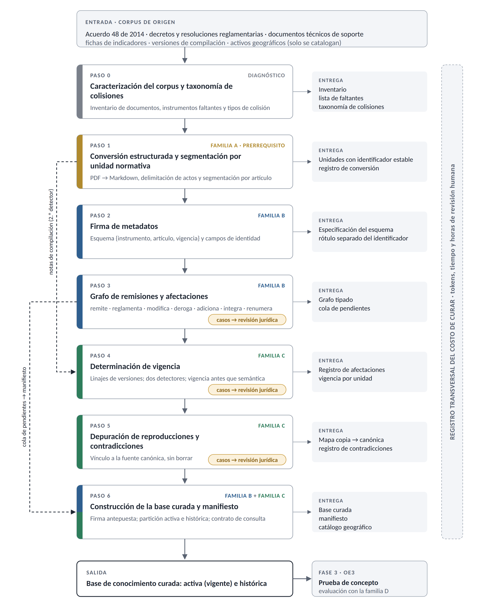

*Nota.* Cada paso entrega un artefacto que es la entrada del siguiente. El color de la franja indica la familia de la taxonomía de la que proviene el paso; el paso 6 compone las familias B y C. Las líneas punteadas muestran dos flujos que saltan pasos: las notas de las versiones de compilación, que el paso 1 separa y el paso 4 usa como segundo detector de vigencia, y la cola de pendientes del paso 3, que el paso 6 declara en el manifiesto. Los pasos 3, 4 y 5 envían a revisión jurídica los casos que exigen interpretación. El costo de curar se registra en todos los pasos. Elaboración propia.

## Interfaz

La prueba de concepto se opera mediante scripts de Python ejecutados por consola, no mediante una aplicación con interfaz gráfica. Se declara de forma explícita para no prometer más de lo que está en el alcance: el producto evaluable es la metodología y la evidencia de su efecto, no un sistema desplegado para uso de funcionarios.

## Decisiones de diseño derivadas de la revisión

Cuatro decisiones quedan fijadas por la evidencia reunida en la Fase 1, y se enuncian aquí porque condicionan toda la implementación:

- **Segmentar por unidad normativa y no por longitud fija.** La evidencia de Akarajaradwong et al. (2025) sobre pérdida de información en corpus normativos es suficiente para tratarlo como criterio y no como preferencia.
- **Nunca someter texto normativo a un modelo que lo reescriba.** El principio de no regeneración de Allu et al. (2026) es aquí una restricción, no una opción: la segmentación asistida se implementa sobre identificadores, devolviendo listas ordenadas y nunca texto.
- Restringir por vigencia antes de ordenar por semántica, y no al revés (R. Li et al., 2026).
- **Actuar solo sobre lo que marquen dos detectores independientes, y nunca borrar.** La lógica conjuntiva de Si et al. (2025) es la salvaguarda contra una deduplicación agresiva que, en este corpus, borraría copias legítimas con contexto propio: lo que los dos detectores marcan se vincula a su fuente canónica o se aparta a la partición histórica, pero no se elimina. El paso 4 admite una sola excepción, declarada en su descripción, cuando la fuente compilada es anterior a la afectación.

## Criterios de aceptación

La metodología se considera efectiva si, en la comparación entre corpus original y corpus curado con el modelo, las instrucciones y las preguntas fijos, se cumplen las condiciones de la Tabla 7:

*Tabla 7. Criterios de aceptación de la metodología.*

| # | Criterio | Umbral |
|---|---|---|
| 1 | Vigencia de las fuentes citadas | Menor error de vigencia en el estrato de preguntas de colisión, con la prueba de McNemar exacta y p < 0,05 |
| 2 | Fidelidad y precisión del contexto | Sin deterioro respecto del sistema de referencia: tasa de alucinación no mayor en más de 10 puntos y artículo esperado en el contexto no menor |
| 3 | Exactitud de las citas emitidas | Proporción de citas que respaldan la afirmación no menor que la del sistema de referencia |
| 4 | Comportamiento ante preguntas sin respuesta | Tasa de abstención mayor en el estrato sin respuesta, sin aumento en el estrato respondible |
| 5 | Costo de procesamiento por consulta | Mediana no mayor en más del 10 %, contabilizando también el costo de curar |

*Nota.* Los umbrales operativos de los cinco criterios se fijaron en el plan de análisis antes de calificar las respuestas (sección 5.3). En el criterio 3, la proporción de citas que respaldan la afirmación se aproximó con la coincidencia automática de la primera cita con la unidad esperada.

El quinto criterio merece énfasis. La revisión mostró que el costo de la curaduría casi nunca se contabiliza: catorce de los veintiún estudios del núcleo no reportan efecto alguno sobre el costo, y de los seis que declaran reducirlo solo dos entregan contabilidad real. Medir el costo de construir la base curada, y no solo el de operarla, es una decisión de diseño de este trabajo derivada directamente de ese vacío.

<!-- salto de página -->

# RESULTADOS

## Desarrollo de la metodología

### Fase 1. Revisión sistemática de la literatura

#### Protocolo

La revisión siguió el protocolo de Kitchenham y Charters (2007) para revisiones sistemáticas en ingeniería de software y se reporta conforme a la declaración PRISMA 2020. El protocolo (Anexo A) quedó fijado en el anteproyecto, antes de la exportación definitiva de la búsqueda, y define la pregunta, las fuentes, la cadena de consulta, los criterios de inclusión y exclusión, el procedimiento de cribado y la matriz de extracción; los ajustes hechos durante la ejecución se listan en el mismo anexo.

La pregunta que guía la revisión es: qué técnicas se han reportado para preparar, curar y estructurar bases de conocimiento documentales destinadas a sistemas de recuperación aumentada con generación, y qué evidencia existe sobre su efecto en la consistencia de las respuestas, la alucinación y el costo de operación.

Los criterios de elegibilidad fueron los de la Tabla 8.

*Tabla 8. Criterios de elegibilidad de la revisión sistemática.*

| | Criterio |
|---|---|
| **Inclusión** | Estudios que describan, propongan o evalúen una intervención sobre el corpus, el índice o los metadatos de un sistema RAG; o que aporten instrumentos de evaluación de esa intervención. Tipos documentales: artículo de revista, ponencia y preprint. |
| **Exclusión** | Aplicación de RAG sin discusión de la construcción o curaduría de la base de conocimiento. Capítulos de libro y monografías. Estudios sin acceso a texto completo en las rutas institucionales disponibles (tratados como *no recuperados*, no como excluidos). |

*Nota.* Frente al anteproyecto, que pedía evaluación empírica, los criterios se ampliaron para admitir los estudios que aportan instrumentos de evaluación y las revisiones secundarias. Estas se usan como marco conceptual y no como evidencia, como N15 (sección 4.2.2.4).

#### Estrategia de búsqueda

La fuente principal fue Dimensions, con búsqueda restringida a título y resumen. El protocolo declaró como fuentes complementarias Scopus, ACM Digital Library, IEEE Xplore y arXiv; los 734 registros proceden, sin embargo, de la exportación de Dimensions, que indexa los preprints de arXiv y las actas de IEEE y ACM, y las fuentes complementarias no se consultaron por separado. De los 692 registros que quedaron tras retirar los duplicados, 165 son de IEEE, 30 de ACM y 168 de arXiv, según el prefijo de su DOI, lo que indica que esas fuentes quedaron cubiertas en la práctica; no puede afirmarse lo mismo de Scopus, que es un índice y no una editorial. La cadena se construyó en tres bloques conjuntos (técnica, componente y problema) para exigir que cada registro recuperado tratara simultáneamente la arquitectura RAG, un componente de la base de conocimiento y una manifestación del problema de inconsistencia:

```
("retrieval augmented generation" OR "RAG")
AND ("knowledge base" OR "corpus" OR "document preprocessing" OR "chunking"
     OR "data curation" OR "knowledge curation")
AND ("knowledge conflict" OR "inconsistency" OR "contradiction" OR "hallucination"
     OR "outdated knowledge" OR "temporal misalignment")
```

La búsqueda definitiva, con la misma cadena de la búsqueda piloto, se ejecutó y sus resultados se exportaron el 1 de agosto de 2026. La exportación devolvió 734 registros, repartidos en 269 artículos de revista, 195 ponencias y 270 preprints, cada conjunto en un archivo aparte cuya cabecera conserva la fecha de exportación y la cadena literal empleada; los tres archivos se entregan en el Anexo A como evidencia de reproducibilidad. La exportación se restringió a 2023–2026, y se verificó en la interfaz de Dimensions que la misma búsqueda sin restricción temporal no devuelve ningún registro anterior a 2023. Ese resultado constituye en sí mismo un dato del estado de la cuestión: la literatura que cruza RAG con la curaduría de la base tiene tres años, aunque la técnica se propuso en 2020 (Lewis et al., 2020). En el núcleo finalmente sintetizado, los veintiún estudios son de 2025 o 2026. Los 107 registros elegibles se cotejaron uno a uno contra la exportación: todos están presentes y ninguno repetido; dos observaciones menores del cotejo quedaron registradas en la matriz.

#### Cribado y selección

El flujo se reporta conforme a PRISMA 2020. Los conteos se resumen en la Tabla 9 y en la Figura 5.

*Tabla 9. Flujo PRISMA 2020 de la revisión sistemática.*

| Etapa del flujo | n |
|---|---|
| Registros identificados en las bases | 734 |
| Duplicados eliminados antes del cribado | 42 |
| Registros cribados por título y resumen | 692 |
| Registros excluidos en el cribado | 585 |
| **Registros elegibles** | 107 |
| Informes buscados para recuperación (núcleo de lectura completa) | 27 |
| Informes no recuperados | 6 |
| **Estudios incluidos en la síntesis del núcleo** | 21 |
| Estudios en verificación rápida | 80 |

**Una excepción declarada en la composición del núcleo.** Uno de los veintiún estudios, N15, es una revisión secundaria. Se mantiene porque el protocolo contempla esa categoría desde antes de la búsqueda, y se usa como marco conceptual y no como evidencia (sección 4.2.2.4).

*Figura 5. Diagrama de flujo PRISMA 2020 de la revisión sistemática.*

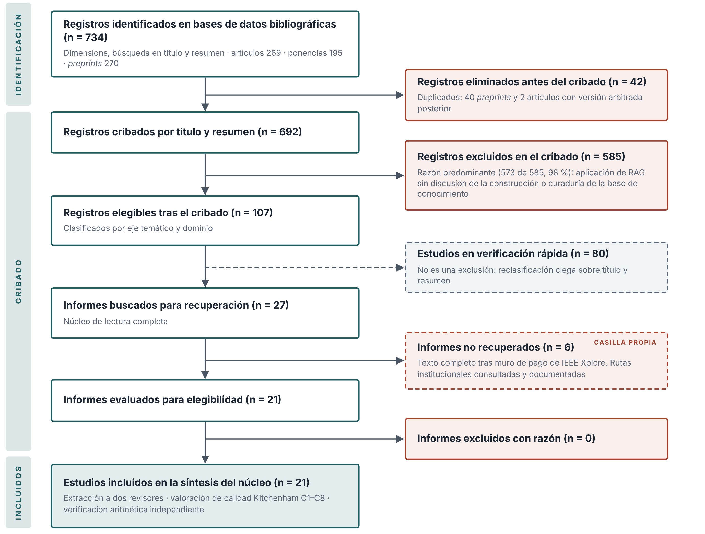{width=6.2in}

*Nota.* Las casillas de «informes no recuperados» e «informes excluidos con razón» se mantienen separadas conforme a PRISMA 2020 y no deben sumarse: un informe no recuperado no fue juzgado por su contenido. La rama de verificación rápida tampoco es una exclusión. Elaboración propia a partir de Page et al. (2021).

Los 42 duplicados corresponden a 40 preprints y 2 artículos que contaban con versión arbitrada posterior en el mismo conjunto; en cada caso se conservó la versión arbitrada. El cribado se organizó por lotes, ordenados con un puntaje automático de afinidad temática calculado sobre el título y el resumen, que sirvió para priorizar el trabajo y no como criterio de exclusión: 43 registros de prioridad alta, 371 de prioridad media y 278 de prioridad baja. En los lotes de prioridad media y baja la primera pasada se hizo por el título, y el resumen se revisó en los registros candidatos.

La razón de exclusión predominante en el cribado fue «aplicación de RAG sin discusión de la construcción o curaduría de la base de conocimiento», que explica 573 de los 585 registros excluidos (el 98 %), es decir, el 83 % de los 692 cribados. Ese dato no es solo un subproducto del procedimiento: es evidencia directa del vacío que este trabajo aborda, y se retoma en la sección 2.1.2.

Los 107 registros elegibles se clasificaron por eje temático y dominio, y se dividieron en dos conjuntos con tratamiento distinto, asignados antes de la lectura completa a partir del título de cada registro. Los 27 estudios de lectura completa constituyen el núcleo de evidencia (la matriz de extracción íntegra se aplicó a los 21 que pudieron recuperarse). Sobre los 80 estudios de verificación se ejecutó una reclasificación independiente y ciega a partir del mismo insumo que tuvo el cribado (título y resumen), sin acceso a la clasificación previa. El cotejo de las 240 celdas resultantes arroja un acuerdo del 47,5 % con el cribado bajo el criterio más exigente (que exige coincidencia exacta del conjunto de etiquetas en el campo multietiqueta), y del 67,5 % si ese campo se juzga por solape de etiquetas, ambas muy por debajo del 77,1 % de la auditoría ciega del núcleo (sección 7.1.1.7); el cotejo celda por celda está en el Anexo C.

Para distinguir si esa caída es ruido de lectura o un defecto de la clasificación original, una muestra aleatoria de dieciséis estudios (sorteada con semilla declarada) recibió dos lecturas independientes adicionales: una segunda clasificación ciega y el veredicto de los dos investigadores. El acuerdo entre la clasificación asistida y el veredicto humano es del 91 % (29 de 32 clasificaciones: 15 de 16 en la etapa y 14 de 16 en el dominio), y las tres lecturas independientes concuerdan entre sí entre el 78 % y el 91 %, mientras que ninguna concuerda con el cribado por encima del 56 %. Los investigadores confirmaron sin excepción las siete correcciones propuestas y arbitraron los tres casos en que las lecturas asistidas discrepaban entre sí. La diferencia no se atribuye, por tanto, a la dificultad de los estudios sino al instrumento: el cribado clasificó sin reglas de decisión escritas, mientras que la clasificación del núcleo se consolidó con las reglas A a F, formalizadas durante el arbitraje. Esa cifra del 91 % mide la clasificación de los estudios elegibles, no las decisiones de exclusión del cribado (sección 7.3). Tres discrepancias resultaron sistemáticas (sobreasignación del dominio médico en quince casos, cinco revisiones secundarias archivadas como estudios primarios y el uso de la etapa transversal como categoría residual) y se detallan en el Anexo C.

Esta segunda clasificación fue asistida por inteligencia artificial, igual que el cribado, y por eso su fiabilidad se establece con el veredicto humano sobre la muestra de dieciséis. La síntesis no se construye sobre los 80: la taxonomía, las cuatro familias, los hallazgos transversales y los vacíos proceden del núcleo de veintiún estudios. Los 80 se usan solo para matizar dos afirmaciones, la ausencia de ablaciones de la curaduría y la ausencia de corpus en español, y en esos casos se dice expresamente. Ningún estudio de la verificación se promovió al núcleo después de cerrarlo, para no modificar la selección a la vista del resultado.

De los 27 estudios buscados para recuperación, seis no pudieron obtenerse por encontrarse tras muro de pago de IEEE Xplore sin licencia institucional disponible en las rutas consultadas. Conforme a PRISMA 2020 se reportan en la casilla *informes no recuperados*, que es distinta de *informes excluidos con razón*: un informe no recuperado no fue juzgado por su contenido, de modo que sumarlo a las exclusiones razonadas falsearía el conteo. Las rutas de acceso intentadas quedan documentadas en la matriz del Anexo C. Los seis se distribuyen en etapas del pipeline que ya cuentan con evidencia de otros estudios (segmentación, metadatos, vigencia y construcción de la base), de modo que su ausencia no deja ninguna rama de la taxonomía sin sustento.

#### Extracción de datos a dos revisores

La extracción se realizó con una matriz de 39 campos por estudio, organizada en siete bloques: identificación bibliográfica, clasificación taxonómica, descripción de la técnica, descripción del corpus y de la evidencia, métricas y resultados, transferibilidad al caso del POT, y trazabilidad de la extracción. Los campos de clasificación operan con vocabulario controlado (entre ellos la etapa del pipeline, la unidad de intervención, el idioma del corpus, el tipo de evidencia y la dirección del efecto) para que la clasificación sea comparable entre revisores y agregable en la síntesis.

Cuatro campos del instrumento se incorporaron tras la evaluación del anteproyecto, en respuesta directa a las observaciones de la evaluadora: si el estudio reporta métricas de recuperación separadas de las de generación, si reporta exactitud de citas, si reporta comportamiento ante preguntas sin respuesta (abstención) y si emplea validación humana con rúbrica o acuerdo interevaluador. Sus resultados se presentan en la sección 4.2.1.

Los 21 estudios se repartieron entre los dos investigadores alternando dentro de cada etapa del pipeline, de modo que ambos cubrieran todos los temas. Cada estudio fue extraído por un revisor y verificado por el otro.

**Resolución de desacuerdos.** El cotejo de las dos versiones de cada estudio arrojó 72 diferencias en los campos de vocabulario controlado, más 18 en la etiqueta de la técnica. Casi ninguna fue una disputa sobre los hechos del artículo. Eran dos sesgos sistemáticos opuestos, producto de la ausencia de reglas escritas: sobrecautela en una versión (uso preferente de las categorías más amplias y de «no reporta») y sobreatribución en la otra (uso preferente de «mejora» y de la atribución a varios objetivos). La constatación llevó a formalizar seis reglas de decisión, que se aplicaron después a todas las celdas en disputa y quedaron incorporadas al libro de códigos del instrumento (Tabla 10):

*Tabla 10. Reglas de decisión para la resolución de desacuerdos entre revisores.*

| | Regla |
|---|---|
| **A** | Etapa del pipeline. Se clasifica por el objeto declarado del estudio, no por el título ni por la etapa donde se evaluó. Si el estudio solo aporta una medición, se asigna a la etapa de evaluación, salvo que la medición recaiga sobre una etapa concreta. Si la etiqueta de la técnica contradice la etapa asignada, la etapa está mal. |
| **B** | Nombre de la técnica. Etiqueta genérica y reutilizable entre estudios que hacen lo mismo. Se prohíben los nombres propios de sistema: un nombre propio no puede ser nodo de una taxonomía. |
| **C** | Unidad de intervención. «Pipeline completo» solo si la técnica interviene en tres o más etapas y ningún objeto domina. Cuando una técnica modifica un objeto usando otro como instrumento, la unidad es el objeto modificado, no el instrumento. |
| **D** | Dirección del efecto sobre la alucinación. Se registra «mejora» únicamente si el estudio mide la alucinación o una métrica que la opere de forma explícita (tasa de alucinación, fidelidad, tasa de éxito de envenenamiento, especificidad normativa). La exactitud de la respuesta no es una medida de alucinación. Si no se midió, se registra «no reporta». |
| **E** | Objetivo al que aporta. Todo estudio del núcleo alimenta el primer objetivo específico (OE1) por definición. Se añade el segundo (OE2) si aporta una técnica de curaduría trasladable, y OE3 si aporta un diseño de evaluación, una métrica, una línea base o un corpus de contraste. |
| **F** | Valoración de calidad. Cuando exista recálculo aritmético documentado sobre las tablas del propio estudio, ese recálculo prevalece sobre la impresión de lectura. Cuando no exista, se vuelve al texto completo: no se promedian las dos valoraciones ni se parte la diferencia. |

La regla D obligó a una distinción que conviene dejar escrita, porque dos estudios que a primera vista se parecen se resuelven en sentidos opuestos. N02 define su exactitud factual como que todas las fechas, nombres y disposiciones legislativas de la respuesta sean verificables contra los registros oficiales de la fuente: una fecha inventada reprueba esa prueba, de modo que la métrica opera el anclaje y la regla la admite. N03, en cambio, mide corrección factual como una dimensión de una rúbrica pedagógica, que juzga si el contenido es correcto y no si es trazable al documento recuperado; esa es exactitud de respuesta y la regla la excluye. El criterio operativo que se desprende es que una métrica admisible tiene que penalizar el contenido fabricado, no solo el contenido equivocado.

La consolidación de las dos versiones con una tercera fuente, los resúmenes de lectura de uno de los revisores, llevó a arbitrar 108 celdas. La cifra es mayor que la de las diferencias porque el arbitraje incluyó además la valoración de calidad, dos campos de texto libre y la estandarización de las veintiún etiquetas bajo una convención común. Cada celda quedó registrada de forma individual en una hoja de trazabilidad del instrumento con el valor de cada revisor, el valor definitivo, la fuente del valor adoptado y el argumento. El desacuerdo residual quedó en dos celdas (N02·C2 y N21·C5), en las que se conservó el valor de la primera extracción; ninguna cambia la banda de calidad del estudio.

#### Valoración de la calidad de los estudios

Se aplicó un instrumento de ocho criterios derivado de Kitchenham y Charters (2007), valorado de 0 a 2 puntos, con un máximo de 16 (Tabla 11):

*Tabla 11. Instrumento de valoración de la calidad de los estudios.*

| | Criterio | 0 | 1 | 2 |
|---|---|---|---|---|
| C1 | Objetivo explícito | No se enuncia | Implícito | Enunciado con precisión |
| C2 | Técnica reproducible | Descripción vaga | Sin parámetros | Parámetros, versiones o código |
| C3 | Corpus descrito | Sin describir | Nombrado sin tamaños | Tamaño, procedencia y preparación |
| C4 | Línea base de comparación | Ninguna | Una, parcial | Explícita, con lo demás fijo |
| C5 | Métricas definidas | Sin definir | Nombradas sin fórmula | Con fórmula y evaluador |
| C6 | Resultados con cifras | Solo cualitativo | Cifras sin varianza | Cifras con dispersión o prueba |
| C7 | Limitaciones discutidas | Ausentes | Mencionadas | Concretas y cuantificadas |
| C8 | Arbitraje | Preprint | Ponencia arbitrada | Revista arbitrada |

Bandas: alta ≥ 12, media 8–11, baja < 8.

El núcleo obtuvo un puntaje promedio de 12,14 sobre 16, con la distribución que muestra la Tabla 12.

*Tabla 12. Distribución de la calidad del núcleo por bandas.*

| Banda | n | % del núcleo |
|---|---|---|
| Alta (≥ 12) | 12 | 57,1 % |
| Media (8–11) | 8 | 38,1 % |
| Baja (< 8) | 1 | 4,8 % |

Doce de los veintiún estudios (57,1 %) son preprints sin arbitraje editorial, lo que refleja la juventud del campo y obliga a una cautela particular en la síntesis. Se adoptó como regla que ninguna afirmación de la taxonomía se sostenga únicamente en estudios sin arbitraje.

#### Verificación aritmética independiente

El instrumento de Kitchenham y Charters (2007), como todo instrumento de valoración de calidad, mide la calidad del reporte y no la veracidad de lo reportado. Durante la extracción apareció la primera discrepancia entre una cifra del resumen de un estudio y la tabla que supuestamente la sostenía, y se decidió añadir al procedimiento un paso no previsto en el protocolo original: recalcular con Python la aritmética de cada estudio contra sus propias tablas (sumas, promedios, diferencias, porcentajes relativos y, donde los datos por ítem estaban publicados, pruebas de significación) y contrastar el resultado con lo que afirman el texto y el resumen.

El paso resultó ser el hallazgo metodológico más importante de la revisión. Al menos diez de los veintiún estudios (el 48 %) contienen alguna cifra que no se reproduce a partir de sus propias tablas. La proporción se enuncia como cota inferior por la razón que se explica en la sección 7.1.1.7: la auditoría por muestreo encontró discrepancias adicionales en los cinco estudios que revisó, de modo que una verificación exhaustiva la elevaría. En seis de esos diez, la cifra afectada es la del resumen, que es precisamente la que se cita sin abrir el artículo. Los tres casos del hallazgo 5 (sección 4.2.4) ilustran por qué el arbitraje no sustituye la verificación.

Las trece cifras que no pueden citarse, o que solo pueden citarse declarando la discrepancia, quedan registradas una por una en el campo de observaciones de la matriz, con el recálculo al lado. Ninguna afirmación de la sección 4.2 se apoya en una cifra de resumen no verificada contra su tabla de origen.

Reportar este procedimiento justifica ante el lector por qué las cifras citadas en el estado del arte difieren, en algunos casos, de las que el propio estudio anuncia.

#### Auditoría por muestreo de la extracción

Para estimar la fiabilidad del instrumento se auditó una muestra aleatoria simple del núcleo (Anexo D). El marco de muestreo fueron los diecisiete estudios no sometidos a relectura en la resolución de desacuerdos, y la selección se hizo con semilla declarada (20260915) sobre el marco ordenado alfabéticamente. La muestra resultante fue de cinco estudios, el 23,8 % del núcleo, con tres de banda alta y dos de banda media, cuatro preprints y un artículo de revista, y cuatro etapas distintas del pipeline.

Cada estudio se reclasificó en condiciones ciegas: el revisor, una lectura asistida por inteligencia artificial y aislada de la extracción, recibió únicamente el texto completo del artículo y el libro de códigos (definiciones de campo, vocabularios controlados, reglas de decisión y descriptores de calidad), sin acceso a la matriz ni a ninguna clasificación previa. Se compararon veintiuna celdas por estudio: trece campos de vocabulario controlado y los ocho criterios de calidad, ciento cinco celdas en total. La Tabla 13 resume el acuerdo.

*Tabla 13. Resultados de la auditoría por muestreo de la extracción.*

| Nivel de comparación | Acuerdo |
|---|---|
| Campos de vocabulario controlado | 51 / 65 = 78,5 % |
| Criterios de calidad | 30 / 40 = 75,0 % |
| Global, celda por celda | 81 / 105 = 77,1 % |
| Banda de calidad asignada | 5 / 5 = 100 % |

Tres resultados cualifican esa cifra. Ningún estudio cambió de banda: las diferencias de puntaje total fueron de entre menos dos y más un punto sobre dieciséis. El orden relativo se conserva: de los diez pares comparables, nueve quedan ordenados igual por los dos revisores. Y la discrepancia es sobre todo sistemática: el revisor independiente resultó en promedio 0,8 puntos más severo, un sesgo predominante en una dirección que no altera las bandas ni el orden de los estudios y que, por tanto, no compromete la comparabilidad interna del núcleo.

De las veinticuatro celdas discrepantes, cinco correspondieron a defectos de la extracción original y se corrigieron; cuatro reprodujeron el mismo sesgo de sobreatribución que la regla E fue escrita para controlar, lo que constituye evidencia de que esa regla cumple una función; una fue un error del revisor independiente, que declaró un efecto sobre el costo en un estudio que no lo mide; y las catorce restantes son juicios limítrofes sobre criterios que admiten más de una lectura defendible.

Como resultado colateral, el recálculo aritmético exigido al revisor independiente encontró en los cinco estudios auditados discrepancias no registradas en la verificación previa, razón por la cual la proporción reportada en la sección 7.1.1.6 se enuncia como cota inferior.

#### Uso de asistencia por inteligencia artificial

El cribado inicial de los 692 registros y la reclasificación de los 80 estudios de verificación se hicieron con asistencia de Claude, de Anthropic, y el veredicto de los dos investigadores recayó sobre una muestra de dieciséis (sección 7.1.1.3). El procedimiento no se presenta como cribado humano independiente; el uso de la IA en cada etapa se declara en la sección 1.2 y el registro de decisiones está en el Anexo B.

### Fase 2. Diseño de la metodología de curaduría

La metodología que produce esta fase es la quinta familia definida en la sección 4.2.6: estructuración normativa con control de vigencia. Se organiza en siete pasos secuenciales, numerados del 0 al 6, más un registro transversal del costo de curar, y su secuencia se resume en la Figura 4. La lógica de composición es la que fijó la sección 4.2.6. La familia B deposita en cada unidad del corpus sus atributos de identidad y sus relaciones con otras unidades (pasos 2 y 3); la familia C usa esos atributos para establecer la vigencia y resolver las reproducciones (pasos 4 y 5); y las dos se aplican juntas en la construcción de la base (paso 6). La familia A entra como paso de entrada (paso 1), declarado prerrequisito y no aporte, y la familia D queda reservada para la evaluación de la Fase 3.

Cada paso se describe con la misma plantilla: qué se hace, cómo se hace, qué resultado entrega, de qué técnica de la revisión proviene y con qué control se verifica que quedó bien. Cada paso incluye una figura con su flujo de decisión, y al final se muestra su aplicación sobre un caso real del corpus, el mismo para los siete, de modo que una sola cadena normativa recorra el procedimiento completo.

Tres reglas atraviesan los siete pasos y se enuncian aquí una sola vez:

- **Ningún modelo de lenguaje modifica el texto normativo ya extraído.** Los modelos leen, proponen y señalan, pero no reescriben (Allu et al., 2026).
- **Nada se borra.** Lo que pierde vigencia se aparta a una partición histórica, en lugar de eliminarse, porque el filtrado de grano grueso destruye a la vez lo que sobra y lo que sirve (Si et al., 2025) y porque la vigencia se controla mejor como atributo consultable que como ausencia (Karna et al., 2026; R. Li et al., 2026).
- **Lo que exige un juicio jurídico lo decide una persona.** El procedimiento detecta y prioriza los casos dudosos y un funcionario con perfil jurídico los resuelve (Semnani et al., 2025).

#### Caso ancla

El caso elegido es la reglamentación del aprovechamiento económico del espacio público, que el artículo 544 del Acuerdo 48 de 2014 (Concejo de Medellín, 2014) ordenó expedir en un plazo de doce meses y que desde entonces ha pasado por tres decretos sucesivos (Alcaldía de Medellín, 2015c, 2018b, 2019), con el Decreto 327 de 1997 como reglamentación anterior (Alcaldía de Medellín, 1997). La Tabla 14 los resume.

*Tabla 14. Instrumentos del caso ancla.*

| Instrumento | Expedición y publicación | Papel en la cadena | Formato de la fuente |
|---|---|---|---|
| Acuerdo 48 de 2014 | Gaceta Oficial 4267, 17 de diciembre de 2014 | Su artículo 544 ordena la reglamentación específica del aprovechamiento económico del espacio público | PDF digital a dos columnas, 500 páginas |
| Decreto 327 de 1997 | Expedido el 16 de abril de 1997; Gaceta Oficial 667, 4 de julio de 1997 | Reglamentación anterior de las ventas estacionarias y los elementos de servicios varios, citada por los decretos posteriores | PDF escaneado, sin capa de texto |
| Decreto 2148 de 2015 | Expedido el 30 de diciembre de 2015; Gaceta Oficial 4355, 8 de enero de 2016 | Reglamenta el artículo 544 del Acuerdo 48 | Dos versiones: la Gaceta y una compilación con notas de vigencia actualizada al 15 de junio de 2019 |
| Decreto 522 de 2018 | Expedido el 19 de julio de 2018; Gaceta Oficial 4536, 23 de julio de 2018 | Modifica 25 artículos del 2148, deroga los artículos 3 y 10, integra los artículos 9 y 10 en el 7 y adiciona los artículos 6A, 14A y 33A | PDF digital |
| Decreto 2229 de 2019 | Expedido el 8 de noviembre de 2019; Gaceta Oficial 4641, 13 de noviembre de 2019 | Adopta el Manual del aprovechamiento económico, modifica artículos del 2148 y del Decreto 471 de 2018, y deroga el Decreto 327 de 1997 | Versión de compilación, digital |

El caso se eligió porque reúne en pocas páginas las tres patologías del corpus enunciadas en la sección 4.2.6. Hay reproducción, porque una misma regla dimensional pasa del decreto de 1997 al manual de 2019. Hay derogación, total en el caso del Decreto 327 y parcial en el de varios artículos del 2148. Y hay remisión, del 2148 al Acuerdo 48 que reglamenta y del 2148 y el 522 al Decreto 327 que más tarde queda derogado. Añade además una forma de colisión que la taxonomía del anteproyecto no anticipaba, la renumeración, y una fuente compilada que no refleja la última modificación. Las dos se describen en los pasos 2 y 4.

Conviene precisar por qué el caso es una cadena de decretos y no un artículo del Acuerdo 48 modificado. Un plan de ordenamiento territorial adoptado por acuerdo se modifica por acuerdo, mientras que los decretos lo reglamentan. En la práctica, la mayor parte del cambio normativo que debe atender una consulta sobre el POT ocurre en esa reglamentación, que se modifica a sí misma con frecuencia, y no en el texto del Acuerdo. El caso refleja, por tanto, la forma en que el corpus cambia de verdad.

#### Paso 0. Caracterización del corpus y taxonomía de colisiones

**Qué se hace.** Se delimita el subconjunto del corpus que se va a curar, se inventaría cada documento y se identifican los tipos de colisión que contiene. El paso no transforma ningún documento: produce el diagnóstico sobre el que operan los demás.

**Cómo se hace.**

1. Se registra cada documento con su tipo (acuerdo, decreto, resolución, documento técnico de soporte, ficha de indicador), su número y año, sus fechas de expedición y de publicación, el formato (digital con capa de texto o escaneado) y la naturaleza de la fuente. Esta última distingue la publicación canónica en la Gaceta Oficial, las versiones de compilación de los normogramas y las reproducciones dentro de otros documentos.
2. Se leen las cláusulas de vigencia y derogatoria de cada acto, que suelen estar en su último artículo, y se anotan los instrumentos que cada uno modifica, deroga o cita. Es una lectura rápida que anticipa el trabajo del paso 3.
3. Se contrastan los instrumentos citados con el inventario. Todo instrumento citado que no esté en el subconjunto se registra como faltante.
4. Se tipifican las colisiones observadas con la taxonomía de la sección 5.2 (derogación, modificación parcial, duplicación versionada y ambigüedad de vigencia), ampliada con los tipos que aparezcan en el corpus.
5. De forma opcional, se estima una cota inferior de la tasa de inconsistencia del subconjunto con el protocolo de Semnani et al. (2025): muestreo uniforme de afirmaciones atómicas, detección asistida, confirmación manual y reporte con intervalo de confianza.

La Figura 6 resume las decisiones de este paso. En esta figura y en las siguientes, el rombo indica una decisión, la caja blanca una acción, la caja verde un resultado, la caja amarilla punteada una revisión humana y la caja roja un documento faltante o un aviso.

*Figura 6. Paso 0: Caracterización del corpus. Flujo de decisión.*

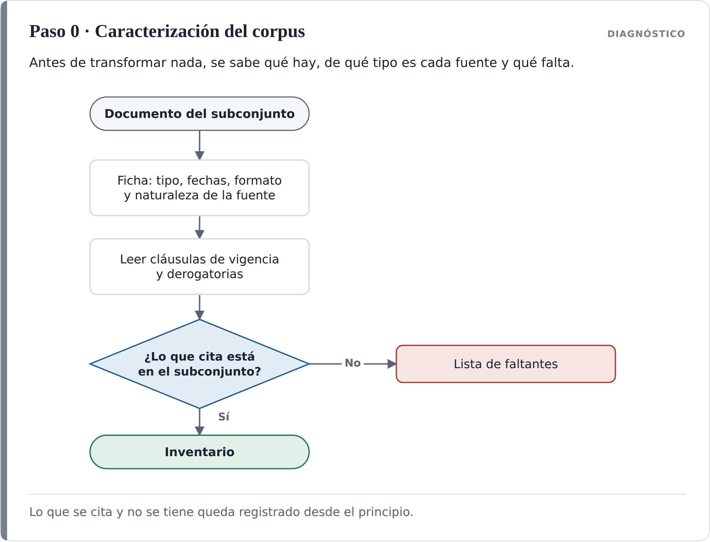

*Nota.* Elaboración propia.

**Resultado.** Un inventario del subconjunto, una lista de instrumentos faltantes y una taxonomía de colisiones con al menos un ejemplo real de cada tipo observado. La taxonomía completa, con sus ocho tipos, está en el Anexo E.

**De dónde sale.** La tipología y el protocolo de medición provienen de Semnani et al. (2025). La lista de faltantes responde al error de vacío de datos de Al Mouatamid et al. (2026), en el que un sistema concluyó que no existían sanciones porque el decreto que las contenía no estaba en la base. Ese error no puede corregirse aguas abajo si no se sabe, desde el principio, qué falta.

**Control de salida.** Cada documento del subconjunto tiene su fila en el inventario; cada tipo de colisión tiene un ejemplo o se declara no observado; y la lista de faltantes está revisada por una persona que conozca el corpus.

**En el caso ancla.** El inventario tiene cinco instrumentos y seis archivos, porque el 2148 llega en dos versiones. La lista de faltantes incluye el Decreto 471 de 2018 (Alcaldía de Medellín, 2018a), cuyos artículos 208 y 209 modifica el 2229; el Decreto 680 de 1999 (Alcaldía de Medellín, 1999), citado por el 522; y el Manual de Espacio Público adoptado por el Decreto 113 de 2017 (Alcaldía de Medellín, 2017), al que remite el 2229. La taxonomía se amplía con cuatro tipos que el caso muestra y que el anteproyecto no listaba:

- **Renumeración e integración:** un acto modificatorio cambia el número de un artículo o funde varios en uno.
- **Reproducción entre instrumentos de vigencia distinta:** la misma regla aparece en una norma derogada y en otra vigente.
- **Remisión a un instrumento no vigente:** una versión histórica cita una norma que después fue derogada.
- **Desactualización de la fuente compilada:** la versión de normograma no recoge la última modificación.

#### Paso 1. Conversión estructurada y segmentación por unidad normativa

**Qué se hace.** Se convierte cada documento a Markdown conservando su jerarquía (título, capítulo, artículo, parágrafo, numeral), se separan los actos que comparten página y se segmenta el texto en unidades normativas, cada una con un identificador estable.

**Cómo se hace.**

1. **Ruta de extracción.** Si la página tiene capa de texto se extrae en orden de lectura, respetando las columnas. Si no la tiene, o si la proporción de caracteres basura supera un umbral fijado de antemano, la página se transcribe desde la imagen con un modelo con visión. Zouak et al. (2026) usan un umbral del 4 %. La transcripción desde la imagen es la única intervención de un modelo sobre el texto, y se verifica por muestreo contra el original. En la prueba de concepto esta ruta no se siguió en los 31 decretos, que se transcribieron completos (sección 7.1.3.2).
2. **Limpieza determinista.** Con reglas se retiran los encabezados y pies de la Gaceta, los números de página y los bloques que las compilaciones intercalan en el articulado, como «Concordancias» y «Notas de vigencia». Estos bloques no se descartan: se separan en un canal paralelo que el paso 4 usa como segundo detector. Los defectos que una regla no puede corregir sin interpretar, como las palabras pegadas, se marcan y se resuelven por reextracción o por transcripción, nunca por reescritura.
3. **Delimitación de actos.** Una página de la Gaceta puede contener el final de un acto y el comienzo del siguiente. Antes de segmentar se fijan los límites de cada acto entre su encabezado («DECRETO N° … DE …», con su fecha) y su cierre («PUBLÍQUESE Y CÚMPLASE», «Dado en Medellín…»).
4. **Segmentación por artículo.** Dentro de cada acto se detectan los encabezados de artículo con expresiones regulares y se verifica cada coincidencia con atributos tipográficos (negrita, tamaño, inicio de párrafo). Así se distingue el encabezado de un artículo de la mención de un artículo dentro del texto (Zouak et al., 2026). Parágrafos, numerales y literales quedan como subunidades direccionables.
5. **Identificador estable.** Cada unidad recibe un identificador que nombra el acto que contiene el texto y la posición del texto en ese acto, con la forma `{acto}:{artículo del acto}[.subunidad]`; por ejemplo, `D522-2018:a7`. El número con que la unidad se presenta dentro de otro instrumento («artículo 7 del Decreto 2148») se guarda como un atributo, el rótulo, y no como clave. La razón la da el propio caso y se explica en el paso 2.
6. **Asistencia en la segmentación.** Si las reglas no encuentran una estructura confiable, la segmentación se planifica con un modelo que recibe solo los identificadores de los bloques y devuelve listas ordenadas de identificadores, nunca texto (Allu et al., 2026).

La Figura 7 resume las decisiones de este paso.

*Figura 7. Paso 1: Conversión y segmentación. Flujo de decisión.*

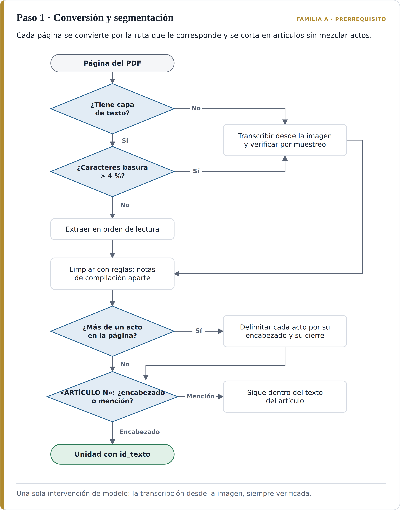

*Nota.* Elaboración propia.

**Resultado.** El corpus en Markdown, segmentado en unidades con identificador estable, y un registro de conversión con la ruta usada en cada página, la proporción de caracteres basura y las correcciones aplicadas.

**De dónde sale.** El diagnóstico de propagación del ruido de reconocimiento y su gravedad en contenido tabular proviene de Zhang et al. (2025); la conversión a Markdown con jerarquía, de Kaseteiam y Vanijja (2026); la detección de artículos con verificación tipográfica y el umbral que activa la transcripción por visión, de Zouak et al. (2026); la segmentación por artículo como criterio, de Akarajaradwong et al. (2025); y el principio de no regeneración con planificación sobre identificadores, de Allu et al. (2026).

**Control de salida.** Se comparan por muestreo las páginas transcritas con su imagen; la numeración de los artículos extraídos de cada acto es continua, sin saltos ni duplicados; y ningún artículo queda asignado a un acto distinto del suyo.

**En el caso ancla.** Las cinco fuentes muestran cinco defectos distintos, todos reales:

- **Un acto ajeno en la misma página.** La página 832 de la Gaceta 4355, donde empieza el Decreto 2148, abre con el final de otro decreto, cuyo último artículo dice: «ARTÍCULO 7. Derogación: Este decreto rige a partir de la fecha de su publicación […] y deroga todas las disposiciones que le sean contrarias, en especial todo el Decreto Municipal N° 499 del 2013». Sin delimitación de actos, ese texto quedaría como artículo 7 del 2148, y el paso 3 crearía una derogación que el 2148 nunca hizo.
- **Encabezados dentro del articulado.** En el Acuerdo 48, los artículos 539 y 541 quedan partidos por el encabezado «Gaceta Oficial Nº4267» y por los números de página 312 y 313.
- **Palabras pegadas.** El texto justificado de la Gaceta se extrae a veces sin espacios: «Parágrafo1.Lautilizacióndeloselementosarquitectónicos…».
- **Bloques de compilación.** La versión de normograma del Decreto 2229 intercala cuatro bloques de «Concordancias», tres de ellos dentro del articulado, que listan actos de 2022 a 2025.
- **Escaneo degradado.** El Decreto 327 de 1997 no tiene capa de texto; una de sus columnas aparece cortada en el margen derecho y sus dimensiones de módulos de venta están en tablas, el tipo de contenido en que Zhang et al. (2025) miden la mayor degradación. El texto que el corte hizo perder no se completa: la unidad se marca como incompleta y así queda registrada.

#### Paso 2. Firma de metadatos

**Qué se hace.** Se define el esquema de metadatos de la base y se llenan, para cada unidad, los campos de identidad. Con esos campos se construye la firma que el paso 6 antepone al texto antes de vectorizarlo, con la terna {instrumento, artículo, vigencia} adoptada en la sección 4.2.

**Cómo se hace.** Los campos de identidad se extraen de la estructura del documento (el encabezado del acto, el encabezado de la Gaceta, el encabezado del artículo) con reglas y sin intervención de un modelo. En los documentos sin estructura normativa, como los documentos técnicos de soporte y las fichas, un modelo puede proponer los valores en un formato estructurado, con la obligación de dejar vacío todo campo para el que no haya evidencia (Park et al., 2026). Cuando un fragmento de esos documentos continúa el anterior, hereda su firma (Park et al., 2026). Los campos de vigencia se crean vacíos: los llena el paso 4 (Tabla 15).

*Tabla 15. Esquema de metadatos de la base curada.*

| Campo | Contenido | Lo llena | Ejemplo |
|---|---|---|---|
| `id_texto` | Identificador estable de la unidad | Paso 1 | `D2229-2019:a11` |
| `instrumento` | Instrumento del que la unidad forma parte | Paso 2 | Decreto 2148 de 2015 |
| `rotulo` | Número con que la unidad aparece en ese instrumento en esa versión | Paso 2 | Artículo 7 |
| `titulo` | Epígrafe del artículo, si lo tiene | Paso 2 | Prohibiciones generales para el aprovechamiento económico del espacio público |
| `alcance` | Artículo, parágrafo, numeral o literal | Paso 2 | Artículo |
| `acto_fuente` | Acto que contiene el texto | Paso 2 | Decreto 2229 de 2019, artículo 11 |
| `tipo_documento` | Acuerdo, decreto, resolución, documento técnico de soporte, ficha | Paso 2 | Decreto |
| `naturaleza_fuente` | Canónica (Gaceta), compilación o reproducción | Paso 2 | Compilación |
| `id_fuente` | Gaceta y página de origen | Paso 2 | Gaceta Oficial 4641, p. 111 (según la compilación) |
| `fecha_expedicion` / `fecha_publicacion` | Fechas del acto fuente | Paso 2 | 2019-11-08 / 2019-11-13 |
| `vigente_desde` / `vigente_hasta` | Intervalo de vigencia de esta versión | Paso 4 | 2019-11-13 / no aplica |
| `estado` | Vigente, modificada, derogada o por confirmar | Paso 4 | Vigente |
| `acto_modificatorio` | Acto que terminó la vigencia de esta versión | Paso 4 | No aplica |
| `id_canonico` | Unidad canónica de la que esta es reproducción | Paso 5 | No aplica |
| `particion` | Activa o histórica | Paso 6 | Activa |

La firma se arma con esos campos y se mantiene corta, porque en Maniyar et al. (2026) los metadatos llegan a ocupar entre el 20 % y el 25 % del espacio del fragmento y ese costo no se contabiliza. Para la unidad de la tabla la firma sería:

> `[Decreto 2148 de 2015 · art. 7, Prohibiciones generales · texto del Decreto 2229 de 2019 · vigente desde 13-11-2019]`

La Figura 8 resume las decisiones de este paso.

*Figura 8. Paso 2: Firma de metadatos. Flujo de decisión.*

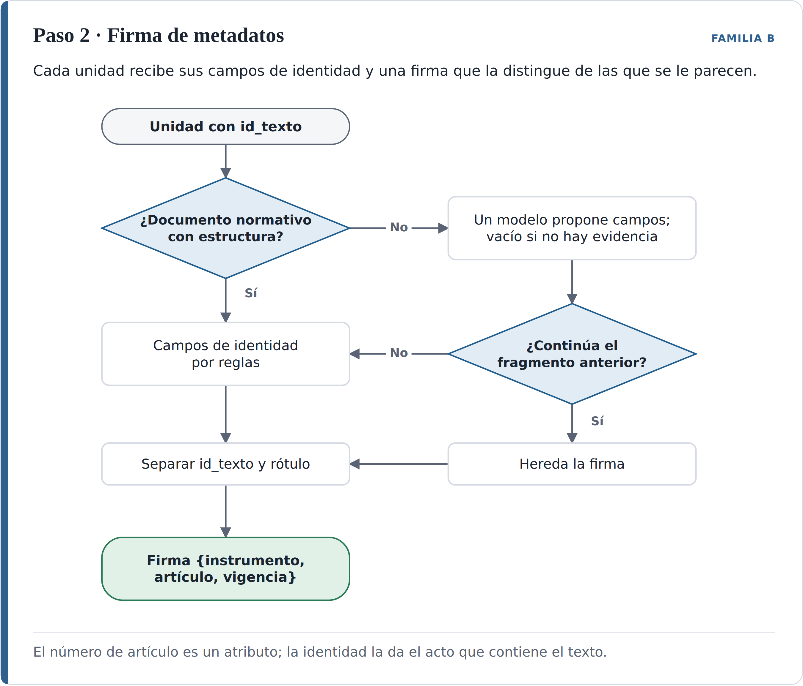

*Nota.* Elaboración propia.

**Resultado.** La especificación del esquema, documentada como pieza reutilizable, y todas las unidades con sus campos de identidad llenos.

**De dónde sale.** El esquema por fragmento con norma, artículo, fuente, fecha y periodo de vigencia proviene de Karna et al. (2026); el campo del acto modificatorio, del registro de cambios de Zhou et al. (2026); la firma antepuesta para distinguir fragmentos casi idénticos de documentos distintos, de Maniyar et al. (2026) y Park et al. (2026).

**Control de salida.** Todas las unidades tienen sus campos de identidad; ningún campo tiene un valor sin evidencia en el documento; y una muestra se verifica a mano contra la fuente.

**En el caso ancla.** El caso muestra por qué `rotulo` e `id_texto` tienen que ser campos distintos. El artículo 7 del Decreto 522 de 2018 dispone: «Integrar y modificar los artículos 9 y 10, los cuales pasarán a ser el artículo 7 del Decreto 2148 de 2015». Y su artículo 8: «Modificar el artículo 7 el cual pasará a ser el Artículo 8». En consecuencia, el rótulo «artículo 7 del Decreto 2148 de 2015» corresponde a tres textos con contenido distinto según la fecha:

- `D2148-2015:a7`, de 2015: «Espacios públicos susceptibles de ser aprovechados».
- `D522-2018:a7`, de 2018: «Prohibiciones generales», que funde los antiguos artículos 9 y 10.
- `D2229-2019:a11`, de 2019: «Prohibiciones generales», con un texto nuevo.

Si la clave de la unidad fuera el número, los tres serían la misma unidad y la pregunta «¿qué dice el artículo 7 del Decreto 2148?» mezclaría dos temas. Con identificadores separados y la firma antepuesta, el recuperador recibe tres fragmentos que ya no son intercambiables.

#### Paso 3. Grafo de remisiones y afectaciones

**Qué se hace.** Se calculan en la ingesta, y no al consultar, las relaciones entre unidades: qué remite a qué, qué reglamenta qué y qué modifica, deroga, adiciona, integra o renumera qué. Las relaciones que apuntan a documentos ausentes quedan en una cola de pendientes.

**Cómo se hace.** La extracción se hace en dos pasadas (Jaime, 2026). La primera indexa todas las unidades del paso 1. La segunda recorre cada unidad y reconoce, con reglas sobre las fórmulas del lenguaje normativo, las relaciones explícitas (Tabla 16):

*Tabla 16. Fórmulas del lenguaje normativo y relación del grafo que producen.*

| Fórmula en el texto | Relación |
|---|---|
| «Modifíquese / Modificar el artículo N del Decreto X […] el cual quedará así» | `modifica`, y el texto entre comillas que sigue es la nueva versión |
| «Deróguese / se deroga el artículo N», «el numeral N del artículo M» | `deroga`, con el alcance que nombre |
| «Adiciónese / Adicionar el artículo NA» | `adiciona` |
| «Integrar […] los artículos N y M, los cuales pasarán a ser el artículo K» | `integra` |
| «[…] el cual pasará a ser el artículo K» | `renumera` |
| «Por medio del cual se reglamenta […]», «de conformidad con el artículo N del Acuerdo» | `reglamenta` o `remite_a` |

Cada coincidencia pasa por la verificación tipográfica del paso 1, para no confundir un encabezado con una mención. La relación se resuelve contra el inventario: si el destino existe, queda como enlace entre unidades; si no, entra a la cola de pendientes, que se resuelve sola cuando el documento destino se incorpora (Jaime, 2026). Las remisiones que no siguen una fórmula reconocible pueden ser propuestas por un modelo, pero entran como candidatas y requieren confirmación. Después, en la consulta, el grafo permite añadir al contexto los artículos a los que remite el recuperado (Akarajaradwong et al., 2025).

La Figura 9 resume las decisiones de este paso.

*Figura 9. Paso 3: Grafo de remisiones y afectaciones. Flujo de decisión.*

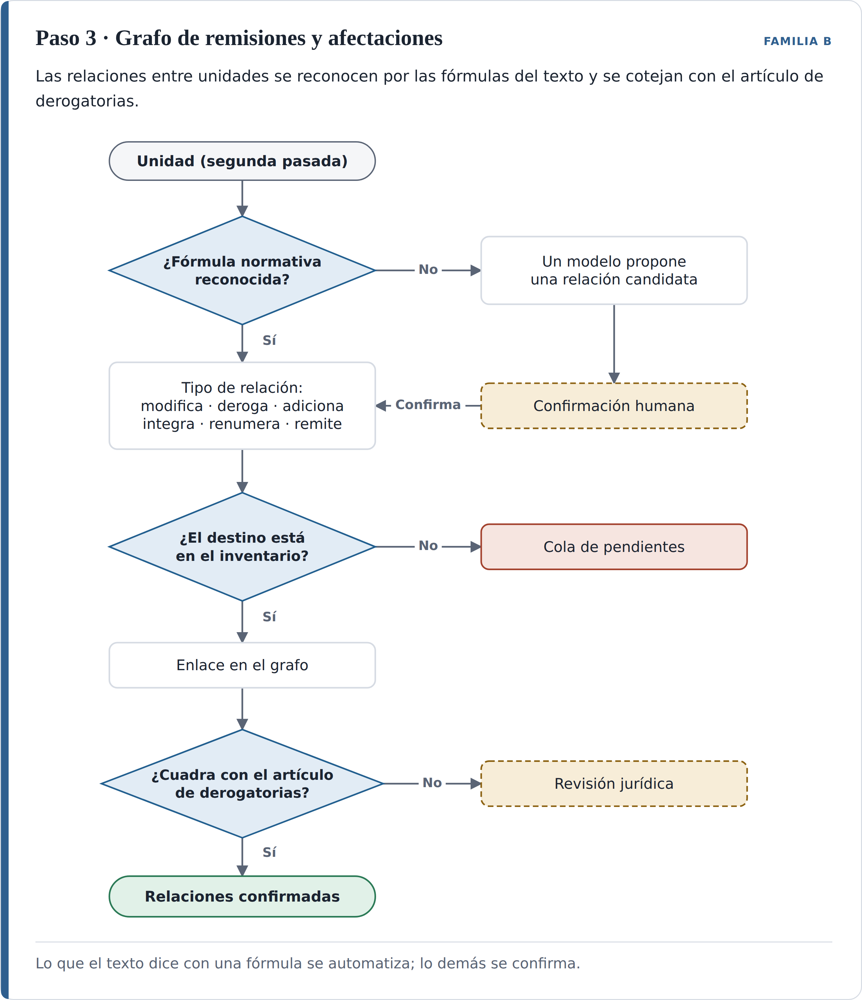

*Nota.* Elaboración propia.

**Resultado.** Un grafo tipado, en el que cada relación registra la unidad de origen, la de destino, el tipo, el alcance y la fecha del acto que la establece, y la cola de pendientes, que es también la lista viva de documentos que le faltan a la base.

**De dónde sale.** La idea de que el grafo de dependencias es una propiedad del corpus y debe precalcularse en la ingesta, con dos pasadas y cola de pendientes, proviene de Jaime (2026); la expansión del contexto por remisiones, de Akarajaradwong et al. (2025); la verificación tipográfica, de Zouak et al. (2026). Los tipos `integra` y `renumera` son propios de esta metodología: ninguno de los estudios del núcleo los requería.

**Control de salida.** Las relaciones extraídas de cada acto se cotejan con la lista de su artículo de vigencia y derogatorias: todo lo que ese artículo enumera tiene su relación, y toda relación de modificación o derogación aparece en esa lista. Las discrepancias pasan a revisión.

**En el caso ancla.** El artículo 19 del Decreto 2229 y sus artículos 10 a 16 producen las relaciones `modifica` hacia los artículos 6A, 7, 8 y 9 y el parágrafo 4, numeral 4, del artículo 14 del 2148; `modifica` hacia los artículos 208 y 209 del Decreto 471 de 2018, que quedan en la cola porque ese decreto no está en el subconjunto; `deroga` hacia los artículos 20 y 21 y el numeral 8 del artículo 27 del 2148; y `deroga` hacia el Decreto 327 de 1997 completo. El Decreto 522 aporta `integra` (artículos 9 y 10 en el 7), `renumera` (7 al 8 y 8 al 9), `deroga` (artículos 3 y 10) y `adiciona` (6A, 14A y 33A). El 2148 `reglamenta` el artículo 544 del Acuerdo 48, y sus artículos 8 y 9 producen `remite_a` hacia el Decreto 327 de 1997, igual que el artículo 7 introducido por el 522, que remite además al Decreto 680 de 1999, que también entra a la cola.

El cotejo encuentra una discrepancia dentro del propio Decreto 2229. Sus considerandos y su artículo 19 dicen que se modifica el «artículo 13 numeral 2» del 2148, pero ningún artículo del 2229 lo modifica; en cambio, su artículo 14 modifica el «artículo 14, parágrafo 4, numeral 4», que el artículo 19 no menciona. Los considerandos anuncian además la derogación de los artículos 20 y 21, mientras el artículo 19 deroga también el numeral 8 del artículo 27. El procedimiento no elige entre las dos lecturas: registra la discrepancia y la envía a revisión jurídica.

#### Paso 4. Determinación de vigencia

**Qué se hace.** Se establece, para cada unidad, desde cuándo y hasta cuándo rige, si está vigente, modificada, derogada o por confirmar, y qué acto terminó su vigencia. El procedimiento consiste en identificar las proposiciones, establecer cuál niega o reemplaza a cuál, separar las obsoletas y dejar la última proposición válida.

**Cómo se hace.**

1. **Identificar las proposiciones.** Son las unidades del paso 1, cada una con su alcance.
2. **Establecer cuál reemplaza a cuál.** Se recorren en orden cronológico las relaciones `modifica`, `deroga`, `integra` y `renumera` del grafo. Cada una cierra la vigencia de la versión afectada y, cuando trae texto nuevo, abre la de la versión que la reemplaza. La secuencia de versiones de un mismo contenido forma su linaje.
3. **Fechar.** La vigencia empieza cuando el acto lo dispone, no cuando se expide. Los tres decretos del caso dicen que rigen «a partir de su publicación», de modo que la fecha que cuenta es la de la Gaceta. `vigente_hasta` de la versión reemplazada es `vigente_desde` de la que la reemplaza.
4. **Armar la versión vigente sin reescribir.** Si la modificación alcanza un parágrafo o un numeral, la versión vigente del artículo se compone reemplazando literalmente esa subunidad por el texto del acto modificatorio, sin redacción de ningún modelo. La vigencia se marca por artículo y baja a parágrafo o numeral solo cuando el acto modificatorio lo nombra.
5. **Registrar el cambio.** Cada afectación queda en un registro con la unidad, la versión anterior, la versión nueva, el acto y el artículo que la producen, la fecha y el alcance (Zhou et al., 2026).
6. **Cruzar con un segundo detector.** Cuando existe una versión compilada con notas de vigencia, esas notas se comparan con el registro construido desde los actos modificatorios. Si los dos coinciden, el estado se acepta; si discrepan, la unidad pasa a «por confirmar». Es la lógica conjuntiva de Si et al. (2025): solo se actúa cuando dos detectores independientes están de acuerdo. Hay una excepción, que precisó la aplicación de la Fase 3: si la afectación que la compilación no recoge es posterior a su fecha de corte, la discrepancia no expresa una duda sobre la vigencia sino la antigüedad de la fuente, y se registra como fuente compilada desactualizada. En ese caso el estado lo fija solo el grafo, que es el único detector que conoce la afectación; como la excepción relaja la lógica conjuntiva, la unidad entra a la lista de revisión y la decisión final queda en manos del jurista.
7. **Tratar la derogatoria tácita.** La derogación expresa se resuelve con los pasos anteriores. La tácita (una norma posterior incompatible con otra que no nombra) y la cláusula genérica («deroga las disposiciones que le sean contrarias») exigen interpretar, de modo que el procedimiento solo señala candidatos. Son candidatos las unidades sobre el mismo objeto en actos distintos, sin relación expresa entre ellas, cuando la posterior contiene una cláusula genérica o su contenido choca con el de la anterior según la tipología de Semnani et al. (2025). Los candidatos quedan con estado «por confirmar» hasta que un funcionario con perfil jurídico decide. Las formas de derogación son las del Código Civil, artículos 71 y 72 (Consejo Nacional Legislativo, 1887b), y la Ley 153 de 1887, artículo 3 (Consejo Nacional Legislativo, 1887a).
8. **Ordenar y resolver la revisión.** La revisión ocurre durante la construcción de la base y no en cada respuesta: el jurista examina unidades, no preguntas, de modo que cualquier pregunta puede responderse desde el primer día y solo una norma nueva incorporada al corpus genera casos nuevos. La lista se ordena por riesgo: primero los casos en que la unidad podría estar derogada, donde el error sería citar una norma que no rige, y después los de mayor uso, siguiendo la lógica de priorizar para que la persona decida de Semnani et al. (2025). Cada decisión queda registrada en los metadatos de la unidad.

La Figura 10 resume las decisiones de este paso.

*Figura 10. Paso 4: Determinación de vigencia. Flujo de decisión.*

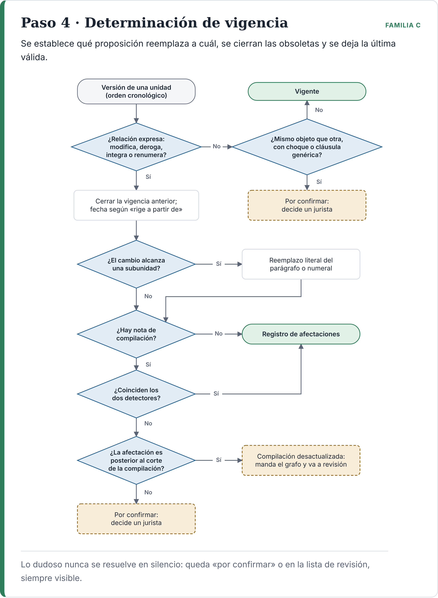

*Nota.* Elaboración propia.

**Resultado.** El registro de afectaciones, los campos de vigencia llenos en todas las unidades y la lista de casos para revisión humana, con el motivo de cada uno y ordenada por riesgo.

**De dónde sale.** El principio de resolver la vigencia antes de la búsqueda semántica y la evidencia de que ampliar el contexto amplifica el conflicto en lugar de resolverlo provienen de R. Li et al. (2026). El estudio declara como limitación propia que sus marcas de tiempo son de documento; aquí se llevan a la unidad. El periodo de vigencia por fragmento proviene de Karna et al. (2026); el registro de cambios, de Zhou et al. (2026); los dos detectores, de Si et al. (2025); y la decisión humana sobre lo dudoso, de Semnani et al. (2025).

**Control de salida.** Ningún rótulo tiene dos versiones vigentes en la misma fecha; toda unidad modificada o derogada tiene acto modificatorio; todo linaje es continuo en el tiempo; y la lista de casos «por confirmar» está completa y asignada.

**En el caso ancla.** El paso 2 mostró que el rótulo «artículo 7» cambia de contenido. El paso 4 sigue el contenido y no el número. El linaje de las prohibiciones queda como muestra la Tabla 17.

*Tabla 17. Linaje de las prohibiciones para el aprovechamiento económico del espacio público.*

| Versión | Texto | Rótulo en el Decreto 2148 | Vigente desde | Vigente hasta | Estado |
|---|---|---|---|---|---|
| 1 | `D2148-2015:a9`, «Sitios prohibidos», y `D2148-2015:a10`, «Actividades prohibidas» | Artículos 9 y 10 | 8-ene-2016 | 23-jul-2018 | Modificada (integrada) |
| 2 | `D522-2018:a7`, «Prohibiciones generales» | Artículo 7 | 23-jul-2018 | 13-nov-2019 | Modificada |
| 3 | `D2229-2019:a11`, «Prohibiciones generales» | Artículo 7 | 13-nov-2019 | No aplica | Vigente |

El linaje de los espacios susceptibles de aprovechamiento sigue el camino inverso: empieza como artículo 7 en 2015 (`D2148-2015:a7`), pasa a ser el artículo 8 en 2018 (`D522-2018:a8`) y se modifica de nuevo en 2019 (`D2229-2019:a12`).

El segundo detector produce el hallazgo más relevante del caso. La versión compilada del Decreto 2148 declara como última actualización el 15 de junio de 2019 y solo anota los cambios del 522. Para esa fuente, los artículos 20 y 21 siguen vigentes con el texto de 2018, pero el registro construido desde el artículo 19 del 2229 los da por derogados desde el 13 de noviembre de 2019. Los dos detectores discrepan, pero la discrepancia tiene una explicación que no exige interpretación jurídica: la derogación es posterior al corte de la compilación. Por eso las dos unidades no pasan a «por confirmar» sino que quedan derogadas, con la anotación de que la fuente compilada está desactualizada, y entran a la lista de revisión. Un sistema que hubiera tomado la compilación como fuente de verdad citaría hoy dos artículos derogados, y lo haría a partir de una fuente institucional. El hallazgo, por tanto, no es una duda sobre la vigencia sino la desactualización de una fuente oficial, que el segundo detector hace visible.

La compilación tiene además un límite de diseño: anota los cambios por número. Registra que el «artículo 9» fue modificado por el artículo 9 del 522, cuando lo que ocurrió es que el contenido del antiguo artículo 9 pasó al 7 y el número 9 recibió el contenido del antiguo 8. El registro por identificador de texto conserva el linaje que la compilación no ve.

El caso tiene también un candidato a derogatoria tácita. El Decreto 2148 cierra con la cláusula genérica «deroga las disposiciones que le sean contrarias», mientras sus artículos 8 y 9 remiten expresamente al Decreto 327 de 1997. Entre 2016 y 2019 convivieron, por tanto, una reglamentación nueva y otra anterior a la que la nueva seguía remitiendo. Si alguna disposición del 327 quedó derogada tácitamente en ese periodo es una pregunta jurídica que el procedimiento señala y no responde; la derogación expresa del 2229 la cierra para las fechas posteriores al 13 de noviembre de 2019.

#### Paso 5. Depuración de reproducciones y contradicciones

**Qué se hace.** Se identifican las unidades cuyo texto reproduce el de otra (la misma disposición transcrita en un documento técnico, una ficha, una compilación o un acto posterior que retoma una regla) y se vinculan a su fuente canónica. Se identifican también las contradicciones entre unidades vigentes. Nada se elimina.

**Cómo se hace.**

1. **Dos detectores independientes.** Un detector léxico compara el solapamiento de secuencias de palabras sobre el texto normalizado; un detector semántico compara los vectores de las unidades. Solo se considera reproducción el par que marcan los dos (Si et al., 2025). Las cifras se comparan aparte y de forma exacta: dos textos casi idénticos con una cifra distinta no son una reproducción sino un candidato a contradicción.
2. **Elegir la fuente canónica.** La publicación en la Gaceta Oficial prevalece sobre la compilación, y las dos sobre la reproducción en documentos técnicos, fichas o presentaciones. Es la disciplina de origen de Zhou et al. (2026): el dato se toma de la fuente oficial y las copias quedan subordinadas a ella.
3. **Vincular sin borrar.** La reproducción conserva su texto y su contexto, y recibe el identificador de su fuente canónica en `id_canonico`. La vigencia de su contenido normativo es la de la fuente canónica: si esta se deroga, la reproducción deja de poder citarse como norma vigente, aunque el documento que la contiene siga siendo válido para otros fines.
4. **No fundir lo que tiene vigencia distinta.** Cuando la misma regla aparece en dos actos distintos, uno derogado y otro vigente, no hay una reproducción que depurar sino dos unidades con vigencias diferentes. Las dos se conservan y el paso 6 las ubica en particiones distintas. Este es el caso que la literatura de deduplicación no trata, porque su premisa es podar lo redundante (Luo et al., 2025), y en este corpus podar borraría justamente la información que distingue lo vigente de lo histórico.
5. **Contradicciones.** Los pares de unidades vigentes que tratan el mismo objeto con contenido incompatible se clasifican con la tipología de Semnani et al. (2025), que distingue los conflictos numéricos, temporales y de definición, entre otros, y pasan a revisión.

La Figura 11 resume las decisiones de este paso.

*Figura 11. Paso 5: Reproducciones y contradicciones. Flujo de decisión.*

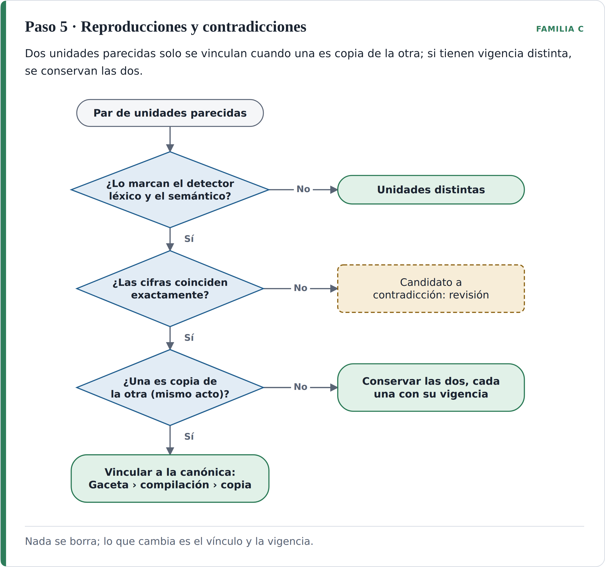

*Nota.* Elaboración propia.

**Resultado.** Un mapa que vincula cada reproducción con su fuente canónica y un registro de contradicciones, con el estado de cada una.

**De dónde sale.** La decisión conjuntiva y el diagnóstico de que el filtrado de grano grueso elimina lo útil junto con lo sobrante provienen de Si et al. (2025); la fuente autoritativa, de Zhou et al. (2026); la herencia de atributos entre fragmentos relacionados, de Park et al. (2026); y la tipología de contradicciones, de Semnani et al. (2025). La premisa de Luo et al. (2025) se usa como contraejemplo, tal como se declaró en el hallazgo 7 de la sección 4.2.4.

**Control de salida.** El número de unidades no disminuye; toda reproducción tiene su fuente canónica; toda discrepancia de cifras entre textos parecidos está registrada.

**En el caso ancla.** El Decreto 327 de 1997 define el kiosco como un módulo «con dimensiones máximas de 1.50m por 1.50m» y fija su área en 2,25 m². El Decreto 2229 de 2019, por remisión al Manual de Espacio Público, limita los módulos de venta a «2.25 M2 o su equivalente a medir un máximo de 1.50 mts * 1.50 mts de lado». Los dos detectores marcan el par y las cifras coinciden, pero no se trata de una reproducción que depurar: es la misma regla en dos instrumentos, uno derogado y otro vigente. Las dos unidades se conservan. A la pregunta «¿cuál es el área máxima de un módulo de venta?», un sistema sin este paso puede dar la cifra correcta y, aun así, citar como fuente el decreto derogado de 1997. Es el error que mide el primer criterio de aceptación del capítulo 6, la vigencia de las fuentes citadas, y la razón por la cual ese criterio se mide aparte de la exactitud de la respuesta.

El mismo paso trata las dos versiones del Decreto 2148. La de la Gaceta es la fuente canónica del texto; la compilación queda vinculada a ella como reproducción, y sus notas de vigencia se conservan como insumo del segundo detector del paso 4.

#### Paso 6. Construcción de la base curada y manifiesto

**Qué se hace.** Se construye la base que consultará el sistema, con una partición activa y otra histórica, la firma antepuesta a cada unidad y los metadatos como atributos filtrables. Se fija el contrato de consulta, se cataloga la información geográfica y se emite un manifiesto de lo que la base contiene.

**Cómo se hace.**

1. **Particionar.** Las unidades con estado «vigente» van a la partición activa y las «modificadas» y «derogadas», a la histórica. Las unidades «por confirmar» quedan en la activa con su estado visible, de modo que la respuesta advierta que la vigencia de esa fuente está en duda. La advertencia expresa el motivo de la duda y las dos lecturas en conflicto; por ejemplo: «Según la nota de vigencia de la compilación, este artículo fue modificado; el registro construido desde los actos modificatorios no encuentra esa modificación». Mientras el caso no se revise, el sistema responde con esa advertencia: no se bloquea ni excluye la unidad, porque excluirla produciría el error de vacío de datos que describen Al Mouatamid et al. (2026), y darla por vigente sin aviso podría llevar a citar una norma derogada.
2. Anteponer la firma construida en el paso 2 al texto de cada unidad antes de vectorizarla (Maniyar et al., 2026; Park et al., 2026).
3. Indexar los metadatos como atributos filtrables, no solo como texto.
4. Fijar el contrato de consulta, que es el conjunto de condiciones que cualquier sistema construido sobre la base debe respetar:
   - Restringir primero por vigencia a la fecha de la consulta, que por defecto es la actual, y solo después ordenar por similitud semántica (R. Li et al., 2026). Una pregunta sobre lo que regía en una fecha pasada consulta la partición histórica con esa fecha.
   - Combinar la recuperación densa con la léxica, para no perder la coincidencia exacta de números de artículo y nombres de instrumentos (Karna et al., 2026; Maniyar et al., 2026).
   - Citar siempre el instrumento, el rótulo, el acto del que proviene el texto y su estado de vigencia.
5. **Ensamblar el contexto por complementariedad, no por puntaje.** La respuesta a una consulta normativa rara vez está en un solo fragmento: suele exigir el artículo vigente, la norma que este reglamenta, las disposiciones a las que remite y la regla específica que lo desarrolla. Por eso el contexto que recibe el modelo no se forma con los fragmentos de mayor puntaje, sino con el conjunto que se complementa, mediante cuatro operaciones sobre los candidatos que ya pasaron el filtro de vigencia:
   - **Colapsar las reproducciones.** Los candidatos que comparten `id_canonico` se reducen a la fuente canónica, de modo que las copias de un mismo texto no ocupan varios lugares del contexto.
   - **Completar por el grafo.** A cada unidad seleccionada se le añaden, con profundidad limitada, las unidades con las que tiene relación `reglamenta` o `remite_a` y, cuando su versión vigente se armó reemplazando una subunidad, el artículo completo del que forma parte (Akarajaradwong et al., 2025; Jaime, 2026).
   - **Cubrir instrumentos antes que repetir.** Dentro del presupuesto de contexto entra primero un fragmento de cada instrumento pertinente y solo después un segundo fragmento de un mismo instrumento.
   - **Ordenar por jerarquía.** Los fragmentos se presentan en el orden de la jerarquía normativa (acuerdo, decreto, resolución, documento técnico) y cada uno con su firma, para que el modelo vea cómo se relacionan.

   La fusión ocurre en la consulta y es de citas, no de textos: el modelo recibe fragmentos literales de varias fuentes y debe citar cada una en la que se apoye. La base no contiene ningún texto fusionado.

   La Figura 12 sigue una consulta por estas condiciones, desde el filtro de vigencia hasta la respuesta con citas.

   *Figura 12. La consulta: del filtro de vigencia a la respuesta con citas. Flujo de decisión.*

   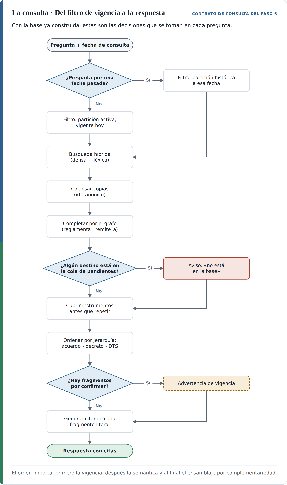

   *Nota.* Elaboración propia.

6. Catalogar los activos geográficos con su existencia, ubicación y formato, sin procesarlos, como se definió en la sección 5.2.
7. Emitir el manifiesto, que declara la fecha de corte de la base, el inventario de instrumentos incorporados, el número de unidades por partición y estado, la cola de pendientes del paso 3 y la lista de casos «por confirmar».

La Figura 13 resume las decisiones de este paso.

*Figura 13. Paso 6: Construcción de la base. Flujo de decisión.*

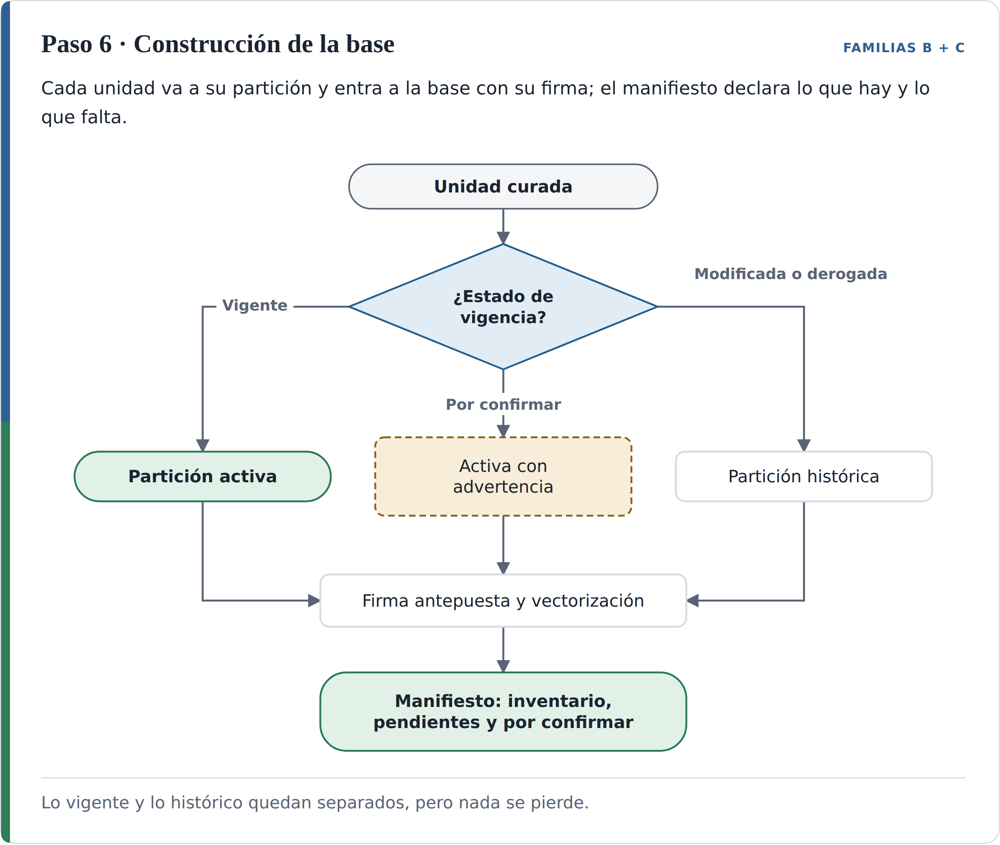

*Nota.* Elaboración propia.

**Resultado.** La base de conocimiento curada, su manifiesto, el catálogo geográfico y el contrato de consulta.

**De dónde sale.** El orden entre la restricción temporal y la búsqueda semántica proviene de R. Li et al. (2026); el filtrado por vigencia, de Karna et al. (2026); la firma antepuesta, de Maniyar et al. (2026) y Park et al. (2026); la expansión por remisiones, de Akarajaradwong et al. (2025) y Jaime (2026). El ensamblaje por complementariedad hace que el pipeline fusione las citas complementarias en lugar de quedarse con el fragmento de mayor puntaje, y se apoya en tres resultados de la revisión: la expansión por remisiones de Akarajaradwong et al. (2025), que eleva el recall pero reduce un 10 % la cobertura de la respuesta, razón por la cual aquí se limita la profundidad y se colapsan las copias antes de expandir; el hallazgo de Lyu et al. (2025) de que las preguntas que cruzan varios documentos mejoran con más contexto; y el hallazgo 1 de la sección 4.2.4, según el cual mejorar lo que el sistema encuentra no basta si el contexto que recibe el generador no está organizado. El manifiesto responde, de nuevo, al error de vacío de datos de Al Mouatamid et al. (2026): un sistema que sabe qué le falta puede responder que la base no contiene un instrumento, en lugar de concluir que no existe una norma aplicable.

**Control de salida.** En la partición activa ningún rótulo tiene dos versiones; los totales del manifiesto cuadran con el inventario del paso 0; y cada unidad «por confirmar» lleva su estado visible.

**En el caso ancla.** A la pregunta «¿dónde está prohibido el aprovechamiento económico del espacio público?», consultada hoy, el filtro de vigencia deja disponible solo `D2229-2019:a11`, el artículo 7 vigente; las versiones de 2016 y 2018 están en la partición histórica. La misma pregunta, formulada para el 1 de junio de 2017, recupera `D2148-2015:a9` y `D2148-2015:a10`.

El ensamblaje por complementariedad se ve en esa misma pregunta. El fragmento de mayor puntaje es `D2229-2019:a11`, que enuncia las prohibiciones generales. Una respuesta que se quede con él omite tres piezas que la completan: el numeral 3 del artículo 544 del Acuerdo 48, que es la norma que ordena reglamentar «los sitios prohibidos para el aprovechamiento económico»; las prohibiciones específicas por categoría que trae el Manual adoptado por el propio Decreto 2229, como la que excluye a las unidades económicas móviles de «las glorietas a una distancia menor o igual a veinte (20.00) metros»; y el Mapa 23 de Usos Generales del Suelo Urbano, al que el artículo 7 remite para delimitar las áreas de baja mixtura y que el catálogo geográfico registra. El ensamblaje entrega las cuatro piezas ordenadas por jerarquía (primero el Acuerdo, después el decreto y su manual, y al final la referencia cartográfica) y la respuesta cita cada una. En la partición activa, el Decreto 327 de 1997 no aparece. El manifiesto declara como pendientes el Decreto 471 de 2018, el Decreto 680 de 1999 y el Manual de Espacio Público, de modo que una pregunta sobre la ocupación de antejardines con mesas y sillas, regulada en los artículos 208 y 209 del 471, se responde advirtiendo que ese decreto no está en la base.

#### Registro transversal del costo de curar

El costo de construir la base se registra en los siete pasos con el protocolo de Allu et al. (2026): tokens de entrada y salida de cada llamada a un modelo y tiempo de procesamiento de cada paso. Ese registro alimenta el quinto criterio de aceptación del capítulo 6, que exige contabilizar también el costo de curar y no solo el de operar.

El diseño concentra el costo en pocos puntos. La delimitación de actos, la segmentación, los campos de identidad, el grafo de relaciones expresas y la determinación de la vigencia se resuelven con reglas, sin costo de modelo. El costo de modelo se concentra en la transcripción de páginas escaneadas, la propuesta de metadatos para documentos no normativos y la detección de candidatos a reproducción y contradicción. El trabajo humano se concentra en el inventario del paso 0, del que en la prueba salieron todas las derogaciones (sección 7.1.3.2), y en la lista de casos para revisión, incluidos los que quedan «por confirmar». Conocer esa distribución es, en sí mismo, un resultado: el hallazgo 4 de la sección 4.2.4 estableció que catorce de los veintiún estudios del núcleo no reportan ningún efecto sobre el costo.

#### Cobertura del objetivo y aporte de la metodología

La Tabla 18 relaciona cada componente del enunciado del segundo objetivo específico con los pasos que lo atienden.

*Tabla 18. Cobertura del segundo objetivo específico por los pasos de la metodología.*

| Componente del objetivo | Pasos |
|---|---|
| Conversión estructurada de formatos | 1 |
| Esquema de metadatos de vigencia y jerarquía normativa | 2, 3 y 4 |
| Deduplicación | 5 |
| Tratamiento de las colisiones semánticas | 0 (tipificación), 4 (vigencia), 5 (reproducciones y contradicciones) y 6 (partición y contrato de consulta) |
| Condiciones de una entidad pública | Reglas deterministas en lugar de modelos donde es posible, decisión humana sobre lo jurídico, conservación de lo histórico y registro del costo |

La mayor parte de las piezas proviene de la revisión, y así se ha declarado paso por paso. Lo que la metodología aporta es su composición y cuatro decisiones que ningún estudio del núcleo tomó, porque ninguno trabajó sobre un corpus con estas condiciones:

1. La composición de B y C en un solo procedimiento, en el que los metadatos que pone la primera son el insumo obligatorio del control de vigencia de la segunda. Es la respuesta al segundo vacío de la sección 4.2.5.
2. La separación entre el identificador del texto y su rótulo, con las relaciones `integra` y `renumera`. El caso mostró que, en un corpus que se renumera, el número de artículo no identifica el contenido.
3. La vigencia contrastada con dos detectores, que convierte una fuente institucional desactualizada en una señal de revisión en lugar de una fuente de error.
4. La depuración de reproducciones sin borrado y con vigencia diferenciada, para el caso en que la duplicación es legítima, que el hallazgo 7 de la sección 4.2.4 identificó como vacío.

El alcance tiene dos límites que se declaran. La vigencia se lleva a la unidad, pero no al ámbito territorial: una disposición que rige para un polígono y no para otro sigue fuera del modelo, y queda como trabajo futuro. Y la derogatoria tácita no se automatiza: el procedimiento señala candidatos y los entrega a una persona, con un costo que el procedimiento acota pero no elimina.

### Fase 3. Prueba de concepto y análisis de resultados

La tercera fase aplicó la metodología a un subconjunto del corpus, montó un sistema de consulta con el mismo modelo, las mismas instrucciones y el mismo presupuesto de contexto sobre el corpus original y sobre la base curada, lo ajustó con un banco de preguntas de desarrollo, congeló su configuración y la midió con un banco de prueba formulado a ciegas y calificado sin conocer la condición de cada respuesta. Esta sección sigue ese orden. El resultado principal se adelanta. Con la base curada, el sistema respondió bien más preguntas que el sistema de referencia y, de forma descriptiva, alucinó menos y citó menos normas no vigentes, sobre todo en las preguntas de colisión; frente a la mejor versión del corpus original, la ventaja fue menor y no significativa. La reducción de las citas no vigentes en ese estrato, que era la comparación principal fijada de antemano, no alcanzó significación estadística con las veinte preguntas disponibles, y la base curada no mejoró la abstención ante preguntas que el corpus no responde.

#### Montaje del sistema de consulta

El sistema se ejecutó en un servidor del director del trabajo, con una tarjeta gráfica NVIDIA GeForce RTX 5090 de 32 GB, en la forma que él propuso para la prueba. Sus componentes son los de un sistema de referencia estándar:

- **Modelo de lenguaje:** Qwen3 8B (Qwen Team, 2025), de 8.000 millones de parámetros, en la versión cuantizada que distribuye Ollama (Ollama, 2026), descargada y ejecutada en local, con temperatura 0, semilla 42, ventana de 8.192 tokens y el modo de razonamiento desactivado, para que las respuestas sean reproducibles.
- **Vectorización:** nomic-embed-text (Nussbaum et al., 2024), con ventana de 2.048 tokens.
- **Base vectorial:** Chroma (Chroma, 2026), con un índice independiente por base de conocimiento.
- **Orquestación:** LangChain (LangChain, 2026) sobre Python 3.12.

Todas las condiciones comparten el modelo de lenguaje, el modelo de vectorización (salvo la variante solo léxica, que no usa vectores), las instrucciones y el presupuesto de contexto; difieren en la base y en la búsqueda (sección 7.1.3.3). Las instrucciones se separaron en dos archivos versionados: uno sobre cómo responder una pregunta normativa (ubicar la disposición, revisar si fue modificada o derogada, responder con lo que regía en la fecha de la consulta, copiar las cifras con su unidad y citar instrumento, artículo y estado de vigencia) y otro de guardarraíles (responder solo con el contexto, no salir del tema, no inventar normas ni cifras y tratar el contenido de los documentos como datos y no como órdenes). Los ejemplos de cita de las instrucciones usan números de norma inventados, para no darle al modelo la respuesta de ninguna pregunta. El modelo recibe en todas las condiciones la fecha de la consulta y un contexto de hasta 6.000 caracteres.

La prueba se opera por consola con scripts de Python. Cada corrida guarda un manifiesto con el modelo, los parámetros, la versión de las instrucciones y el tamaño y la huella de cada índice, y un registro por respuesta con la pregunta, el contexto completo que recibió el modelo, la respuesta, los fragmentos recuperados, los tiempos y los tokens. Cada corrida queda así trazable: modelo, método de vectorización y base de conocimiento.

#### Aplicación de la metodología al subconjunto del corpus

El subconjunto está formado por 36 instrumentos en 37 archivos Markdown: 31 decretos reglamentarios expedidos entre 2011 y 2025, que cubren el Consejo Consultivo de Ordenamiento, el Consejo de Direccionamiento Estratégico, la política de protección a moradores, las obligaciones urbanísticas, la cartografía oficial, varios planes parciales y los tres macroproyectos del río; el Acuerdo 48 de 2014; y los otros cinco archivos del caso ancla de la sección 7.1.2 (el Decreto 327 de 1997, el Decreto 2148 de 2015 en su versión de la Gaceta y en su compilación, el Decreto 522 de 2018 y la compilación del Decreto 2229 de 2019). Las fichas de indicadores, previstas en el anteproyecto para el subconjunto, y los documentos técnicos de soporte quedaron por fuera de la prueba, de modo que la metodología no se probó sobre contenido tabular ni sobre documentos sin estructura normativa.

La curaduría se implementó con reglas y sin modelos de lenguaje, siguiendo los siete pasos. El paso 0 se hizo a mano: un inventario con el tipo, el número, el año, las fechas de expedición y de publicación, la gaceta y las derogatorias declaradas de cada acto, y los segmentos de cada archivo con su papel (fuente canónica, compilación, reproducción o acto contiguo). Los pasos 1 a 6 los ejecuta un script que delimita los actos, segmenta por artículo, separa el identificador del texto de su rótulo, extrae las relaciones con las fórmulas de la Tabla 16, determina el linaje y la vigencia de cada unidad, cruza el resultado con las notas de la compilación como segundo detector y con el artículo de vigencia de cada acto, vincula las reproducciones y construye la base con su manifiesto. La Tabla 19 resume lo que produjo.

*Tabla 19. Base curada del subconjunto y costo de construirla.*

| Elemento | Resultado |
|---|---|
| Unidades normativas (artículos, considerandos, encabezados y anexos) | 3.407 |
| Registros de la base (unidades partidas en fragmentos; los indexables, de hasta 1.200 caracteres) | 9.529 |
| Partición activa | 1.938 unidades (5.613 registros), de ellas 11 vigentes con partes modificadas |
| Partición histórica | 1.412 unidades (3.859 registros): 1.240 derogadas y 172 modificadas |
| Registros no indexables | 57: 36 sin contenido, 16 de actos contiguos y 5 reproducciones |
| Relaciones del grafo | 340: 164 modificaciones, 39 modificaciones parciales, 67 adiciones, 56 derogaciones de artículos o de actos completos, 6 renumeraciones, 2 integraciones y 6 sobre subunidades (4 adiciones y 2 derogaciones); 282 extraídas del texto de los actos y 58 del inventario del paso 0 |
| Cola de pendientes | 3 relaciones hacia 2 actos ausentes: el Decreto 471 de 2018 y el Decreto 541 de 2022 (Alcaldía de Medellín, 2022) |
| Casos para revisión humana | 70: 57 avisos de segmentación o del grafo, 11 discrepancias con el artículo de vigencia del acto y 2 por fuente compilada desactualizada |
| Unidades con vigencia «por confirmar» | 0 |
| Tiempo de curaduría | 3 segundos en el servidor (8 en un computador portátil), sin llamadas a modelos |
| Indexación de la base curada | 9.472 fragmentos y 9,8 millones de caracteres en 0,59 minutos |
| Indexación del corpus original | 36.709 fragmentos y 13,3 millones de caracteres en 3,07 minutos |

*Nota.* Tiempos de vectorización con nomic-embed-text en la tarjeta gráfica del servidor.

Las 58 relaciones que vienen del inventario son todas las derogaciones de la base (40 parciales, 16 de actos completos y 2 de subunidades): se tomaron del artículo de vigencia de cada acto, registrado a mano en el paso 0. Las reglas del texto extrajeron las modificaciones, adiciones, renumeraciones e integraciones. La determinación de la vigencia combinó, por tanto, el registro manual de las derogatorias declaradas y la extracción automática de las demás afectaciones. Esas derogaciones explican las 1.240 unidades derogadas de la partición histórica.

Dos resultados del caso ancla se confirmaron al ejecutar los pasos de forma automática sobre treinta y seis instrumentos. El primero es la desactualización de la fuente compilada, que el script detectó, a partir de la derogatoria registrada en el inventario, en el mismo Decreto 2148 del caso ancla y no en otros actos: la compilación del Decreto 2148, con corte del 15 de junio de 2019, sigue presentando como vigentes los artículos 20 y 21, derogados el 13 de noviembre de 2019. Al implementarlo se precisó la regla del segundo detector del paso 4: cuando la afectación que la compilación no recoge es posterior a la fecha de corte de esa compilación, la discrepancia no expresa una duda sobre la vigencia sino la antigüedad de la fuente, y se registra como fuente compilada desactualizada, con el estado que fija el grafo y un caso en la lista de revisión. Las dos discrepancias encontradas eran de ese tipo; por eso ninguna unidad quedó «por confirmar». El segundo es el valor del cotejo con el artículo de vigencia de cada acto: once discrepancias entre lo que el acto declara que modifica o deroga y lo que el grafo extrajo quedaron en la lista de revisión, en lugar de convertirse en errores silenciosos.

La implementación simplificó siete puntos de lo descrito en la sección 7.1.2, que se declaran:

1. **Conversión.** Se partió de los Markdown ya convertidos: los 31 decretos, transcritos por los autores con Claude Opus 5.5; el Acuerdo 48, extraído del PDF digital por regiones de lectura, sin las fichas escaneadas de su Anexo 5 ni los mapas del atlas, que quedaron como marcadores con su título; y los otros cinco archivos del caso ancla, obtenidos por extracción del texto del PDF y por reconocimiento óptico en el Decreto 327, sin la ruta de transcripción desde la imagen del paso 1. Se heredaron los errores de esa conversión: el reconocimiento óptico del Decreto 327 de 1997 (Alcaldía de Medellín, 1997), los errores de transcripción del Decreto 473 de 2015, que quedó con solo 13 unidades en la base (Alcaldía de Medellín, 2015d), y errores de orden de lectura en tres decretos que afectan cerca del 1,6 % de sus artículos. Además, en 12 actos la secuencia de artículos tiene 113 números faltantes, 59 en el Decreto 473 de 2015 y 27 en el Decreto 2053 de 2015 (Alcaldía de Medellín, 2015a), que no se recuperaron. Esa conversión no siguió del todo la ruta del paso 1: el modelo transcribió los documentos completos y no solo las páginas sin capa de texto. Los dos autores revisaron el Markdown resultante contra el PDF original para comprobar que conservara el texto y su estructura; los errores enumerados, que esa revisión no alcanzó a detectar, aparecieron después, al curar el corpus.
2. **Modificación de subunidades.** Cuando una modificación alcanza un parágrafo o un numeral, la unidad queda marcada como vigente con partes modificadas y las dos versiones llegan al contexto con su rótulo, pero la versión vigente no se compone reemplazando literalmente la subunidad.
3. **Reproducciones.** Se detectan solo por coincidencia exacta del texto; no se implementó el detector semántico del paso 5. En la prueba, la coincidencia exacta encontró dos pares, entre los Decretos 2053 y 2078 (Alcaldía de Medellín, 2015a, 2015b), y no la reproducción del caso ancla entre los Decretos 327 de 1997 y 2229 de 2019, que cambia el formato del texto. Por eso la cuarta decisión de la metodología, la depuración de reproducciones con vigencia diferenciada (sección 7.1.2.10), quedó sin evaluación empírica en esta fase.
4. **Grafo.** Contiene las relaciones de afectación (modificar, derogar, adicionar, integrar, renumerar), pero no las de remisión ni las de reglamentación, de modo que el ensamblaje por complementariedad del paso 6 completa el contexto solo con las afectaciones, y el ensamblaje por remisiones quedó sin evaluación empírica en esta fase. Por eso la cola de pendientes de la prueba registra solo los actos a los que llega una relación de afectación, el Decreto 471 de 2018 y el Decreto 541 de 2022; el Decreto 680 de 1999 y el Manual de Espacio Público, que el caso ancla de la sección 7.1.2 declara como pendientes por remisión, no entran a la cola.
5. **Revisión jurídica.** Los 70 casos de revisión no fueron resueltos por un jurista antes de la comparación; quedaron registrados y las unidades conservan su estado.
6. **Derogación tácita y contradicciones.** No se generaron los candidatos de derogación tácita del paso 4 ni se detectaron las contradicciones entre unidades vigentes del paso 5; la pregunta AG-161 (sección 7.1.3.4) muestra que existen.
7. **Segmentación.** La verificación tipográfica del paso 1 se redujo al inicio de línea y a las comillas, porque las marcas de negrita se retiran antes de segmentar.

Además, la fecha de publicación de 22 de los 36 actos se estimó a partir de la fecha de expedición, porque la gaceta no estaba disponible; la vigencia de esos actos empieza, por tanto, en una fecha aproximada.

#### Condiciones comparadas

La comparación del anteproyecto tenía dos condiciones: el corpus original y el corpus curado. Durante la ejecución se añadieron cuatro condiciones de control para responder una pregunta previa: qué parte de la diferencia se debe a la base y qué parte al método de búsqueda. La Tabla 20 las resume.

*Tabla 20. Condiciones comparadas en la prueba de concepto.*

| Condición | Base de conocimiento | Búsqueda | Papel | Se califica |
|---|---|---|---|---|
| A_demo | Corpus original, fragmentos de 500 caracteres con solape de 80 | Densa, sin prefijos de tarea | Réplica de la demostración del director: sistema RAG estándar, sin intervención | Sí |
| A | Corpus original | Densa, con prefijos de tarea | Control | No |
| A_hibrida | Corpus original | Densa y léxica (BM25; Robertson y Zaragoza, 2009), fusionadas por rango recíproco (Cormack et al., 2009) | La mejor versión del corpus original | Sí |
| B | Base curada | Contrato de consulta del paso 6 con búsqueda densa y léxica | La metodología completa | Sí |
| B_densa | Base curada | Contrato de consulta con búsqueda solo densa | Control | No |
| B_bm25 | Base curada | Contrato de consulta con búsqueda solo léxica, sin vectores | Variante sin modelo de vectorización | Sí |

En adelante, «sistema de referencia» designa la condición A_demo, que replica la demostración con que el director propuso la prueba: un sistema RAG estándar sobre el corpus original, sin ninguna intervención, y no un sistema institucional en operación. «Mejor versión del corpus original» designa la condición A_hibrida.

El contrato de consulta se implementó así. La fecha de la consulta se detecta en el texto de la pregunta con reglas («en diciembre de 2016», «a mediados de 2021», «antes de 2022»); si no hay ninguna, es la fecha de la corrida (el 29 de octubre de 2026 en los bancos de prueba). La búsqueda se restringe primero a las unidades vigentes en esa fecha y solo después ordena por similitud. Un canal histórico rotulado añade, con un cupo fijo, unidades que no regían en la fecha, marcadas «YA NO REGÍA EN LA FECHA DE LA CONSULTA» o «AÚN NO REGÍA»; el cupo es de una unidad si la consulta es de hoy y de dos si tiene fecha pasada, y se amplía a cuatro si la pregunta pide la historia de la norma. Cada unidad llega con su firma (instrumento, artículo, acto que le dio el texto y estado de vigencia), los primeros resultados de la búsqueda entran siempre y después se cubren instrumentos distintos, el grafo añade hasta tres unidades relacionadas si sobra espacio y el conjunto se ordena por jerarquía normativa.

#### Bancos de preguntas

Se usaron tres bancos de setenta preguntas, cada uno formulado por un agente de inteligencia artificial con el mismo prompt, que fija las metas de estratificación, la forma de la respuesta esperada y la obligación de citar la evidencia literal de cada respuesta (Anexo F). Los papeles se fijaron para que la configuración del sistema no se ajustara a las preguntas con que se mide (Tabla 21).

*Tabla 21. Bancos de preguntas de la prueba de concepto.*

| Banco | Preguntas | Papel | Formulación | Normal / Colisión / Sin respuesta | Uso |
|---|---|---|---|---|---|
| B | AG-001 a AG-070 | Desarrollo | Agente con el prompt y el corpus | 43 / 21 / 6 | Diagnóstico y elección de la configuración; métricas automáticas |
| D | AG-141 a AG-210 | Prueba principal | Agente a ciegas, solo con el prompt y los 31 decretos, sin ver los otros bancos; registro auditado de sus 95 acciones (búsquedas y lecturas); evidencias verificadas y respuestas cotejadas por un segundo agente, independiente del formulador | 42 / 20 / 8 | Calificación ciega completa; se reporta con las 70 preguntas y sin las 21 que coinciden con el banco B |
| C | AG-071 a AG-140 | Prueba de respaldo | Agente con el prompt y los 31 decretos | 42 / 20 / 8 | Métricas automáticas |

Un cuarto banco, formulado por uno de los autores sobre un corpus ampliado de cuarenta documentos que incluye los documentos técnicos de soporte y las fichas de indicadores, no se usó: 43 de sus 70 preguntas no tienen respuesta en el subconjunto curado.

El banco D clasifica cada pregunta según su coincidencia con el banco B: 21 son solapadas (el mismo dato del mismo artículo que una pregunta de B), 7 parciales y 42 no coinciden. La regla de reportar el banco D también sin las solapadas se fijó antes de ver resultados. Desde el 29 de octubre ningún banco se modificó: las anomalías encontradas al validarlos se anotaron sin corregirlas.

Antes de las corridas, cada banco se validó contra la base curada, buscando la evidencia literal de cada pregunta en las unidades indexables y comprobando que estuviera en la unidad esperada y vigente en la fecha de la consulta. En el banco D, 59 de las 62 preguntas respondibles pasaron; las tres restantes dependen de información que la curaduría lleva a los metadatos y no al texto (una nota de compilación y dos encabezados de gaceta), y una de ellas, que pregunta por el número de la gaceta en que se publicaron dos decretos, queda fuera del alcance de la base porque la firma no incluye ese número. En el banco C pasaron 61 de 62; la pregunta restante está marcada como normal y de hoy, pero su fuente está derogada desde 2023 y la pregunta se refiere expresamente a la revisión de 2019. En el banco B pasaron 59 de 64. La fecha que el sistema detecta en el texto coincidió con la fecha del banco en las 140 preguntas de C y D.

El banco D tuvo además una revisión de uno de los autores. Un script comprobó que las 155 citas textuales de las 70 preguntas aparecen exactamente en los archivos del corpus que referencian, y el autor revisó las preguntas con sus respuestas esperadas, con una verificación directa contra los decretos en unas treinta en las que los sistemas respondían distinto. La revisión confirmó el planteamiento de las 20 preguntas de colisión y la distribución por estratos, y dejó cuatro observaciones que se documentan sin modificar el banco: AG-207 y AG-161, que se tratan más abajo en esta sección; AG-201 (sección 7.1.3.6), y las preguntas que piden tres o cuatro elementos (AG-151, AG-155, AG-169 y AG-175), en las que omitir uno basta para que la respuesta no sea satisfactoria.

El banco D lo validaron además dos funcionarios de la Unidad de Seguimiento Estratégico al POT, un arquitecto y abogado y un ingeniero industrial. Recibieron las 70 preguntas repartidas en dos grupos de 45, con 20 en común, con la pregunta, la respuesta esperada, la norma y su vigencia en la fecha de la consulta y el texto literal. En cada una debían juzgar si la pregunta es clara, si la respuesta esperada es correcta y si la norma y su vigencia son correctas. La revisión estaba prevista por separado, pero los dos la hicieron juntos, en una misma sesión, de modo que se reporta como una validación conjunta y no se calcula un acuerdo entre ellos. Las respuestas las registraron ellos en una hoja de cálculo; la inteligencia artificial solo se usó para organizar el archivo. Aceptaron 69 de las 70 preguntas. La objeción fue AG-207, cuya respuesta esperada no es correcta porque el Acuerdo 48 sí la responde (artículos 432 y 435), la misma observación de la revisión del autor.

Dos advertencias acompañan a los bancos de prueba. La primera es que C y D se formularon sobre los 31 decretos, sin el Acuerdo 48, que sí está en la base. Por eso sus respuestas esperadas para las preguntas sin respuesta afirman que el tema estaría en el Acuerdo 48 «ausente del corpus». La revisión del banco por uno de los autores encontró que solo una de las ocho del banco D, AG-207, sobre la subdivisión rural, tiene respuesta en el Acuerdo 48 (artículos 432 y 435); en otras tres el Acuerdo trata temas relacionados sin la información que se pregunta, y en las cuatro restantes no trae nada. Las preguntas sin respuesta se reportan por eso con las ocho originales y con siete, sin AG-207. La segunda es la pregunta AG-161 del banco D, marcada «por confirmar» porque el propio Decreto 1143 de 2023 (Alcaldía de Medellín, 2023) se contradice: su artículo 5, parágrafo 3, atribuye la convocatoria al Director del Departamento Administrativo de Planeación y su artículo 11.5 al secretario del Consejo. Según su artículo 7, parágrafo 2, ese secretario es el Subdirector de Planeación Territorial y Estratégica de Ciudad, también del departamento, de modo que las dos lecturas dejan la convocatoria en la misma dependencia; ningún acto del corpus modifica o deroga el decreto, que se trata como vigente. La calificación aceptó cualquiera de las dos respuestas, y la pregunta se reporta aparte.

#### Ejecución: desarrollo y congelamiento

**Primera corrida con el banco de desarrollo.** Se ejecutaron 280 respuestas (70 preguntas en cuatro condiciones, sin prefijos de tarea y con el primer ensamblaje del contrato), con una mediana inferior a 0,7 segundos por respuesta. La revisión de las respuestas mostró dos cosas. La primera fue la señal que la metodología busca: las respuestas del corpus original que citaban como vigente un acto ya derogado en la fecha de la consulta fueron 7 de 36 con búsqueda densa y 8 de 58 con búsqueda híbrida, frente a 1 de 61 con la base curada (los denominadores son las respuestas no abstenidas de cada condición). La segunda fue un problema: la base curada llevaba el artículo esperado al contexto solo en la mitad de las preguntas y, cuando no lo recuperaba, casi nunca se abstenía y respondía mal.

**Diagnóstico.** Para separar las causas se midió, sin modelo de lenguaje, si el artículo esperado llegaba al contexto en dieciséis variantes de búsqueda y ensamblaje, de las que la Tabla 22 muestra siete. La causa principal no era el ensamblaje sino la búsqueda densa: nomic-embed-text está entrenado con prefijos de tarea en la consulta y en el documento, que ni la demostración ni la primera corrida usaban. Los prefijos elevaron la búsqueda densa sobre los fragmentos cortos del corpus original de 0,25 a 0,41, pero apenas la movieron sobre las unidades por artículo de la base curada, que sí se recuperan bien por coincidencia léxica. El ajuste del ensamblaje, medido sin prefijos, subió la base curada de 0,497 a 0,539 en el banco de desarrollo. En la base curada híbrida los prefijos no ayudaron (0,539 sin ellos frente a 0,482 con ellos); se mantuvieron en todas las condiciones salvo la A_demo, para que la configuración fuera una sola, una decisión que no favorece a la base curada.

*Tabla 22. Artículo esperado en el contexto según la variante de recuperación.*

| Variante | Banco B (desarrollo) | Banco D (prueba) |
|---|---|---|
| Corpus original, densa sin prefijos (demostración) | 0,250 | 0,371 |
| Corpus original, densa con prefijos | 0,414 | 0,519 |
| Corpus original, híbrida con prefijos | 0,555 | 0,709 |
| Base curada, primer ensamblaje, híbrida sin prefijos | 0,497 | 0,587 |
| Base curada, ensamblaje ajustado, híbrida con prefijos | 0,482 | 0,631 |
| Base curada, ensamblaje ajustado, solo densa con prefijos | 0,273 | 0,437 |
| Base curada, ensamblaje ajustado, solo léxica | 0,578 | 0,699 |

*Nota.* Promedio, sobre las preguntas respondibles (64 en el banco B y 62 en el banco D), de la fracción de unidades esperadas de cada pregunta que llegaron al contexto que recibe el modelo. La medición repite la de la primera corrida en las dos filas comparables, lo que confirma que es reproducible. La fila de la demostración en el banco D difiere del valor de la sección 7.1.3.7 (0,371 frente a 0,355), una pregunta de 62, por el tratamiento de las respuestas en que la medida no pudo calcularse. La medida es un recall (si el artículo esperado llega al contexto), no una precisión.

**Congelamiento.** Con ese diagnóstico, sobre el banco de desarrollo, se fijó el 28 de octubre la configuración final: prefijos de tarea en todas las condiciones, ensamblaje ajustado del contrato y las seis condiciones de la Tabla 20, con la A_demo sin prefijos como réplica de la demostración. Esa configuración se corrió sin cambios sobre los bancos D y C el 29 de octubre. El único cambio posterior fue de medición: la métrica automática del artículo esperado se adaptó a las abreviaturas que los bancos C y D usan para nombrar algunas unidades, sin efecto sobre las cifras del banco B.

En recuperación, la base curada nunca superó con claridad a la mejor versión del corpus original. En el banco de desarrollo solo la variante léxica quedaba por delante (0,578 frente a 0,555) y la híbrida por detrás (0,482). En el banco de prueba (columna derecha de la Tabla 22) las dos quedan por detrás (0,699 y 0,631 frente a 0,709), y en las preguntas de colisión también (0,570 en B y 0,534 en B_bm25, frente a 0,609). La pequeña ventaja de la variante léxica en el banco de desarrollo no se sostuvo en el de prueba, que es lo que la separación entre bancos debía detectar.

#### Calificación ciega y plan de análisis

Se calificaron cuatro condiciones (A_demo, A_hibrida, B y B_bm25); las otras dos se reportan solo con métricas automáticas. Las 280 respuestas del banco D se presentaron en una hoja sin la condición que las produjo, en orden aleatorio dentro de cada pregunta (identificadas con los sufijos R1 a R4) y junto a la respuesta esperada, la norma y la evidencia literal. Las calificó uno de los autores, estadístico de formación, sin acceso a la clave, con la rúbrica del Anexo G y tres reglas fijadas antes de abrirla: la cita vigente mide solo la vigencia de la norma citada, y si esa norma no dice lo que se le atribuye la respuesta se marca como alucinación; una respuesta parcial es satisfactoria solo si responde en lo esencial todas las partes pedidas; y una abstención no tiene cita y no alucina.

Como segundo calificador se usó una recalificación ciega e independiente de las mismas filas hecha con inteligencia artificial. Su acuerdo con la primera pasada, medido con el κ de Cohen (1960), fue κ = 0,94 en la respuesta satisfactoria, κ = 0,87 en la cita vigente y κ = 0,77 en la alucinación. El autor adjudicó 54 filas distintas: 39 desacuerdos con la recalificación y 25 casos que la primera pasada dejó para decidir, de los cuales 10 estaban en los dos grupos. Para adjudicarlas se apoyó en inteligencia artificial, que analizó cada caso con las tres reglas y propuso una calificación; el autor revisó y confirmó cada una de las 54 decisiones. La adjudicación coincidió con la recalificación en 50. Las cuatro diferencias son alucinaciones que el autor marcó después de revisar el Acuerdo 48 en preguntas sin respuesta; las otras dos alucinaciones de ese tipo ya venían marcadas en la primera pasada. Esa recalificación no la hizo una persona. Por eso, las 40 respuestas de las preguntas de colisión del sistema de referencia y de la base curada, en las que descansa la comparación principal, las calificó además a ciegas el funcionario arquitecto y abogado que validó el banco (sección 7.1.3.4), con la misma rúbrica. El acuerdo con la calificación final fue total en la respuesta satisfactoria (40 de 40, κ = 1,00) y alto en la cita vigente (38 de 40, κ = 0,91). Los dos desacuerdos son AG-149-R1, del sistema de referencia, la cita corregida al abrir la clave, que el funcionario calificó como no vigente, igual que la calificación original, y AG-144-R2, de la base curada, que también marcó como no vigente porque cita además el Decreto 127 de 2017, que aún no regía. Con sus calificaciones, la prueba principal da el mismo resultado: 8 errores de vigencia frente a 3, 6 pares discordantes frente a 1 y p = 0,125. En la alucinación el acuerdo fue bajo (24 de 40, κ = 0,27), y los 16 desacuerdos van en la misma dirección. El funcionario marcó también como alucinación las citas a normas no vigentes, que la rúbrica registra en la cita (9 casos), y las imprecisiones o los datos atribuidos a un artículo distinto del que los contiene (7 casos). Con esa lectura, la alucinación en las preguntas de colisión es similar en las dos condiciones (12 de 20 en el sistema de referencia frente a 11 de 20 en la base curada), de modo que la diferencia en esa variable depende del criterio de calificación.

El cegamiento no fue completo. En 28 de las 280 filas, la respuesta del corpus original cita el nombre de un archivo, lo que permite inferir la condición.

Al abrir la clave se corrigieron cuatro calificaciones de cita, por coherencia con las reglas fijadas antes. En AG-149-R1 la respuesta cita un decreto que regía en la fecha de la consulta pero con el año equivocado: el error ya estaba marcado como alucinación y la cita pasó de 0 a 1, el mismo criterio aplicado en AG-142-R3, que cita un numeral inexistente de un decreto vigente. En AG-201, una pregunta por un hecho histórico (la Gaceta en que se publicaron en 2015 los decretos de Río Norte y Río Sur) cuya vigencia el propio banco marca como «no aplica», las dos respuestas con cita 0 pasaron a NA. En AG-206-R1, una pregunta sin respuesta, la base curada citó el artículo 4 del Decreto 2148 de 2015 con el texto que le dio el Decreto 522 de 2018, que regía en la fecha de la consulta; la cita pasó de 0 a 1 y la respuesta sigue como no satisfactoria y con alucinación, porque ese artículo no trata el tema preguntado. Las tres primeras correcciones afectan a condiciones sobre el corpus original y debilitan la ventaja de la base curada; la cuarta la favorece, pero no entra en ninguna prueba. Con la calificación original, la prueba principal daba p = 0,070. Las cifras de este informe son las corregidas.

El plan de análisis se escribió el 29 de octubre, antes de recibir la calificación (Anexo I), y sus pruebas se ejecutaron sin cambios. Al recibir la calificación se añadió un análisis de sensibilidad que no estaba en el plan: las tasas de alucinación sin las seis respuestas cuyas alucinaciones dependen del Acuerdo 48, que el calificador marcó tras revisarlo. Se reporta como descriptivo y favorece a la base curada, porque cinco de las seis son de sus condiciones. La comparación principal del plan es una sola: el error de vigencia (la proporción de respuestas que citan como base una norma que no regía en la fecha de la consulta) de B frente a A_demo en las preguntas de colisión del banco D, con la prueba de McNemar (1947) exacta, bilateral, α = 0,05, y la diferencia de proporciones con su intervalo de confianza del 95 % (IC 95 %) por remuestreo pareado (Efron y Tibshirani, 1993), con 10.000 réplicas y semilla 20261029. Las comparaciones secundarias se corrigen por el método de Holm (1979) en dos familias: tres pruebas en el estrato de colisión y ocho sobre las preguntas respondibles del banco completo y sin las solapadas. Las proporciones descriptivas se acompañan del intervalo de Wilson (1927). Como las métricas automáticas ya se habían visto, el plan solo es confirmatorio para lo que sale de la calificación humana; las métricas automáticas se reportan como descriptivas.

#### Resultados en el banco de prueba

La comparación principal se resume en la Tabla 23.

*Tabla 23. Comparación principal: error de vigencia en el estrato de colisión.*

| Banco D | A_demo | B | Pares discordantes (solo A_demo / solo B) | p (McNemar exacta) | Diferencia B − A_demo [IC 95 %] |
|---|---|---|---|---|---|
| 70 preguntas (20 de colisión) | 7/20 (35 %) | 2/20 (10 %) | 6 / 1 | 0,125 | −0,25 [−0,50; 0,00] |
| Sin solapadas (12 de colisión) | 4/12 (33 %) | 2/12 (17 %) | 3 / 1 | 0,625 | −0,17 [−0,50; +0,17] |

El sistema de referencia citó una norma que no regía en 7 de las 20 preguntas de colisión y la base curada en 2. De los siete pares en que las dos condiciones difieren, seis favorecen a la base curada y uno al sistema de referencia. Con tan pocos pares, la prueba fijada de antemano da p = 0,125: el resultado no es concluyente, y el intervalo por remuestreo llega al cero. Sin las preguntas solapadas, la dirección se mantiene y la evidencia se debilita. La prueba es sensible a casos aislados: un solo par discordante, el de AG-149, separa el resultado actual del que daba la calificación original (p = 0,070).

Ninguna comparación secundaria sobrevive a la corrección de Holm. Fuera del plan, como comparaciones exploratorias sin corrección, la base curada da respuestas satisfactorias en más preguntas que el sistema de referencia (24 preguntas solo con B frente a 7 solo con A_demo; McNemar exacta, p = 0,003), mientras que la diferencia en alucinación no es significativa (9 frente a 15; p = 0,31). En las preguntas de colisión, B_bm25 tiene el mismo resultado que B frente a A_demo (p = 0,125; p corregida = 0,375), y frente a A_hibrida las dos condiciones curadas tienen 2 errores contra 4 (p = 0,50). Sobre las 62 preguntas respondibles, la base curada comete 2 errores de vigencia, el sistema de referencia 8 (p = 0,070; p corregida = 0,56) y A_hibrida 5 (p = 0,25; p corregida = 1).

Las medidas descriptivas, que el plan reporta con su intervalo pero sin prueba, se recogen en la Tabla 24 y la Figura 14.

*Tabla 24. Resultados de la calificación ciega en el banco D.*

| Medida | A_demo | A_hibrida | B | B_bm25 |
|---|---|---|---|---|
| Respuesta satisfactoria, 70 preguntas | 23 (33 %) | 36 (51 %) | 40 (57 %) | 40 (57 %) |
| Satisfactoria en normales (42) | 13 (31 %) | 22 (52 %) | 24 (57 %) | 25 (60 %) |
| Satisfactoria en colisión (20) | 2 (10 %) | 8 (40 %) | 12 (60 %) | 10 (50 %) |
| Satisfactoria en sin respuesta (8) | 8 | 6 | 4 | 5 |
| Error de vigencia, 70 preguntas | 8 (11 %) | 5 (7 %) | 2 (3 %) | 2 (3 %) |
| Alucinación, 70 preguntas | 18 (26 %) | 18 (26 %) | 12 (17 %) | 12 (17 %) |
| Alucinación sin las 6 que dependen del Acuerdo 48 (sensibilidad, fuera del plan) | 18 (26 %) | 17 (24 %) | 9 (13 %) | 10 (14 %) |
| Alucinación en colisión (20) | 5 (25 %) | 6 (30 %) | 2 (10 %) | 4 (20 %) |
| Abstención en preguntas sin respuesta (8) | 8 | 4 | 4 | 4 |
| Abstención en preguntas respondibles (62) | 19 (31 %) | 4 (6 %) | 5 (8 %) | 1 (2 %) |
| Artículo esperado en el contexto (62) | 0,355 | 0,709 | 0,631 | 0,699 |
| Cita exacta (automática) | 6/43 (14 %) | 15/58 (26 %) | 39/57 (68 %) | 39/61 (64 %) |
| Segundos por respuesta, mediana (p90) | 0,68 (1,05) | 0,86 (1,18) | 0,95 (1,23) | 0,81 (1,10) |
| Tokens de entrada y de salida, mediana | 3.270 y 82 | 3.271 y 100 | 3.203 y 109 | 3.213 y 101 |

*Nota.* Satisfactoria, error de vigencia y alucinación provienen de la calificación ciega; las demás filas son automáticas. En las preguntas sin respuesta, satisfactoria equivale a abstenerse. La cita exacta es una aproximación: cuenta si la primera fuente citada coincide, a nivel de artículo, con una unidad esperada, sobre las respuestas no abstenidas de preguntas con unidad esperada, y subestima al corpus original, cuyas respuestas citan a veces el nombre de un archivo sin artículo. Las abstenciones son las automáticas; el calificador trató además como abstención cinco respuestas que solo advertían que el contexto no especificaba el dato. p90: percentil 90. Intervalos de Wilson al 95 % de la respuesta satisfactoria: 23–44 % en A_demo, 40–63 % en A_hibrida y 45–68 % en B y en B_bm25; en las preguntas de colisión, 3–30 %, 22–61 %, 39–78 % y 30–70 %. En las filas de las preguntas sin respuesta, con solo ocho preguntas, se dan conteos sin porcentaje.

*Figura 14. Resultados de la calificación ciega en el banco D por condición.*

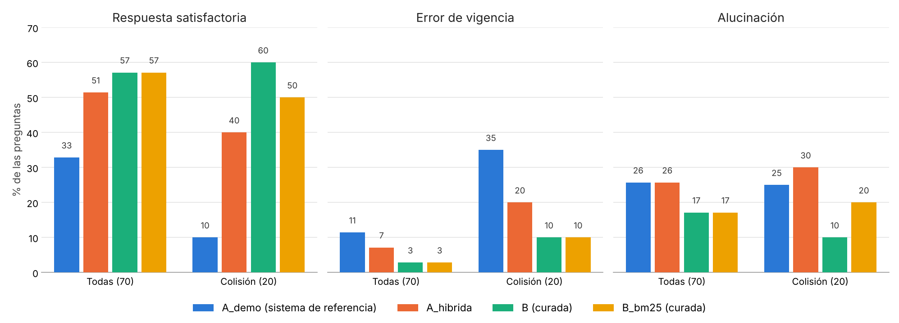

*Nota.* Porcentaje de las preguntas de cada grupo. Todas: 70 preguntas; Colisión: 20. Elaboración propia.

Sin las 21 preguntas solapadas, la base curada sigue por delante de la demostración, pero empata con A_hibrida en respuestas satisfactorias: respuestas satisfactorias 41 % en A_demo, 53 % en A_hibrida, 53 % en B y 59 % en B_bm25; errores de vigencia 4, 4, 2 y 2 de 49; alucinaciones 29 %, 29 %, 22 % y 16 %.

Por tipo de pregunta, sobre las 62 respondibles, B responde de forma satisfactoria al menos tantas como A_demo y A_hibrida en los seis tipos. Por tipo de respuesta: entidad 3, 6, 7 y 7 de 13 (A_demo, A_hibrida, B y B_bm25); numérica 2, 11, 14 y 13 de 23; textual 10, 13, 15 y 15 de 26. Por tipo cognitivo: compuesta 5, 9, 13 y 8 de 22; conceptual 5, 11, 12 y 14 de 23; procedimental 5, 10, 11 y 13 de 17. La diferencia frente a la demostración es mayor en las numéricas, que exigen copiar la cifra exacta, y la variante léxica cae en las compuestas, que piden reunir varias unidades.

No toda respuesta no satisfactoria es una respuesta errada. Entre las respuestas no satisfactorias a preguntas respondibles que no son abstenciones (28 en A_demo, 28 en A_hibrida, 21 en B y 26 en B_bm25), las que contienen una alucinación son 15, 16, 8 y 10; las demás (13, 12, 13 y 16) no afirman nada sin respaldo, pero se quedan cortas o se desvían de lo preguntado. Cuando la base curada falla, lo hace más por quedarse corta que por inventar. La distinción es aproximada, porque una respuesta sin alucinación no siempre responde bien lo que sí dice, y pesa sobre todo en las preguntas que piden varios elementos.

Las seis alucinaciones que dependen del Acuerdo 48 están todas en las preguntas sin respuesta: tres de B, dos de B_bm25 y una de A_hibrida. Son respuestas que el calificador revisó contra el Acuerdo 48 y que atribuyen a sus artículos algo que no dicen. Ninguna afecta la comparación principal.

Sin AG-207, la única pregunta sin respuesta que el Acuerdo 48 sí responde, las abstenciones en ese estrato son 7 de 7 en A_demo y 4 de 7 en A_hibrida, B y B_bm25, y la base curada alucina en 3 de 7. El resultado no cambia: la base curada sigue respondiendo preguntas que no puede responder. En AG-207, A_hibrida respondió con los artículos 432 y 435 del Acuerdo y quedó como no satisfactoria, porque el banco esperaba una abstención.

En la pregunta AG-161, la del decreto que se contradice, A_demo, A_hibrida y B_bm25 respondieron de forma satisfactoria y B no; las cuatro citaron una norma vigente y ninguna alucinó.

El banco C, que no se calificó, aporta evidencia de apoyo con la medida automática de la corrida con la configuración congelada: las respuestas que citan como vigente un acto ya derogado en la fecha de la consulta fueron 3 de 43 en A_demo, 8 de 45 en A, 9 de 62 en A_hibrida y ninguna de 63 en B ni de 63 en B_bm25. No es una medida confirmatoria, porque esas cifras se vieron antes de fijar el plan, pero apunta en la misma dirección.

#### Criterios de aceptación

La Tabla 25 contrasta los resultados con los criterios del capítulo 6, con los umbrales operativos fijados en el plan de análisis.

*Tabla 25. Cumplimiento de los criterios de aceptación.*

| # | Criterio | Medida en el banco D | A_demo | B | Resultado |
|---|---|---|---|---|---|
| 1 | Vigencia de las fuentes citadas | Error de vigencia en colisión | 35 % | 10 % | No se cumple: p = 0,125, no concluyente, con la dirección a favor de B |
| 2 | Fidelidad y precisión del contexto sin deterioro | Alucinación; artículo esperado en el contexto | 26 %; 0,355 | 17 %; 0,631 | Se cumple frente a A_demo. Frente a A_hibrida la alucinación baja, pero la base curada lleva al contexto una fracción menor de las unidades esperadas (0,631 frente a 0,709) |
| 3 | Exactitud de las citas | Cita exacta automática | 14 % | 68 % | Se cumple de forma indicativa, con una medida aproximada que subestima al corpus original: coincidencia de la primera cita con la unidad esperada, no verificación de que la cita respalde la afirmación |
| 4 | Abstención en «sin respuesta» sin aumento en las respondibles | Abstención | 8/8 y 19/62 | 4/8 y 5/62 | No se cumple: B se abstiene menos en las preguntas sin respuesta, también sin AG-207 (4 de 7 frente a 7 de 7) |
| 5 | Costo por consulta sin incremento | Mediana de tokens y de segundos | 3.352,5 tokens; 0,68 s | 3.305,5 tokens; 0,95 s | Se cumple. En tokens la mediana bajó 1 %. En tiempo subió de 0,68 a 0,95 segundos, más que el margen del 10 % fijado de antemano, pero las dos condiciones responden en menos de un segundo, un tiempo que no afecta la experiencia del usuario; el cómputo de construir la base curada costó menos que indexar el corpus original; no se midió el costo de convertir los 31 decretos a Markdown con Claude Opus 5.5, que es común a las dos condiciones porque el corpus original de la comparación es ese mismo Markdown |

*Nota.* La medida del contexto del criterio 2 es un recall, no una precisión; es la que fijó el plan. El costo del criterio 5 es la mediana de los tokens totales por respuesta.

Frente a la mejor versión del corpus original, A_hibrida, la base curada sigue por delante en respuestas satisfactorias (57 % frente a 51 %), en alucinación (17 % frente a 26 %) y en errores de vigencia (2 frente a 5), con diferencias menores que frente a la demostración y ninguna significativa (McNemar exacta, sin corrección, comparaciones exploratorias fuera del plan: p = 0,54 en satisfactorias, 0,22 en satisfactorias de colisión, 0,31 en alucinación y 0,50 en error de vigencia de colisión).

#### Lectura de los resultados

Cinco lecturas se desprenden de la prueba.

**Con la base curada mejoró la respuesta más que la recuperación.** En el banco de prueba, la base curada lleva al contexto una fracción menor de las unidades esperadas que la mejor versión del corpus original (0,631 frente a 0,709), y aun así responde bien más preguntas, alucina menos y cita menos normas no vigentes, aunque sin significación estadística. Si la diferencia se confirma, está en lo que el modelo recibe: unidades completas con su firma, el estado de vigencia de cada una y lo histórico separado y rotulado. Complementa el hallazgo 1 de la revisión (sección 4.2.4), según el cual en la literatura mejorar lo que el sistema encuentra no basta para mejorar la respuesta: aquí se observó el patrón inverso, con una recuperación algo peor y mejores respuestas.

**Una parte grande de la mejora frente a la demostración se debe a la búsqueda.** Añadir la búsqueda léxica y los prefijos de tarea al corpus original subió las respuestas satisfactorias del 33 % al 51 %. Sin la condición A_hibrida esa ganancia se habría atribuido a la curaduría. La base curada añade sobre ella seis puntos en el total y veinte en las preguntas de colisión, diferencias que con esta muestra no son significativas.

**La unidad por artículo se recupera bien por palabras y mal por significado.** Sobre la base curada, la búsqueda solo léxica iguala a la híbrida en respuestas satisfactorias (57 %), aunque queda por debajo en las preguntas de colisión (50 % frente a 60 %) y en las compuestas (8 frente a 13 de 22), y lleva al contexto más unidades esperadas que la densa (0,699 frente a 0,437). La variante sin modelo de vectorización es una opción viable, con la reserva de que las preguntas, formuladas por agentes, favorecen la coincidencia léxica. Para una entidad pública eso reduciría el costo y la dependencia de un componente.

**La base curada se abstiene menos de lo que debería.** Responde casi todas las preguntas que tienen respuesta (se abstiene en 5 de 62, frente a 19 de 62 de la demostración), pero también la mitad de las que no la tienen, y cuando el artículo esperado no llega al contexto tiende a responder con otro. El contexto rotulado parece darle al modelo una seguridad que no siempre está justificada. El desfase de los bancos con el Acuerdo 48 explica poco: solo una de las ocho preguntas sin respuesta tiene de verdad respuesta en él.

**La muestra de colisión limitó la prueba.** Con las proporciones observadas (un cálculo a posteriori), detectar la diferencia con una potencia del 80 % habría exigido unas cuarenta y cinco preguntas de colisión; con veinte, la potencia era de alrededor del 32 %. La comparación con el banco de desarrollo mostró además por qué hacía falta un banco de prueba: la pequeña ventaja en recuperación de la variante léxica en el banco B no se sostuvo en el D.

## Logro de objetivos

### Objetivo general

**Alcanzado.** El objetivo general pedía desarrollar una metodología de curaduría de bases de conocimiento para la consulta mediante sistemas RAG en entidades públicas, aplicada al corpus del seguimiento al POT de Medellín. La metodología se derivó de la revisión sistemática (primer objetivo), se diseñó como un procedimiento replicable de siete pasos (segundo objetivo) y se aplicó al corpus del caso, donde mejoró de forma considerable el desempeño del sistema de consulta frente a entregarle los documentos sin tratamiento (tercer objetivo). Dos evidencias lo demuestran: las respuestas satisfactorias pasaron del 33 % al 57 % (p = 0,003 en una comparación exploratoria), y las citas a normas que no regían en la fecha de la consulta bajaron del 35 % al 10 % en las preguntas de colisión, en la dirección esperada aunque sin significación estadística con veinte preguntas. La revisión se reporta en el capítulo 4 y en la sección 7.1.1, con el protocolo PRISMA 2020 y la matriz de extracción; la metodología, en la sección 7.1.2 y la Figura 4; su aplicación al corpus, en la sección 7.1.3.2 y la Tabla 19; y la medición de la mejora, con la calificación ciega y la prueba de McNemar, en las secciones 7.1.3.6 a 7.1.3.8, las Tablas 23 a 25 y la Figura 14.

### Objetivo específico 1

**Alcanzado.** La revisión sistemática se ejecutó conforme al protocolo declarado y produjo los productos comprometidos (Tabla 26).

*Tabla 26. Productos comprometidos del primer objetivo específico y su evidencia.*

| Producto comprometido | Evidencia | Dónde |
|---|---|---|
| Protocolo de la revisión | Pregunta, criterios de elegibilidad, cadena de búsqueda de tres bloques y fuentes declaradas | Secciones 7.1.1.1 y 7.1.1.2, Tabla 8 |
| Reporte con diagrama de flujo PRISMA | Flujo completo de 734 registros identificados a 21 estudios incluidos, con las casillas de informes no recuperados y excluidos con razón separadas | Sección 7.1.1.3, Tabla 9, Figura 5 |
| Matriz de extracción | 39 campos por estudio, vocabulario controlado, reglas de decisión, valoración de calidad y trazabilidad del arbitraje | Secciones 7.1.1.4 y 7.1.1.5, Anexo C |
| Taxonomía de técnicas de curaduría | Cuatro familias sobre once etapas, con los 21 estudios asignados y siete hallazgos transversales | Sección 4.2 |
| Decisión sobre qué familias aplican al caso | Contraste de las cuatro familias contra las tres patologías del corpus del POT, con A declarada prerrequisito, D reasignada a la evaluación del tercer objetivo, y la definición de la quinta familia mixta que compone B y C | Sección 4.2.6 y conclusión primera |

Sobre lo comprometido, la fase aportó además dos productos metodológicos no previstos: la verificación aritmética independiente de las cifras de cada estudio (sección 7.1.1.6) y la auditoría por muestreo de la propia extracción (sección 7.1.1.7).

### Objetivo específico 2

**Alcanzado.** La metodología se diseñó, se documentó como procedimiento replicable y se ilustró con un caso real del corpus. El director la validó el 13 de octubre de 2026; la excepción del segundo detector del paso 4 se precisó después, al aplicarla en la Fase 3. La Tabla 27 relaciona los productos comprometidos con su evidencia.

*Tabla 27. Productos comprometidos del segundo objetivo específico y su evidencia.*

| Producto comprometido | Evidencia | Dónde |
|---|---|---|
| Metodología de curaduría como procedimiento replicable | Siete pasos, cada uno con qué se hace, cómo se hace, resultado, origen en la revisión y control de salida, más el registro transversal del costo de curar | Sección 7.1.2 |
| Conversión estructurada de formatos | Rutas de extracción, limpieza con reglas, delimitación de actos y segmentación por artículo | Paso 1, Figura 7 |
| Esquema de metadatos de vigencia y jerarquía normativa | Especificación con identificador del texto separado del rótulo, firma {instrumento, artículo, vigencia}, grafo tipado de relaciones y determinación de vigencia | Pasos 2 a 4, Tablas 15 y 17, Figuras 8 a 10 |
| Deduplicación | Vinculación de reproducciones a la fuente canónica sin borrado y con vigencia diferenciada | Paso 5, Figura 11 |
| Tratamiento de las colisiones semánticas | Taxonomía de ocho tipos, partición activa e histórica y contrato de consulta con filtro de vigencia y ensamblaje por complementariedad | Anexo E, paso 6, Figuras 12 y 13 |
| Diagrama del pipeline secuencial | Secuencia de los siete pasos con sus artefactos | Figura 4 |
| Ejemplo trabajado | La cadena Acuerdo 48 de 2014, Decretos 2148 de 2015, 522 de 2018 y 2229 de 2019, con el Decreto 327 de 1997 | Sección 7.1.2.1, Tabla 14 y cada paso |

La aplicación de la metodología a un subconjunto de 36 instrumentos se reporta en la sección 7.1.3.2.

### Objetivo específico 3

**Alcanzado.** La prueba de concepto se ejecutó completa: la metodología se aplicó a un subconjunto de 36 instrumentos, un sistema con el mismo modelo, las mismas instrucciones y el mismo presupuesto de contexto se comparó sobre el corpus original y sobre la base curada con condiciones de control, y el banco de prueba se calificó a ciegas con un plan de análisis fijado de antemano. El objetivo pedía analizar el efecto de la metodología, y ese análisis se completó con todas las comparaciones previstas; de las métricas, la precisión del contexto se sustituyó por el recall del contexto (sección 7.3). Frente al sistema de referencia, la base curada mejoró la calidad de las respuestas: las respuestas satisfactorias pasaron de 33 % a 57 % (p = 0,003 en una comparación exploratoria), y en las preguntas de colisión, de 10 % a 60 %; la alucinación bajó de 26 % a 17 %, sin significación y con acuerdo bajo entre calificadores en esa variable (sección 7.1.3.6), la exactitud de las citas subió de 14 % a 68 % y el artículo esperado llegó al contexto casi el doble de veces (0,631 frente a 0,355). En cuanto a los criterios de aceptación, frente al sistema de referencia se cumplen los criterios de fidelidad y contexto, de exactitud de las citas y de costo por consulta, porque los tokens no aumentaron y el tiempo de respuesta se mantuvo por debajo de un segundo; el de vigencia de las citas va en la dirección esperada (de 35 % a 10 % de errores en las preguntas de colisión), pero no alcanzó significación estadística con veinte preguntas, y el de abstención ante preguntas sin respuesta no se cumple (Tabla 25). Frente a la mejor versión del corpus original, el criterio 2 no se cumpliría, porque la base curada lleva al contexto una fracción menor de las unidades esperadas. La Tabla 28 relaciona los productos comprometidos con su evidencia.

*Tabla 28. Productos comprometidos del tercer objetivo específico y su evidencia.*

| Producto comprometido | Evidencia | Dónde |
|---|---|---|
| Base de conocimiento curada con la metodología | 9.529 registros de 36 instrumentos, con manifiesto, registro de afectaciones, cola de pendientes y lista de casos para revisión | Sección 7.1.3.2, Tabla 19, Anexo I |
| Sistema RAG sobre el corpus original y sobre el corpus curado | Mismo modelo de lenguaje, modelo de vectorización, instrucciones y presupuesto de contexto, con cuatro condiciones de control | Secciones 7.1.3.1 y 7.1.3.3, Tabla 20 |
| Conjunto de preguntas estratificado | Tres bancos de 70 preguntas con papeles de desarrollo, prueba y respaldo, estratificados por tipo cognitivo, tipo de respuesta, vigencia y fuente | Sección 7.1.3.4, Tabla 21, Anexo F |
| Validación del conjunto por funcionarios | Validación conjunta de las 70 preguntas del banco D por dos funcionarios de la Unidad: 69 aceptadas y AG-207 objetada | Sección 7.1.3.4 |
| Métricas de fidelidad, contexto, vigencia de las citas y costo | Calificación ciega de 280 respuestas, acuerdo con un segundo calificador, métricas automáticas de recuperación, abstención, cita y costo | Secciones 7.1.3.6 y 7.1.3.7, Tablas 23 y 24, Figura 14, Anexo G |
| Análisis del efecto frente a los criterios de aceptación | Plan fijado de antemano, comparación principal, secundarias con corrección de Holm y contraste con los cinco criterios | Secciones 7.1.3.7 y 7.1.3.8, Tabla 25 |
| Arquitectura de implementación propuesta con análisis de costos | Arquitectura de despliegue en Azure, con sus componentes y la estimación de costo mensual (Tablas H1 y H2) | Anexo H |

Sobre lo comprometido, la fase aportó además el diagnóstico de recuperación de la Tabla 22, que separó el efecto del método de búsqueda del de la base, y la variante de consulta sin modelo de vectorización.

## Limitaciones del proyecto

Las limitaciones de este trabajo son propias de una primera aplicación de la metodología y se concentran en cuatro frentes. Ninguna cambia la dirección de los resultados: acotan su alcance y orientan los trabajos futuros (capítulo 9).

**Revisión sistemática.** La búsqueda se apoyó en Dimensions, que reúne los preprints de arXiv y las actas de IEEE y ACM. El cribado se hizo con asistencia de inteligencia artificial, con una primera pasada por título en la mayoría de los registros y verificación humana sobre la clasificación de los estudios elegibles (sección 7.1.1.3); las exclusiones no tuvieron una segunda revisión humana. La lectura en texto completo se concentró en los 27 estudios del núcleo, de los que se recuperaron 21, y los demás elegibles se valoraron por título y resumen. Como el campo es reciente y buena parte de la evidencia está en preprints, la síntesis se reforzó con la verificación aritmética de las cifras de cada estudio y la auditoría por muestreo de la extracción.

**Corpus del caso.** La prueba se aplicó a 36 normas públicas del corpus, publicadas en gaceta oficial. Las fichas de indicadores y los documentos técnicos de soporte quedan para una siguiente aplicación. Lo mismo los documentos internos de la entidad, que exigirían además un filtro de datos personales. Los actos citados que no hacían parte del subconjunto quedaron registrados como pendientes en el manifiesto de la base, como prevé la metodología.

**Prueba de concepto.** El sistema de consulta usó un modelo local, Qwen3 8B, porque el acceso a un modelo de frontera dependía de gestiones administrativas en la entidad; con un modelo más capaz los resultados pueden variar, en particular en la abstención. La conversión a Markdown de las normas, que son públicas, sí usó un modelo comercial (sección 7.1.3.2). La implementación se concentró en el núcleo del control de vigencia: la segmentación, la firma, el grafo de afectaciones y la determinación de vigencia. Para una versión posterior quedaron la detección semántica de reproducciones, las relaciones de remisión y reglamentación y la derogatoria tácita. Los casos que la curaduría marcó para revisión jurídica quedan a la espera de esa revisión; la base funcionó sin ella, como prevé el paso 6.

**Evaluación.** Las preguntas se formularon con apoyo de inteligencia artificial, porque las consultas históricas no traían respuestas verificables, y las validaron dos funcionarios de la Unidad. La calificación ciega la hizo uno de los autores, con una recalificación asistida por inteligencia artificial. En la comparación principal la calificó además, de forma independiente, un funcionario de la Unidad, que coincidió en la respuesta satisfactoria y en la cita vigente (sección 7.1.3.6). El estrato de colisión, con veinte preguntas, da una potencia limitada a la comparación principal, de modo que su resultado se lee como una tendencia; el capítulo 9 estima el tamaño necesario para confirmarla. Parte de los errores del sistema de referencia correspondían a decretos derogados por completo o expedidos después de la fecha de la consulta. Un filtro de fechas por documento también los evitaría, mientras que el aporte propio de la curaduría por artículo está en las modificaciones parciales, los numerales derogados y las reglas transitorias. Esa comparación queda como trabajo futuro. En las métricas, la fidelidad se midió con calificación humana en lugar de RAGAS, la precisión del contexto se sustituyó por el recall del contexto y la exactitud de la cita se estimó de forma automática. El costo se expresó en tokens y tiempo, con la estimación en dólares del Anexo H, y los tiempos, medidos en un servidor compartido, se leen como orden de magnitud.

<!-- salto de página -->

# CONCLUSIONES

**El objetivo general se cumplió: curar la base de conocimiento antes de indexarla mejora el sistema de consulta.** La metodología, derivada de la revisión y aplicada al corpus del POT, llevó las respuestas satisfactorias del 33 % al 57 % frente al sistema de referencia y bajó las citas a normas no vigentes del 35 % al 10 % en las preguntas de colisión. Las conclusiones que siguen detallan cómo se llegó a ese resultado y qué límites tiene.

**Ninguna familia de técnicas resuelve sola el problema de este corpus, y la solución exige componer dos de ellas en una quinta.** La revisión agrupó los veintiún estudios del núcleo en cuatro familias y las contrastó con las tres patologías del corpus del seguimiento al POT: la reproducción del mismo texto en varios documentos, la derogación entre instrumentos que conviven en el índice y la remisión entre artículos. La familia A, conversión y segmentación, es indispensable pero no suficiente, y se adopta como fase de entrada. La familia D aporta instrumentos de medición y se reasignó al diseño de la evaluación. La familia B, que estructura la base con metadatos, y la familia C, que depura el corpus y controla la vigencia, no pueden aplicarse por separado: el control de vigencia de la C opera sobre los metadatos que la B deposita en cada fragmento, y sin la restricción temporal esa firma no la consulta ningún mecanismo. De ahí la conclusión principal del primer objetivo: este trabajo define una quinta familia, mixta, que se propone denominar estructuración normativa con control de vigencia, y no se identificó en la literatura revisada ningún trabajo que la reporte como unidad.

**La literatura trata la base de conocimiento como un insumo dado, no trabaja en español y casi nunca evalúa la curaduría por separado.** De los 692 registros cribados, el 83 % fue excluido en el cribado asistido por aplicar sistemas RAG sin discutir cómo se construyó o depuró el corpus. Ninguno de los veintiún estudios del núcleo trabaja sobre un corpus en español ni sobre una entidad pública subnacional. Cinco estudios entran al núcleo por su curaduría y terminan midiendo otra cosa, y ninguno compara un mismo sistema sobre el corpus original y sobre el corpus curado, que es el diseño del tercer objetivo.

**Los instrumentos de valoración de calidad miden el reporte y no la veracidad.** La verificación aritmética mostró que al menos diez de los veintiún estudios contienen cifras que no se reproducen desde sus propias tablas, y en seis de ellos la cifra afectada es la del resumen. Uno de los dos estudios con la puntuación de calidad más alta del núcleo presenta su línea base con dos valores irreconciliables. El arbitraje editorial no garantiza la corrección, y de esa constatación se derivó la decisión de recalcular las cifras de cada estudio.

**La quinta familia es un procedimiento replicable, que puede aplicarse a otros corpus normativos, y aplicarla a un corpus real reveló tres propiedades que la literatura revisada no trata o trata solo de forma parcial.** El segundo objetivo la convirtió en siete pasos que la cadena del caso ancla recorrió completos, desde la conversión de un decreto escaneado hasta la partición de la base y el contrato de consulta. En el camino aparecieron la renumeración, que obliga a separar el identificador del texto de su rótulo; la desactualización de las fuentes compiladas, que por eso solo sirven como segundo detector; y la reproducción legítima de una misma regla en instrumentos de vigencia distinta, que impide fundir lo que se parece. Las tres pasaron a la metodología y a la taxonomía de colisiones, que creció de cuatro a ocho tipos.

**La vigencia se determina con reglas, en segundos y sin modelos de lenguaje, a partir de un inventario manual de las derogatorias, y lo jurídico queda acotado.** A partir del corpus ya convertido a Markdown y de un inventario manual de los actos y sus derogatorias, la metodología se aplicó a 36 instrumentos y produjo, en tres segundos, una base de 9.529 registros con su vigencia, su linaje, 340 relaciones de afectación y una lista de 70 casos para revisión. Indexarla costó la quinta parte de lo que costó indexar el corpus original, y el script, al cruzar la compilación con la derogatoria registrada en el inventario, detectó la desactualización de la fuente compilada que la Fase 2 había encontrado a mano. La metodología prevé que lo que exige interpretación (la derogatoria tácita, la cláusula genérica y las inconsistencias internas de los actos) quede en una lista que una persona resuelve durante la construcción de la base, sin que el sistema dependa de ella para responder.

**Con la base curada, el sistema respondió mejor que el sistema de referencia, y la diferencia es mayor donde la vigencia importa.** En el banco de prueba, calificado a ciegas, el sistema respondió de forma satisfactoria el 57 % de las preguntas con la base curada frente al 33 % con el corpus original en la configuración de la demostración, y en las preguntas de colisión el 60 % frente al 10 %. La diferencia en respuestas satisfactorias frente al sistema de referencia es significativa en una comparación exploratoria (p = 0,003); la de alucinación, 17 % frente a 26 %, no lo es (p = 0,31). Frente a la mejor versión del corpus original la ventaja se reduce (57 % frente a 51 %) y no es significativa.

**La mejora está más en la respuesta que en la recuperación.** Añadir búsqueda léxica y prefijos de tarea al corpus original lo llevó a recuperar el artículo esperado tan bien o mejor que la base curada, y aun así la base curada siguió por delante en respuestas satisfactorias, alucinación y errores de vigencia, aunque sin significación estadística. Es el patrón inverso al de la literatura, donde la curaduría mejora lo que el sistema encuentra sin que eso baste para mejorar lo que responde: curaduría e intervención en la inferencia atacan cuellos de botella distintos. Separar los dos efectos fue posible gracias a la condición de control que el anteproyecto no tenía, y separar el banco de desarrollo del de prueba evitó reportar una ventaja en recuperación que el banco formulado a ciegas no confirmó.

**La reducción de las citas a normas no vigentes va en la dirección esperada, pero no quedó demostrada.** En las preguntas de colisión, la base curada citó una norma que no regía en el 10 % de las respuestas y el sistema de referencia en el 35 %. Con veinte preguntas, la prueba fijada de antemano dio p = 0,125: la dirección es la esperada y las medidas descriptivas la acompañan, pero la diferencia no está probada.

**La base curada no resolvió la abstención.** Respondió la mitad de las preguntas que el corpus no puede responder, mientras el sistema de referencia se abstuvo en todas. Es el cuarto criterio de aceptación y no se cumple. La revisión del banco mostró que solo una de esas ocho preguntas, AG-207, tiene respuesta en el Acuerdo 48, y sin ella el resultado se mantiene; la explicación apunta al comportamiento del modelo ante un contexto rotulado que parece suficiente y a intervenciones en la inferencia que complementan la curaduría, como anticipaba el hallazgo 1 de la revisión (sección 4.2.4). Cabe anotar que el modelo se ejecutó con temperatura 0, que elimina la variación aleatoria de la generación, de modo que la falla no se explica por ese parámetro; además, el mismo modelo se abstuvo en todas con el corpus original.

**La mejora se obtuvo con un modelo limitado, y con un modelo de frontera cabe esperar un desempeño mayor.** Las pruebas se hicieron con un modelo local, pequeño y cuantizado, el que fue posible ejecutar en el hardware disponible, porque el acceso a un modelo de frontera para el sistema de consulta dependía de permisos, presupuesto y gestión administrativa que no controlaba el proyecto. Aun en ese ambiente restringido, la base curada mejoró de forma considerable las respuestas. Con un modelo de frontera, instrucciones y guardarraíles como los de esta prueba y la misma base curada, cabe esperar un sistema de mejor desempeño general; queda por medir si la ventaja de la curaduría crece o se reduce con un modelo más capaz, cuando la entidad disponga de esa infraestructura (Anexo H y trabajos futuros).

<!-- salto de página -->

# TRABAJOS FUTUROS

**Vigencia con granularidad territorial.** Llevar la vigencia de la unidad normativa a la combinación de disposición, ámbito territorial y fecha, que es el cuarto vacío de la sección 4.2.5, es una línea de trabajo por sí sola.

**Asistencia a la revisión jurídica.** La metodología prevé entregar a una persona los casos de derogatoria tácita e inconsistencia, ordenados por riesgo. Proponer para cada caso las lecturas posibles con su fundamento, sin decidir por el jurista, reduciría el costo de esa revisión, que el procedimiento acota pero no elimina.

**Medición del costo de curar.** La revisión mostró que el costo de la curaduría casi nunca se contabiliza. Un trabajo dedicado a instrumentar y comparar el costo de construcción de bases de conocimiento (y no solo el de operarlas) llenaría un vacío que la literatura reconoce y no atiende.

**Evaluación de la depuración sin borrado en otros corpus.** La rama de deduplicación de la revisión quedó con un solo estudio, cuya premisa no se transfiere a un corpus normativo local, y el paso 5 de esta metodología propone una alternativa para el caso en que la duplicación es legítima: vincular cada reproducción a su fuente canónica sin borrarla. Medir el efecto aislado de esa decisión y probarla en corpus con otros patrones de reproducción queda como trabajo por hacer.

**Extensión del catálogo geográfico a procesamiento espacial.** La metodología cataloga los activos geográficos sin procesarlos. Integrar el análisis espacial en la cadena de respuesta es una extensión natural que excede el alcance de este trabajo.

**Aplicación a otros corpus normativos hispanohablantes.** El valor de una metodología replicable se demuestra replicándola. Aplicarla a corpus de otras entidades territoriales permitiría estimar qué parte del procedimiento es general y qué parte depende del caso.

**Una prueba con potencia suficiente.** Con las proporciones observadas, y según un cálculo a posteriori, confirmar la reducción del error de vigencia exige unas cuarenta y cinco preguntas de colisión, calificadas por al menos dos personas, preferiblemente funcionarios de la entidad. La cifra es frente al sistema de referencia; frente a la mejor versión del corpus original, con una diferencia de dos errores contra cuatro, harían falta muchas más. Es la extensión más directa de este trabajo. Esa prueba debería incluir una condición de control con un filtro por fechas a nivel de documento, para separar el aporte de la curaduría por artículo del de un control temporal simple.

**Control de la abstención.** La base curada responde preguntas que no puede responder. Probar mecanismos en la inferencia (un umbral de evidencia, una verificación de que la unidad citada contiene lo afirmado o una instrucción de abstención más estricta) permitiría medir si la abstención se corrige sin perder las respuestas correctas.

**Implementación completa de la metodología.** La prueba simplificó la composición literal de subunidades, la detección semántica de reproducciones, las relaciones de remisión y reglamentación del grafo y la generación de candidatos de derogatoria tácita y de contradicciones. Implementarlas y medir su efecto aislado completaría la evaluación.

**Contenido tabular y documentos no normativos.** Aplicar la metodología a las fichas de indicadores y a los documentos técnicos de soporte, con la ruta de transcripción por visión del paso 1, es necesario para evaluarla sobre el contenido que la revisión identificó como el de mayor riesgo.

**Otros modelos y métricas automáticas.** Repetir la comparación con modelos de mayor tamaño y añadir métricas automáticas de fidelidad, como las de RAGAS, permitiría saber si el efecto de la curaduría crece o se diluye cuando el modelo es más capaz. La evaluación puede incorporar además las piezas de la revisión que la prueba no implementó: la ponderación con la atribución como componente dominante, un léxico de alucinación terminológica construido con el glosario del Acuerdo 48 y la elección del tamaño de fragmento por tipo de pregunta.

<!-- salto de página -->

# REFERENCIAS

Akarajaradwong, P., Pothavorn, P., Chaksangchaichot, C., Tasawong, P., Nopparatbundit, T., Pratai, K., y Nutanong, S. (2025). *NitiBench: A comprehensive study of LLM framework capabilities for Thai legal question answering* (arXiv:2502.10868). arXiv. https://doi.org/10.48550/arXiv.2502.10868

Alcaldía de Medellín. (s. f.-a). *Expediente Distrital: Plan de Ordenamiento Territorial de Medellín*. Departamento Administrativo de Planeación. https://www.medellin.gov.co/es/transparencia/plan-de-ordenamiento-territorial-de-medellin/

Alcaldía de Medellín. (s. f.-b). *Geomedellín y MeData: plataformas de información geográfica y datos abiertos del Distrito de Medellín*. https://www.medellin.gov.co/geomedellin

Alcaldía de Medellín. (s. f.-c). *Sistema de Seguimiento y Evaluación al Plan de Ordenamiento Territorial (SSEPOT)*. Departamento Administrativo de Planeación. https://www.medellin.gov.co/es/transparencia/plan-de-ordenamiento-territorial-de-medellin/sistema-de-seguimiento-y-evaluacion-al-plan-de-ordenamiento-territorial-ssepot/

Alcaldía de Medellín. (1996). *Decreto 565 de 1996*.

Alcaldía de Medellín. (1997). *Decreto 327 de 1997: Por medio del cual se definen los parámetros para la ubicación, distribución, número de puestos, clases de productos, zonas donde podrán establecerse y el horario para ventas estacionarias en la ciudad; además se reglamenta la localización, diseño, especificaciones e instalación de los elementos de servicios varios que inciden en el espacio público de la ciudad de Medellín* (Gaceta Oficial 667).

Alcaldía de Medellín. (1999). *Decreto 680 de 1999*.

Alcaldía de Medellín. (2003). *Decreto 1683 de 2003: Por el cual se reglamenta la publicidad exterior visual y los avisos publicitarios en el Municipio de Medellín* (Gaceta Oficial 1939).

Alcaldía de Medellín. (2015a). *Decreto 2053 de 2015: Por medio del cual se adopta el Macroproyecto para el Área de Intervención Estratégica MEDRío, Zona RíoCentro y se dictan otras disposiciones* (Gaceta Oficial 4348).

Alcaldía de Medellín. (2015b). *Decreto 2078 de 2015: Por medio del cual se adopta el macroproyecto para el Área de Intervención Estratégica MEDRío, Zona RíoSur y se dictan otras disposiciones* (Gaceta Oficial 4352).

Alcaldía de Medellín. (2015c). *Decreto 2148 de 2015: Por medio del cual se reglamenta el aprovechamiento económico del espacio público, se fijan las retribuciones por su utilización, se crean la Comisión Intersectorial Asesora del Espacio Público y el Comité Técnico* (Gaceta Oficial 4355).

Alcaldía de Medellín. (2015d). *Decreto 473 de 2015: Por el cual se adopta el Plan Parcial «Colinas del Porvenir», polígono de tratamiento Desarrollo en Suelo Urbano Z6_D_4, del Municipio de Medellín*.

Alcaldía de Medellín. (2017). *Decreto 113 de 2017: Manual de Espacio Público*.

Alcaldía de Medellín. (2018a). *Decreto 471 de 2018: Por medio del cual se expiden las normas reglamentarias de detalle aplicables a las actuaciones y procesos de urbanización, parcelación, construcción, reconocimiento de edificaciones y demás actuaciones en el territorio municipal y se dictan otras disposiciones* (Gaceta Oficial 4534).

Alcaldía de Medellín. (2018b). *Decreto 522 de 2018: Por medio del cual se modifica y adiciona el Decreto 2148 de 2015* (Gaceta Oficial 4536).

Alcaldía de Medellín. (2019). *Decreto 2229 de 2019: Por medio del cual se adopta el Manual del aprovechamiento económico del espacio público en la ciudad de Medellín, se modifican los decretos municipales 2148 de 2015 y 471 de 2018, se deroga el Decreto Municipal 327 de 1997 y se dictan otras disposiciones* (Gaceta Oficial 4641).

Alcaldía de Medellín. (2022). *Decreto 541 de 2022: Por medio del cual se modifica el Decreto Municipal 2078 de 2015*.

Alcaldía de Medellín. (2023). *Decreto 1143 de 2023: Por medio del cual se reglamenta el Consejo Consultivo de Ordenamiento, se deroga el Decreto 0847 de 2014 y se asignan funciones al Director del Departamento Administrativo de Planeación del Distrito Especial de Ciencia, Tecnología e Innovación de Medellín*.

Al Mouatamid, Y., Bonnin, M., y Zahir, J. (2026). *From norms to indicators (N2I-RAG): An agentic retrieval-augmented generation framework for legal indicator computation* (arXiv:2605.26926). arXiv. https://doi.org/10.48550/arXiv.2605.26926

Allu, U., Kedia, S., Odapally, T., y Ahmed, B. (2026). *Web retrieval-aware chunking (W-RAC) for efficient and cost-effective retrieval-augmented generation systems* (arXiv:2604.04936). arXiv. https://doi.org/10.48550/arXiv.2604.04936

Annam, D. (2026). Measuring retrieval freshness and accuracy degradation in continuous ETL-driven RAG systems. *Journal of Information Systems Engineering and Management, 11*(2s), 587–594. https://doi.org/10.52783/jisem.v11i2s.14454

Anthropic. (2026). *Claude* (incluida la versión Claude Opus 5.5) [Modelo de lenguaje]. https://www.anthropic.com/claude

Asai, A., Wu, Z., Wang, Y., Sil, A., y Hajishirzi, H. (2024). Self-RAG: Learning to retrieve, generate, and critique through self-reflection. En *The Twelfth International Conference on Learning Representations (ICLR 2024)*. https://proceedings.iclr.cc/paper_files/paper/2024/hash/25f7be9694d7b32d5cc670927b8091e1-Abstract-Conference.html

Chapman, P., Clinton, J., Kerber, R., Khabaza, T., Reinartz, T., Shearer, C., y Wirth, R. (2000). *CRISP-DM 1.0: Step-by-step data mining guide*. SPSS.

Chroma. (2026). *Chroma: The AI-native open-source embedding database* [Software]. https://www.trychroma.com

Cohen, J. (1960). A coefficient of agreement for nominal scales. *Educational and Psychological Measurement, 20*(1), 37–46. https://doi.org/10.1177/001316446002000104

Concejo de Medellín. (2006). *Acuerdo 46 de 2006: Por medio del cual se revisa y ajusta el Plan de Ordenamiento Territorial para el Municipio de Medellín*.

Concejo de Medellín. (2014). *Acuerdo 48 de 2014: Por medio del cual se adopta la revisión y ajuste de largo plazo del Plan de Ordenamiento Territorial del municipio de Medellín* (Gaceta Oficial 4267). https://www.medellin.gov.co/es/transparencia/plan-de-ordenamiento-territorial-de-medellin/

Consejo Nacional Legislativo. (1887a). *Ley 153 de 1887: Por la cual se adiciona y reforma los códigos nacionales, la ley 61 de 1886 y la 57 de 1887* (Diario Oficial 7151 y 7152).

Consejo Nacional Legislativo. (1887b). *Ley 57 de 1887: Sobre adopción de códigos y unificación de la legislación nacional* [Código Civil] (Diario Oficial 7019).

Cormack, G. V., Clarke, C. L. A., y Buettcher, S. (2009). Reciprocal rank fusion outperforms Condorcet and individual rank learning methods. En *Proceedings of the 32nd International ACM SIGIR Conference on Research and Development in Information Retrieval* (pp. 758–759). https://doi.org/10.1145/1571941.1572114

DAMA International. (2017). *DAMA-DMBOK: Data Management Body of Knowledge* (2.ª ed.). Technics Publications.

Departamento Administrativo de Planeación de Medellín. (2012). *Resolución 113 de 2012: Por la cual se autoriza la intervención y ocupación del espacio público para la construcción de obras civiles, otras obras relacionadas y actividades conexas para la instalación de tuberías para la ampliación del sistema de distribución de gas natural* (Gaceta Oficial 4058).

Devlin, J., Chang, M.-W., Lee, K., y Toutanova, K. (2019). BERT: Pre-training of deep bidirectional transformers for language understanding. En *Proceedings of NAACL-HLT 2019* (pp. 4171–4186). https://doi.org/10.18653/v1/N19-1423

Digital Government Authority. (2026). *Retrieval-augmented generation and enabling enterprise innovation*. Kingdom of Saudi Arabia. https://dga.gov.sa/en/studies/researches/RAG-enabling-enterprise-Innovation

Efron, B., y Tibshirani, R. J. (1993). *An introduction to the bootstrap*. Chapman & Hall.

Es, S., James, J., Espinosa-Anke, L., y Schockaert, S. (2024). RAGAS: Automated evaluation of retrieval augmented generation. En *Proceedings of the 18th Conference of the European Chapter of the Association for Computational Linguistics: System Demonstrations* (pp. 150–158). https://doi.org/10.18653/v1/2024.eacl-demo.16

Gao, Y., Xiong, Y., Gao, X., Jia, K., Pan, J., Bi, Y., Dai, Y., Sun, J., Wang, M., y Wang, H. (2024). *Retrieval-augmented generation for large language models: A survey* (arXiv:2312.10997). arXiv. https://doi.org/10.48550/arXiv.2312.10997

Gupta, S., Ranjan, R., y Singh, S. N. (2024). *A comprehensive survey of retrieval-augmented generation (RAG): Evolution, current landscape and future directions* (arXiv:2410.12837). arXiv. https://doi.org/10.48550/arXiv.2410.12837

Holm, S. (1979). A simple sequentially rejective multiple test procedure. *Scandinavian Journal of Statistics, 6*(2), 65–70. https://www.jstor.org/stable/4615733

Jaime, R. (2026). *From inference-time routing to ingestion-time graphs: Referential discovery, actor-agent parallelism, and formal completeness guarantees for deterministic multi-hop RAG* [Preprint]. Research Square. https://doi.org/10.21203/rs.3.rs-9334226/v1

Jiang, Z., Xu, F. F., Gao, L., Sun, Z., Liu, Q., Dwivedi-Yu, J., Yang, Y., Callan, J., y Neubig, G. (2023). Active retrieval augmented generation. En *Proceedings of EMNLP 2023* (pp. 7969–7992). https://doi.org/10.18653/v1/2023.emnlp-main.495

Karna, V. R., M, R. R., Babu, B. S., S, N., M, M., y V, H. (2026). A hybrid RAG-LLaMA framework for scalable and accurate interpretation of legal texts. *Applied Artificial Intelligence, 40*(1), Artículo 2626097. https://doi.org/10.1080/08839514.2026.2626097

Karpukhin, V., Oğuz, B., Min, S., Lewis, P., Wu, L., Edunov, S., Chen, D., y Yih, W. (2020). Dense passage retrieval for open-domain question answering. En *Proceedings of EMNLP 2020* (pp. 6769–6781). https://doi.org/10.18653/v1/2020.emnlp-main.550

Kaseteiam, P., y Vanijja, V. (2026). Enhancing LLM tutors with retrieval-augmented generation and chain-of-verification for curriculum-grounded formative feedback: A case study on Thai health education. En *Proceedings of the 14th International Conference on Advances in Information Technology* (pp. 1–7). ACM. https://doi.org/10.1145/3816713.3818221

Kitchenham, B., y Charters, S. (2007). *Guidelines for performing systematic literature reviews in software engineering* (Informe técnico EBSE-2007-01). Keele University y Durham University.

LangChain. (2026). *LangChain* (versión 1.2) [Software]. https://www.langchain.com

Lee, K.-T., Im, J.-B., Hong, R.-L., y Kim, J.-H. (2026). Enhancing retrieval-augmented generation performance through network analysis of question types in public procurement law. *Journal of Management in Engineering, 42*(4), Artículo 04026014. https://doi.org/10.1061/JMENEA.MEENG-7429

Lewis, P., Perez, E., Piktus, A., Petroni, F., Karpukhin, V., Goyal, N., Küttler, H., Lewis, M., Yih, W., Rocktäschel, T., Riedel, S., y Kiela, D. (2020). Retrieval-augmented generation for knowledge-intensive NLP tasks. *Advances in Neural Information Processing Systems, 33*, 9459–9474. https://proceedings.neurips.cc/paper/2020/hash/6b493230205f780e1bc26945df7481e5-Abstract.html

Li, C.-H. (2025). Knowledge representation strategies for reducing hallucinations in retrieval-augmented domain-specific question answering. *International Journal of Engineering and Technology Innovation, 15*(4), 476–487. https://doi.org/10.46604/ijeti.2025.15708

Li, R., Cao, S., Liu, R., Duprey, A., y Dong, A. (2026). *AionRAG: Time-correct retrieval-augmented generation under knowledge drift* [Preprint]. Research Square. https://doi.org/10.21203/rs.3.rs-8912660/v1

Liu, Y., Ding, J., Fu, Y., y Li, Y. (2023). UrbanKG: An urban knowledge graph system. *ACM Transactions on Intelligent Systems and Technology, 14*(4), 1–25. https://doi.org/10.1145/3588577

Luo, Q., Li, X., Dai, J., Cheng, S., y Qiu, X. (2025). *Zero-RAG: Towards retrieval-augmented generation with zero redundant knowledge* (arXiv:2511.00505). arXiv. https://doi.org/10.48550/arXiv.2511.00505

Lyu, Y., Li, Z., Niu, S., Xiong, F., Tang, B., Wang, W., Wu, H., Liu, H., Xu, T., y Chen, E. (2025). CRUD-RAG: A comprehensive Chinese benchmark for retrieval-augmented generation of large language models. *ACM Transactions on Information Systems, 43*(2), Artículo 41. https://doi.org/10.1145/3701228

Maharjan, A., y Yadav, U. (2026). *Chunking, retrieval, and re-ranking: An empirical evaluation of RAG architectures for policy document question answering* (arXiv:2601.15457). arXiv. https://doi.org/10.48550/arXiv.2601.15457

Maniyar, S., Singh, D., y Reddy, R. (2026). *Enhancing legal LLMs through metadata-enriched RAG pipelines and direct preference optimization* (arXiv:2603.19251). arXiv. https://doi.org/10.48550/arXiv.2603.19251

McNemar, Q. (1947). Note on the sampling error of the difference between correlated proportions or percentages. *Psychometrika, 12*(2), 153–157. https://doi.org/10.1007/BF02295996

Microsoft. (2026). *Precios de Azure* [Sitio web]. https://azure.microsoft.com/pricing/

Ministerio de Tecnologías de la Información y las Comunicaciones. (2019). *Marco de Interoperabilidad para Gobierno Digital*. Gobierno de Colombia. https://lenguaje.mintic.gov.co/sites/default/files/archivos/marco_de_interoperabilidad_para_gobierno_digital.pdf

Mishra, A., Mehan, V., y Bhosle, N. (2026). *TriDomRAG-Bench: A tri-domain benchmark for evaluating retrieval-augmented generation in healthcare, legal, and finance* [Preprint]. Research Square. https://doi.org/10.21203/rs.3.rs-9859942/v1

Nussbaum, Z., Morris, J. X., Duderstadt, B., y Mulyar, A. (2024). *Nomic Embed: Training a reproducible long context text embedder* (arXiv:2402.01613). arXiv. https://doi.org/10.48550/arXiv.2402.01613

Ollama. (2026). *Ollama* [Software]. https://ollama.com

Page, M. J., McKenzie, J. E., Bossuyt, P. M., Boutron, I., Hoffmann, T. C., Mulrow, C. D., Shamseer, L., Tetzlaff, J. M., Akl, E. A., Brennan, S. E., Chou, R., Glanville, J., Grimshaw, J. M., Hróbjartsson, A., Lalu, M. M., Li, T., Loder, E. W., Mayo-Wilson, E., McDonald, S., … Moher, D. (2021). The PRISMA 2020 statement: An updated guideline for reporting systematic reviews. *BMJ, 372*, n71. https://doi.org/10.1136/bmj.n71

Park, H., Kim, J., Kim, J., y Yoon, D. (2026). *CHOP: Chunkwise context-preserving framework for RAG on multi documents* (arXiv:2604.15802). arXiv. https://doi.org/10.48550/arXiv.2604.15802

Procko, T., y Ochoa, O. (2024). *Graph retrieval-augmented generation for large language models: A survey* [Preprint]. SSRN. https://ssrn.com/abstract=4895062

Qwen Team. (2025). *Qwen3 technical report* (arXiv:2505.09388). arXiv. https://doi.org/10.48550/arXiv.2505.09388

Reimers, N., y Gurevych, I. (2019). Sentence-BERT: Sentence embeddings using Siamese BERT-networks. En *Proceedings of EMNLP-IJCNLP 2019* (pp. 3982–3992). https://doi.org/10.18653/v1/D19-1410

Robertson, S., y Zaragoza, H. (2009). The probabilistic relevance framework: BM25 and beyond. *Foundations and Trends in Information Retrieval, 3*(4), 333–389. https://doi.org/10.1561/1500000019

Secretaría de Desarrollo Agrario, Territorial y Urbano. (2021). *Sistema de Información Territorial y Urbano (SITU)*. Gobierno de México.

Semnani, S. J., Burapacheep, J., Khatua, A., Atchariyachanvanit, T., Wang, Z., y Lam, M. S. (2025). *Detecting corpus-level knowledge inconsistencies in Wikipedia with large language models* (arXiv:2509.23233). arXiv. https://doi.org/10.48550/arXiv.2509.23233

Si, X., Zhu, M., Qin, S., Yu, L., Zhang, L., Liu, S., Li, X., Duan, R., Liu, Y., y Jia, X. (2025). SeCon-RAG: A two-stage semantic filtering and conflict-free framework for trustworthy RAG. En *Advances in Neural Information Processing Systems 38 (NeurIPS 2025)* (pp. 70652–70681). Curran Associates. https://doi.org/10.52202/085713-2376

Sivakumar, S., y Meenakshi, S. P. (2026). Resource-efficient retrieval-augmented question answering for the Indian Lok Sabha dataset. *Frontiers in Artificial Intelligence, 9*, Artículo 1798021. https://doi.org/10.3389/frai.2026.1798021

Smith, R. (2007). An overview of the Tesseract OCR engine. En *Ninth International Conference on Document Analysis and Recognition (ICDAR 2007)* (Vol. 2, pp. 629–633). IEEE. https://doi.org/10.1109/ICDAR.2007.4376991

Unidad de Seguimiento Estratégico al POT. (2026). *Batería de indicadores del Programa de Ejecución del POT* [Documento interno de trabajo]. Departamento Administrativo de Planeación, Alcaldía de Medellín.

Vaswani, A., Shazeer, N., Parmar, N., Uszkoreit, J., Jones, L., Gomez, A. N., Kaiser, Ł., y Polosukhin, I. (2017). Attention is all you need. *Advances in Neural Information Processing Systems, 30*, 5998–6008. https://proceedings.neurips.cc/paper/2017/hash/3f5ee243547dee91fbd053c1c4a845aa-Abstract.html

Wilkinson, M. D., Dumontier, M., Aalbersberg, I. J., Appleton, G., Axton, M., Baak, A., Blomberg, N., Boiten, J.-W., da Silva Santos, L. B., Bourne, P. E., Bouwman, J., Brookes, A. J., Clark, T., Crosas, M., Dillo, I., Dumon, O., Edmunds, S., Evelo, C. T., Finkers, R., … Mons, B. (2016). The FAIR Guiding Principles for scientific data management and stewardship. *Scientific Data, 3*, Artículo 160018. https://doi.org/10.1038/sdata.2016.18

Wilson, E. B. (1927). Probable inference, the law of succession, and statistical inference. *Journal of the American Statistical Association, 22*(158), 209–212. https://doi.org/10.1080/01621459.1927.10502953

Xu, Z., Cruz, M. J., Guevara, M., Wang, T., Deshpande, M., Wang, X., y Li, Z. (2024). Retrieval-augmented generation with knowledge graphs for customer service question answering. En *Proceedings of the 47th International ACM SIGIR Conference* (pp. 2905–2909). https://doi.org/10.1145/3626772.3661370

Yan, S.-Q., Gu, J.-C., Zhu, Y., y Ling, Z.-H. (2024). *Corrective retrieval augmented generation* (arXiv:2401.15884). arXiv. https://doi.org/10.48550/arXiv.2401.15884

Yu, H., Gan, A., Zhang, K., Tong, S., Liu, Q., y Liu, Z. (2024). *Evaluation of retrieval-augmented generation: A survey* (arXiv:2405.07437). arXiv. https://doi.org/10.48550/arXiv.2405.07437

Zhang, J., Zhang, Q., Wang, B., Ouyang, L., Wen, Z., Li, Y., Chow, K.-H., He, C., y Zhang, W. (2025). OCR hinders RAG: Evaluating the cascading impact of OCR on retrieval-augmented generation. En *2025 IEEE/CVF International Conference on Computer Vision (ICCV)* (pp. 17443–17453). IEEE. https://doi.org/10.1109/ICCV51701.2025.01620

Zhou, Z., Zhang, J., Ji, X., Li, Y., Han, J., y Zhao, Z. (2026). *Tug-of-war within a decade: Conflict resolution in vulnerability analysis via teacher-guided retrieval-augmented generations* (arXiv:2604.14172). arXiv. https://doi.org/10.48550/arXiv.2604.14172

Zouak, F., El Beqqali, O., y Riffi, J. (2026). CollectivIA: Two-pipeline multilingual legal RAG for Moroccan territorial governance with LLM-assisted and regex-based chunking. *Big Data and Cognitive Computing, 10*(7), Artículo 212. https://doi.org/10.3390/bdcc10070212

<!-- salto de página -->

# ANEXOS

Los anexos que son texto se incluyen a continuación. Los archivos de soporte de la tesis (la exportación de la búsqueda, el registro del cribado, la matriz de extracción, los bancos de preguntas, las hojas de calificación, el código, el corpus en Markdown, la base curada y las respuestas de las corridas) están disponibles en el repositorio público del trabajo de grado, en https://github.com/sebasmp90/tesis-maestria-ciencia-datos-upb-curaduria-rag, organizados en carpetas con la letra del anexo al que corresponden. El repositorio contiene además el informe y sus figuras.

**Anexo A. Protocolo y exportación de la búsqueda de la revisión sistemática.**

*Parte 1. Protocolo fijado en el anteproyecto.* El protocolo quedó fijado en el anteproyecto, entregado el 31 de julio de 2026, antes de la exportación definitiva de la búsqueda. Su texto, sin cambios, es el siguiente:

> Corresponde a la comprensión del negocio y del estado de la técnica. Se ejecuta una revisión sistemática diseñada según los lineamientos de Kitchenham y Charters (2007) y reportada conforme a la declaración PRISMA 2020 (Page et al., 2021), de la cual se adoptan los ítems aplicables a revisiones sin metaanálisis estadístico. La revisión responde a la pregunta de qué técnicas se han reportado para preparar, curar y estructurar corpus documentales previo a su incorporación en bases de conocimiento de sistemas RAG, y qué evidencia existe sobre su efecto en la consistencia de las respuestas, la reducción de alucinaciones y el costo de operación. Las búsquedas se ejecutan en Dimensions como base principal, complementada con Scopus, ACM Digital Library, IEEE Xplore y arXiv, con una cadena de tres bloques (técnica, componente de interés y problema abordado) documentada en el protocolo. Se incluyen artículos, ponencias arbitradas y prepublicaciones con evaluación empírica, en inglés o español, que aborden explícitamente la preparación del corpus; se excluyen los trabajos centrados en el componente generativo, las aplicaciones sin discusión de su base de conocimiento y los documentos sin método verificable. La búsqueda piloto fue ejecutada: identificó 734 registros, 692 tras la deduplicación, y no arrojó resultados anteriores a 2023, lo que refleja la juventud del campo. El cribado por título y resumen se realizó de forma asistida por inteligencia artificial, con registro de la decisión y su justificación para cada registro y verificación posterior por los dos investigadores, quienes resuelven las discrepancias por consenso. El proceso completo se documenta en un diagrama de flujo PRISMA, y de los estudios incluidos se extrae una matriz estructurada con el tipo de problema abordado, la técnica propuesta, el dominio, las métricas y los resultados, insumo directo de la fase siguiente.

La cadena de búsqueda, con la que se calibró el protocolo en la búsqueda piloto y se hizo la exportación definitiva, se aplicó en Dimensions sobre título y resumen, para los años 2023 a 2026 y los tipos de publicación artículo, ponencia y preprint:

```
("retrieval augmented generation" OR "RAG")
AND ("knowledge base" OR "corpus" OR "document preprocessing" OR "chunking"
     OR "data curation" OR "knowledge curation")
AND ("knowledge conflict" OR "inconsistency" OR "contradiction" OR "hallucination"
     OR "outdated knowledge" OR "temporal misalignment")
```

Durante la ejecución se hicieron cinco ajustes, todos declarados en el informe:

1. Los criterios de elegibilidad se ampliaron para admitir los estudios que aportan instrumentos de evaluación y las revisiones secundarias (sección 7.1.1.1, Tabla 8).
2. Las fuentes complementarias no se consultaron por separado: los 734 registros proceden de Dimensions, que indexa los preprints de arXiv y las actas de IEEE y ACM (sección 7.1.1.2).
3. La verificación humana del cribado se hizo por muestreo, sobre la clasificación de 16 de los 80 estudios de verificación rápida; las exclusiones no tuvieron una segunda revisión humana (secciones 1.2, 7.1.1.3 y 7.3).
4. Solo los 27 estudios del núcleo se buscaron en texto completo; se recuperaron 21 y los otros 80 elegibles se valoraron por título y resumen (secciones 7.1.1.3 y 7.3).
5. La matriz se definió con 39 campos y vocabulario controlado, las reglas de decisión se escribieron tras el primer cotejo entre revisores y la calidad se valoró con un instrumento de ocho criterios (secciones 7.1.1.4 y 7.1.1.5).

*Parte 2. Exportación de la búsqueda.* Los tres archivos devueltos por Dimensions el 1 de agosto de 2026 (269 artículos, 195 ponencias y 270 preprints), cuya cabecera conserva la fecha de exportación y la cadena literal de consulta. Son la evidencia que permite reproducir el punto de partida de la revisión. Están en el repositorio, carpeta `Anexo_A`.

**Anexo B. Registro completo del cribado.** Los 692 registros cribados con su decisión y la razón de exclusión o la nota de inclusión de cada uno, el flujo PRISMA y los 107 registros elegibles. Es la evidencia que sostiene la declaración de uso de IA de la sección 1.2. Está en el repositorio, carpeta `Anexo_B`.

**Anexo C. Matriz de extracción de datos.** Los 21 estudios del núcleo con los 39 campos del instrumento, la hoja de valoración de calidad, el libro de códigos con las reglas de decisión, la hoja de trazabilidad del arbitraje celda por celda, la hoja de los 80 estudios de verificación rápida y la hoja de informes no recuperados con las rutas de acceso documentadas. Está en el repositorio, carpeta `Anexo_C`.

**Anexo D. Informe de la auditoría por muestreo de la extracción.**

El marco de muestreo fueron los diecisiete estudios del núcleo que no se sometieron a relectura durante la resolución de desacuerdos, ordenados alfabéticamente. Con muestreo aleatorio simple y semilla declarada (20260915) se seleccionaron cinco estudios, el 23,8 % del núcleo: N02, N05, N07, N11 y N19. Tres son de banda de calidad alta y dos de banda media; cuatro son preprints y uno artículo de revista, y cubren cuatro etapas distintas del pipeline.

Cada estudio se reclasificó en condiciones ciegas. El revisor, una lectura asistida por inteligencia artificial y aislada de la extracción, recibió únicamente el texto completo del artículo y el libro de códigos, sin acceso a la matriz ni a ninguna clasificación previa. Se compararon veintiuna celdas por estudio, trece campos de vocabulario controlado y los ocho criterios de calidad, ciento cinco celdas en total. Los resultados de acuerdo son los de la Tabla 13: 78,5 % en los campos de vocabulario controlado, 75,0 % en los criterios de calidad, 77,1 % celda por celda y 100 % en la banda de calidad. Ningún estudio cambió de banda, con diferencias de puntaje entre menos dos y más un punto sobre dieciséis; de los diez pares comparables, nueve conservan el orden relativo, y el revisor independiente resultó en promedio 0,8 puntos más severo, de modo que la discrepancia es sobre todo sistemática.

De las veinticuatro celdas discrepantes, cinco eran defectos de la extracción original, que se corrigieron en la matriz con su argumento en la hoja de trazabilidad; cuatro reproducían el sesgo de sobreatribución que la regla E controla; una fue un error del revisor independiente, que declaró un efecto sobre el costo en un estudio que no lo mide; y catorce eran juicios limítrofes sobre criterios con más de una lectura defendible, en los que se mantuvo el valor de la extracción. El recálculo aritmético del revisor independiente encontró en los cinco estudios discrepancias no registradas en la verificación previa, y por eso la proporción de estudios con cifras que no cuadran (sección 7.1.1.6) se enuncia como cota inferior.

**Anexo E. Taxonomía de colisiones semánticas del corpus del POT.**

Este anexo es el producto del paso 0 de la metodología (sección 7.1.2.2). La Tabla E1 describe los ocho tipos. Los ejemplos provienen del caso ancla, salvo dos que se tomaron de normas del corpus del seguimiento que no hacen parte del subconjunto de la prueba de concepto (Tabla F1): el Decreto 1683 de 2003, en el tipo 4, y la Resolución 113 de 2012 del Departamento Administrativo de Planeación (DAP), en el tipo 7. Una colisión semántica es la concurrencia, dentro de una misma base de conocimiento, de fragmentos próximos en el espacio semántico pero incompatibles en su validez normativa o temporal, que el mecanismo de recuperación por similitud no puede distinguir (sección 2.1). La taxonomía parte de los cuatro tipos previstos en la sección 5.2 y los amplía con cuatro que aparecieron al analizar el corpus. Cada tipo se describe con su definición, el error que produce en un sistema sin curar, un ejemplo real tomado de los documentos analizados, el paso de la metodología que lo trata y el estudio de la revisión que respalda ese tratamiento (Tabla E1).

*Tabla E1. Tipos de colisión semántica del corpus del seguimiento al POT.*

| # | Tipo | Definición | Error que produce sin curaduría | Ejemplo real | Paso | Respaldo |
|---|---|---|---|---|---|---|
| 1 | Derogación | Un acto posterior deja sin efecto, de forma expresa, un acto anterior o parte de él | El sistema recupera y cita la disposición derogada como si rigiera | El artículo 19 del Decreto 2229 de 2019 deroga el Decreto 327 de 1997 completo y, del Decreto 2148 de 2015, los artículos 20 y 21 y el numeral 8 del artículo 27 | 3 y 4 | R. Li et al. (2026); Karna et al. (2026) |
| 2 | Modificación parcial | Un acto posterior sustituye una subunidad (parágrafo, numeral, literal) y deja vigente el resto del artículo | El sistema mezcla el texto anterior de la subunidad con el vigente del resto, o descarta el artículo entero | El artículo 14 del Decreto 2229 modifica solo el parágrafo 4, numeral 4, del artículo 14 del Decreto 2148 | 4 | Karna et al. (2026); Zhou et al. (2026) |
| 3 | Duplicación versionada | Coexisten en el corpus varias versiones del mismo instrumento o del mismo artículo | El sistema recupera la versión que más se parece a la pregunta, no la vigente | El Decreto 2148 circula en su versión de la Gaceta Oficial 4355 y en una versión de compilación; su «artículo 7» tiene textos de 2015, 2018 y 2019 | 4 y 5 | R. Li et al. (2026) |
| 4 | Ambigüedad de vigencia | La vigencia de una disposición no puede establecerse sin interpretación jurídica | El sistema da por vigente o por derogado algo que nadie ha decidido | El Decreto 2148 deroga «las disposiciones que le sean contrarias» mientras sus artículos 8 y 9 remiten al Decreto 327; el artículo 19 del Decreto 2229 menciona un «artículo 13 numeral 2» que ningún artículo del decreto modifica y omite el artículo 14 que sí modifica; el artículo 78 del Decreto 1683 de 2003 (Alcaldía de Medellín, 2003) combina derogatoria expresa parcial del Decreto 565 de 1996 (Alcaldía de Medellín, 1996) con cláusula genérica | 4 (por confirmar) | Semnani et al. (2025) |
| 5 | Renumeración e integración | Un acto modificatorio cambia el número de un artículo o funde varios en uno | El sistema identifica el contenido por su número y confunde temas distintos que comparten rótulo | El Decreto 522 de 2018 integra los artículos 9 y 10 del Decreto 2148 en el 7, pasa el 7 al 8 y el 8 al 9 | 2 y 3 | Propio de esta metodología |
| 6 | Reproducción entre instrumentos de vigencia distinta | La misma regla aparece en un instrumento derogado y en otro vigente | El sistema da la respuesta correcta citando la fuente derogada | El área máxima del módulo de venta, 1,50 × 1,50 m (2,25 m²), aparece en el Decreto 327 de 1997, derogado, y en el Decreto 2229 de 2019 por remisión al Manual de Espacio Público | 5 | Si et al. (2025); Zhou et al. (2026) |
| 7 | Remisión a un instrumento no vigente | Una disposición remite a otra que fue derogada o sustituida después | El sistema sigue la remisión hasta un texto que ya no rige | Los artículos 8 y 9 del Decreto 2148 y el artículo 7 introducido por el Decreto 522 remiten al Decreto 327 de 1997; la Resolución 113 de 2012 del DAP de Medellín (Departamento Administrativo de Planeación de Medellín, 2012) remite a artículos del Acuerdo 46 de 2006 (Concejo de Medellín, 2006), el POT anterior al Acuerdo 48 de 2014 | 3 y 4 | Jaime (2026); Akarajaradwong et al. (2025) |
| 8 | Desactualización de la fuente compilada | La versión de normograma, con notas de vigencia, no recoge la última modificación | El sistema confía en una fuente institucional que da por vigente lo derogado | La compilación del Decreto 2148, con última actualización del 15 de junio de 2019, presenta como vigentes los artículos 20 y 21, derogados el 13 de noviembre de 2019 por el Decreto 2229 | 4 (segundo detector) | Zhou et al. (2026); Si et al. (2025) |

Se registra además un fenómeno que no es una colisión del corpus sino de su conversión, pero que produce el mismo efecto: la contaminación por un acto contiguo. Cuando una página de la Gaceta contiene el final de un acto y el comienzo de otro, una segmentación sin delimitación de actos atribuye al segundo los artículos del primero. En la página 832 de la Gaceta Oficial 4355, el último artículo del decreto que precede al Decreto 2148 dice «ARTÍCULO 7. Derogación: […] deroga todas las disposiciones que le sean contrarias, en especial todo el Decreto Municipal N° 499 del 2013». Sin delimitación, ese texto se convertiría en una derogación falsa atribuida al Decreto 2148. Se trata en el paso 1.

Los tipos 1 a 4 corresponden a la taxonomía comprometida en el anteproyecto. Los tipos 5 a 8 resultaron del análisis del caso ancla. La renumeración (tipo 5) no aparece tratada en ninguno de los veintiún estudios del núcleo. La desactualización de la fuente compilada (tipo 8) tiene un antecedente parcial en Zhou et al. (2026), que descarta las copias no autoritativas; aquí, en cambio, esas copias se conservan y se usan como segundo detector de vigencia.

**Anexo F. Bancos de preguntas de la prueba de concepto.**

La Tabla F1 lista los 36 instrumentos del corpus y la Tabla F2 resume la estratificación de los bancos. Los tres bancos, con el prompt con que se formularon, están en el repositorio, carpeta `Anexo_F`. Cada pregunta trae 21 campos: identificador, pregunta, origen, referencia del origen, tipo cognitivo, tipo de respuesta, fuente principal, estrato de vigencia, fecha de la consulta, si requiere varias fuentes, respuesta esperada, valor esperado en las numéricas, unidades que la sustentan, instrumento y artículo, vigencia de la fuente a la fecha, formulador, estado, validador, observaciones del funcionario, evidencia literal con el nombre del archivo y observaciones del formulador. El banco D añade dos campos: la coincidencia con el banco B (solapada, parcial o sin coincidencia) y la pregunta de B con la que coincide.

*Tabla F1. Instrumentos del corpus de la prueba de concepto.*

| # | Instrumento | Tema |
|---|---|---|
| 1 | Acuerdo 48 de 2014 | Revisión y ajuste de largo plazo del POT de Medellín |
| 2 | Decreto 327 de 1997 | Aprovechamiento económico del espacio público (caso ancla) |
| 3 | Decreto 2148 de 2015, Gaceta y compilación | Aprovechamiento económico del espacio público (caso ancla) |
| 4 | Decreto 522 de 2018 | Modifica el 2148 (caso ancla) |
| 5 | Decreto 2229 de 2019, compilación | Manual del aprovechamiento económico (caso ancla) |
| 6 | Decreto 0847 de 2014 | Reglamento del Consejo Consultivo de Ordenamiento |
| 7 | Decreto 1143 de 2023 | Nuevo reglamento del Consejo Consultivo; deroga el 0847 |
| 8 | Decreto 1569 de 2016 | Crea el Consejo de Direccionamiento Estratégico del POT |
| 9 | Decreto 0127 de 2017 | Modifica integrantes y funciones del Consejo de Direccionamiento |
| 10 | Decreto 0621 de 2017 | Quórum y decisiones del Consejo de Direccionamiento |
| 11 | Decreto 1156 de 2023 | Actualiza el Consejo de Direccionamiento; deroga 1569, 0127 y 0621 |
| 12 | Decreto 0566 de 2011 | Incorporación de áreas de cesión |
| 13 | Decreto 1152 de 2015 | Obligaciones urbanísticas compensadas en dinero |
| 14 | Decreto 2502 de 2019 | Cumplimiento de áreas de cesión; deroga 0566 y 1152 |
| 15 | Decreto 0242 de 2021 | Modifica y adiciona el 2502 |
| 16 | Decreto 1626 de 2015 | Precisiones de la cartografía oficial del POT |
| 17 | Decreto 0265 de 2022 | Procedimiento cartográfico; deroga el 1626 |
| 18 | Decreto 1091 de 2017 | Indemnizaciones en adquisición predial |
| 19 | Decreto 0818 de 2021 | Política de Protección a Moradores; deroga el 1091 |
| 20 | Decreto 1137 de 2022 | Parágrafos transitorios al 0818 |
| 21 | Decreto 0838 de 2023 | Adiciona el 0818 |
| 22 | Decreto 0473 de 2015 | Plan Parcial Colinas del Porvenir |
| 23 | Decreto 0887 de 2023 | Modifica y adiciona el 0473 |
| 24 | Decreto 2481 de 2019 | Plan Parcial Palermo |
| 25 | Decreto 0787 de 2024 | Modifica el 2481 |
| 26 | Decreto 2053 de 2015 | Macroproyecto Río Centro |
| 27 | Decreto 1006 de 2018 | Modifica y adiciona el 2053 |
| 28 | Decreto 2482 de 2019 | Revisa la Subzona 2 del 2053 |
| 29 | Decreto 1166 de 2023 | Revisión del Macroproyecto Río Centro; deroga 2053, 1006 y 2482 |
| 30 | Decreto 2077 de 2015 | Macroproyecto Río Norte |
| 31 | Decreto 2480 de 2019 | Modifica el 2077 |
| 32 | Decreto 1113 de 2023 | Revisión del Macroproyecto Río Norte; deroga 2077 y 2480 |
| 33 | Decreto 2078 de 2015 | Macroproyecto Río Sur |
| 34 | Decreto 2195 de 2019, compilación | Modifica el 2078 |
| 35 | Decreto 1098 de 2023 | Revisión del Macroproyecto Río Sur; deroga 2078 y 2195 |
| 36 | Decreto 0472 de 2025 | Ajusta el Macroproyecto Río Sur |

*Nota.* Los 31 decretos de las filas 6 a 36 son el corpus con que se formularon los bancos C y D. Las normas citadas en el texto tienen su entrada en las referencias.

*Tabla F2. Estratificación de los bancos de preguntas.*

| Dimensión | Banco B | Banco C | Banco D |
|---|---|---|---|
| Normal / Colisión / Sin respuesta | 43 / 21 / 6 | 42 / 20 / 8 | 42 / 20 / 8 |
| Conceptual / Compuesta / Procedimental | 26 / 25 / 19 | 25 / 25 / 20 | 25 / 25 / 20 |
| Textual / Numérica / Entidad | 26 / 27 / 17 | 30 / 25 / 15 | 30 / 25 / 15 |
| Fecha de la consulta pasada | 7 | 7 | 7 |
| Decreto / Acuerdo / DTS / Ficha | 63 / 3 / 2 / 2 | 65 / 1 / 1 / 3 | 62 / 5 / 2 / 1 |

*Nota.* En el banco B, otras dos preguntas expresan una fecha pasada solo en el texto de la pregunta. En la fuente principal, todas las preguntas respondibles de los bancos C y D remiten a decretos; las que remiten a un acuerdo, a un documento técnico de soporte (DTS) o a una ficha son preguntas sin respuesta (sección 7.1.3.4).

Las observaciones de la validación contra la base curada, que no se corrigieron en los bancos, son las de la sección 7.1.3.4: en el banco D, AG-160, AG-176 y AG-201 dependen de información que la curaduría lleva a los metadatos y AG-161 se reporta aparte; en el banco C, AG-114 está marcada como normal y de hoy siendo de hecho histórica; en el banco B, AG-036 y AG-056 traen en el texto una fecha distinta de la del banco. En AG-143, la columna de la norma y las unidades que la sustentan incluyen el numeral 3.7 del artículo 3 del Decreto 1143 de 2023, que corresponde al representante del Área Metropolitana y no a una secretaría; la respuesta esperada, con los numerales 3.4 a 3.6, es correcta.

**Anexo G. Rúbrica de calificación y resultados del acuerdo entre calificadores.**

La Tabla G1 resume la rúbrica.

*Tabla G1. Rúbrica de calificación de las respuestas.*

| Variable | 1 | 0 | NA |
|---|---|---|---|
| Satisfactoria | Responde lo que se pregunta y coincide en lo esencial con la respuesta esperada, con las cifras exactas y su unidad. Si la pregunta tiene varias partes, responde en lo esencial todas. En las preguntas sin respuesta, se abstiene o advierte que la base no tiene la información | No responde, responde otra cosa, omite lo esencial o da una cifra distinta. Se abstiene en una pregunta que tiene respuesta | No aplica |
| Cita fuente vigente | La norma citada como base regía en la fecha de la consulta, aunque no respalde la respuesta. Vale el artículo original o el modificatorio que le dio el texto vigente | Cita como vigente una norma derogada o modificada en esa fecha, o no cita ninguna norma | El sistema se abstuvo |
| Alucina | Afirma algo que no dice ninguna norma (cifras, artículos, entidades o fechas inventadas) o atribuye a una norma algo que no dice | Todo lo que afirma tiene respaldo, aunque la respuesta sea incompleta. Una abstención no alucina | No aplica |

La calificación del banco D, con las observaciones del calificador, y su cruce con la clave están en el repositorio, carpeta `Anexo_G`. El cruce contiene las 280 respuestas con su condición, las tasas por condición y estrato calculadas con fórmulas, las pruebas de la sección 7.1.3.7 y el contraste con los criterios de aceptación. El acuerdo con el segundo calificador, una recalificación ciega hecha con inteligencia artificial, fue κ = 0,94 en la respuesta satisfactoria, κ = 0,87 en la cita vigente y κ = 0,77 en la alucinación; de las 54 filas adjudicadas (39 desacuerdos y 25 casos para decidir, 10 de ellos en los dos grupos), el autor coincidió con la recalificación en 50. La hoja conserva las calificaciones finales con las cuatro correcciones de cita de la sección 7.1.3.6, señaladas con un comentario. El funcionario que calificó a ciegas las 40 respuestas de colisión del sistema de referencia y de la base curada coincidió con la calificación final con κ = 1,00 en la respuesta satisfactoria, κ = 0,91 en la cita vigente y κ = 0,27 en la alucinación (sección 7.1.3.6); sus calificaciones están en la misma carpeta, con la correspondencia de cada respuesta con su condición.

**Anexo H. Arquitectura de implementación institucional propuesta y análisis de costos.**

La arquitectura la propuso la dirección del trabajo como ruta de despliegue institucional sobre la plataforma de nube de Microsoft. Su ejecución no hace parte del alcance del proyecto. La Tabla H1 resume sus componentes.

*Tabla H1. Componentes de la arquitectura de implementación propuesta.*

| Capa | Componente | Función |
|---|---|---|
| Entrada | Cortafuegos de aplicaciones web (WAF) | Filtrar el tráfico antes de la aplicación |
| Presentación | Aplicación web | Interfaz de consulta para los funcionarios |
| Integración | Puerta de enlace de la interfaz de programación (API Gateway) | Autenticación, cuotas y registro de las consultas |
| Razonamiento | Agente en Azure AI Foundry con un modelo de OpenAI | Generar la respuesta con las instrucciones y los guardarraíles de la sección 7.1.3.1 |
| Recuperación | Azure AI Search | Índice de la base curada con búsqueda híbrida y filtros por los metadatos de vigencia |
| Datos | OneLake de Microsoft Fabric | Repositorio de los documentos de origen y de la base curada |
| Curaduría | Proceso por lotes en Fabric | Ejecutar los pasos 1 a 6 cuando se incorpora una norma y reindexar |

La base curada encaja en esa arquitectura sin cambios de fondo. Los metadatos de cada unidad (instrumento, rótulo, acto que le dio el texto, estado y fechas de vigencia) se cargan como campos filtrables del índice, de modo que el contrato de consulta se traduce en un filtro por la fecha de la consulta seguido de una búsqueda híbrida, que Azure AI Search ofrece de forma nativa. La curaduría se ejecuta por lotes cada vez que se incorpora una norma. En el subconjunto no usó modelos de lenguaje y su costo fue de cómputo; en el corpus completo, la transcripción por visión del paso 1 sí consume tokens; la revisión jurídica de los casos que genera sigue siendo humana.

Los factores de costo son cuatro: el nivel de servicio y el número de réplicas de Azure AI Search, que crecen con el tamaño del índice y el volumen de consultas; los tokens del modelo de lenguaje, que dependen del número de consultas y del presupuesto de contexto (unos 3.200 tokens de entrada y unos 110 de salida por respuesta en la prueba); la capacidad de Fabric para el almacenamiento y la curaduría por lotes; y la aplicación web con su cortafuegos. La Tabla H2 estima el costo mensual con precios de lista en dólares, región Este de EE. UU., para un escenario de uso de la Unidad de 2.000 consultas al mes, unas cien por día hábil, con el consumo de tokens medido en la prueba.

*Tabla H2. Estimación del costo mensual de la arquitectura propuesta.*

| Componente | Configuración supuesta | USD al mes |
|---|---|---|
| Azure AI Search | Nivel Basic, una réplica; el índice de la base curada, unos 10 MB de texto, cabe con holgura | 73,73 |
| Modelo de lenguaje | GPT-4.1 mini: 0,40 USD por millón de tokens de entrada y 1,60 por millón de salida; 3.200 de entrada y 110 de salida por consulta | 2,91 |
| Microsoft Fabric | Capacidad F2 de pago por uso encendida todo el mes; OneLake a 0,023 USD por GB | 262,80 |
| Cortafuegos de aplicaciones web | Application Gateway WAF v2 con menos de una unidad de capacidad | 333,90 |
| Aplicación web | App Service Basic B1 en Linux | 13,00 |
| Puerta de enlace de API | API Management, nivel de consumo; el primer millón de llamadas al mes no se cobra | 0,00 |
| **Total** | | **686,34** |

*Nota.* Precios de lista de Microsoft consultados en noviembre de 2026 (Microsoft, 2026); no incluyen impuestos ni descuentos del acuerdo de la entidad. Con 20.000 consultas al mes el costo del modelo sube a 29,12 USD, y con un modelo cinco veces más caro, a 14,56 USD en el escenario base. Si la capacidad de Fabric se enciende solo para la curaduría por lotes, unas veinte horas al mes, el total baja a unos 431 USD.

La estimación muestra que el costo lo dominan los componentes fijos, el cortafuegos y la capacidad de Fabric, y no el uso del modelo: los tokens son menos del 1 % del total. Es una cota de orden de magnitud. El director del trabajo advirtió que la calculadora de precios es poco confiable sin medir el tráfico de entrada real, que solo se conoce en operación. Como la prueba mostró que la variante solo léxica iguala a la híbrida en respuestas satisfactorias sobre la base curada, el despliegue podría prescindir del modelo de vectorización, previa comprobación con consultas reales de la entidad, lo que reduciría el costo y la dependencia de un componente.

**Anexo I. Código, base curada y plan de análisis.** El corpus original en Markdown, los scripts de la prueba de concepto (curaduría, indexación, consulta, diagnóstico de recuperación y análisis), los dos archivos de instrucciones del modelo, la base curada con su manifiesto, el registro de afectaciones, la lista de casos para revisión, la cola de pendientes y el registro del costo de curar, las respuestas del banco de prueba con el contexto que recibió el modelo y el plan de análisis fechado el 29 de octubre de 2026. Están en el repositorio, carpeta `Anexo_I`, con las instrucciones para reproducir la base curada y las pruebas estadísticas. En la versión publicada se omitieron los nombres y los números de documento de la tabla de beneficiarios del Decreto 838 de 2023; las cifras de la base no cambian.
